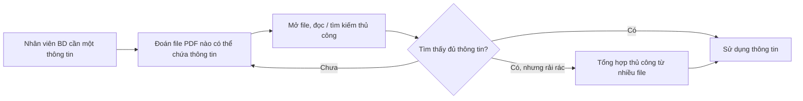
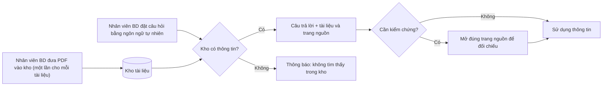

# Business Requirements Document — "Chat với tài liệu" (MVP)

> **Chuẩn áp dụng:** IEEE 29148-2018 · **Phương pháp:** [BRD_Prompt_IEEE_standard.md](../../References/Analysis/BRD_Prompt_IEEE_standard.md) v1.0
> **Quy ước ngôn ngữ chuẩn hóa:** **phải** = *shall* (bắt buộc) · **nên** = *should* (mong muốn) · **có thể** = *may* (được phép). Xem Glossary §13.

---

## 0. Validation summary (tóm tắt kiểm tra đầu vào)

**Đầu vào đã nhận**

| Source ID | Nguồn | Loại | Owner | Ngày / Version | Nội dung chứng minh |
|---|---|---|---|---|---|
| SRC-001 | Mô tả dự án từ quản lý (project brief) | Sponsor brief (văn bản ngắn) | Quản lý (STK-002) | 2026-10-19 | Vấn đề kinh doanh, đối tượng người dùng, mục tiêu MVP, ràng buộc web/PDF/AI chat |
| SRC-002 | BRD_Prompt_IEEE_standard.md | Hướng dẫn phương pháp | Team dự án | v1.0 | Cấu trúc và tiêu chí chất lượng BRD |

**Nội dung SRC-001 (nguyên văn, đã chuẩn hóa chính tả):**
> "Trong một dự án kinh doanh, có nhiều tài liệu PDF mà đội phát triển kinh doanh khó lòng nắm bắt đầy đủ, mỗi khi cần tìm một thông tin thường tốn thời gian tổng hợp từ nhiều file PDF. Bạn nhận được yêu cầu từ quản lý, phát triển một MVP cho một công cụ 'Chat với tài liệu'. Mục tiêu: một ứng dụng web cho phép người dùng upload PDF file và chat với AI để truy vấn về nội dung các tài liệu đã được upload."

**Thông tin còn thiếu** (đều đã được ghi thành `OQ-xxx` ở §12):
- Không có baseline định lượng nào (thời gian tra cứu hiện tại, số lượng tài liệu, số người dùng) → OQ-001, OQ-004, OQ-008.
- Không có target cho chỉ số thành công → OQ-002.
- Không có tên sponsor/business owner/approver, timeline, ngân sách → OQ-012, OQ-013, OQ-014.
- Không có thông tin về mức độ bảo mật tài liệu và chính sách dùng dịch vụ AI → OQ-009.
- Không có thông tin về đặc điểm PDF (scan hay văn bản, ngôn ngữ, bảng biểu) → OQ-005, OQ-007.

**Top 3 rủi ro đối với chất lượng requirement**
1. **Không có baseline/target** → BO-001…BO-003 hiện chưa kiểm chứng được; nhiều acceptance criteria đang chứa `[TBD]`.
2. **Chỉ có một nguồn duy nhất (SRC-001), chưa phỏng vấn người dùng BD** → các stakeholder need SN-003, SN-005…SN-008 là suy luận `[Unverified]`.
3. **Chưa rõ ràng buộc bảo mật dữ liệu** → BR-014, BR-015 có thể thay đổi phạm vi và kiến trúc giải pháp một cách đáng kể.

---

## 1. Document control

| Mục | Giá trị |
|---|---|
| Tiêu đề | Business Requirements Document — "Chat với tài liệu" (MVP) |
| Mã tài liệu | BRD-CWD-001 |
| Version | 0.1 |
| Trạng thái | **Draft** |
| Tác giả | Business Analyst — [TBD: OQ-014] (bản nháp soạn với sự hỗ trợ của AI) |
| Người đóng góp | — |
| Reviewer | Đại diện đội BD (STK-001), Delivery team (STK-003), IT/Bảo mật (STK-004) — [TBD: OQ-014] |
| Approver | Quản lý / Executive sponsor (STK-002) — [TBD: OQ-014] |
| Phân loại | Internal — Confidential |
| Danh sách phân phối | STK-001, STK-002, STK-003, STK-004 |

**Version history**

| Version | Ngày | Tác giả | Tóm tắt thay đổi |
|---|---|---|---|
| 0.1 | 2026-10-19 | BA (draft) | Bản nháp đầu tiên từ SRC-001 |

---

## 2. Executive summary

**Vấn đề.** Đội phát triển kinh doanh (BD) làm việc với nhiều tài liệu PDF của dự án kinh doanh và không nắm bắt được đầy đủ nội dung. Mỗi lần cần một thông tin, nhân viên BD phải mở và tổng hợp thủ công từ nhiều file, tốn thời gian (SRC-001). Mức độ thiệt hại chưa được định lượng: thời gian tra cứu trung bình, tần suất tra cứu và số người bị ảnh hưởng đều là `[TBD: OQ-001]`.

**Thay đổi đề xuất.** Xây dựng một MVP "Chat với tài liệu": người dùng BD tự đưa tài liệu PDF vào một kho tài liệu, sau đó đặt câu hỏi bằng ngôn ngữ tự nhiên và nhận câu trả lời được tổng hợp từ các tài liệu đó, có chỉ rõ tài liệu và trang nguồn để kiểm chứng (SRC-001).

**Lợi ích kỳ vọng và chỉ số chứng minh.**
- Giảm thời gian tra cứu thông tin (MET-001).
- Câu trả lời chính xác và kiểm chứng được (MET-002, MET-005).
- Có bằng chứng về mức độ sử dụng và mức hài lòng để quyết định đầu tư tiếp (MET-003, MET-004).

Baseline và target của tất cả chỉ số đều chưa có: `[TBD: OQ-001, OQ-002]`.

**Đầu tư, timeline, rủi ro chính.** Ngân sách `[TBD: OQ-013]`; timeline `[TBD: OQ-012]`. Rủi ro lớn nhất: AI trả lời sai hoặc bịa thông tin (RSK-001), lộ tài liệu kinh doanh ra bên thứ ba (RSK-002), và PDF dạng scan/bảng biểu không khai thác được (RSK-003).

**Quyết định cần từ approver.**
1. Xác nhận phát biểu vấn đề và mục tiêu BO-001…BO-003.
2. Cung cấp hoặc chỉ định người cung cấp baseline/target (OQ-001, OQ-002).
3. Quyết định chính sách dữ liệu cho dịch vụ AI (OQ-009) trước khi bắt đầu thiết kế.

---

## 3. Business context and problem statement

### 3.1 Current-state process (SRC-001; các bước chi tiết là `[Unverified]`, cần xác nhận với STK-001)

### 3.2 Ai bị ảnh hưởng và như thế nào

| Đối tượng | Ảnh hưởng | Bằng chứng |
|---|---|---|
| Đội BD (STK-001) | Không nắm bắt đầy đủ nội dung tài liệu; tốn thời gian tìm và tổng hợp thông tin từ nhiều PDF | SRC-001 |
| Quản lý (STK-002) | Năng suất đội BD bị giảm; rủi ro quyết định dựa trên thông tin không đầy đủ | `[Unverified]` — suy luận từ SRC-001 |

### 3.3 Chi phí nếu không làm gì (cost of inaction)

- **Thời gian:** số giờ BD dành cho tra cứu mỗi tuần — `[TBD: OQ-001]`.
- **Rủi ro kinh doanh:** bỏ sót thông tin quan trọng trong tài liệu khi trao đổi với khách hàng/đối tác — `[Unverified]`, chưa có sự cố cụ thể được ghi nhận.
- **Doanh thu / tuân thủ:** chưa có dữ liệu — `[TBD: OQ-001]`.

### 3.4 Root causes và symptoms

| Symptom (triệu chứng) | Root cause (nguyên nhân gốc) | Nguồn |
|---|---|---|
| Tốn thời gian khi cần một thông tin | Thông tin nằm phân tán trên nhiều file PDF, không có cách truy vấn chung trên toàn bộ tập tài liệu | SRC-001 |
| BD "khó nắm bắt đầy đủ" tài liệu | Khối lượng tài liệu vượt quá khả năng đọc và ghi nhớ của từng người | SRC-001 (số lượng cụ thể `[TBD: OQ-004]`) |
| Phải tổng hợp thủ công | Câu trả lời cho một câu hỏi thường cần ghép thông tin từ nhiều tài liệu | SRC-001 |

### 3.5 Why now

Quản lý đã yêu cầu xây dựng MVP (SRC-001). Lý do cụ thể về thời điểm (dự án sắp tới, deadline kinh doanh, mức tăng số lượng tài liệu) chưa được nêu — `[TBD: OQ-012]`.

---

## 4. Business drivers and objectives

| ID | Business driver | Objective (kết quả, không phải hoạt động) | Metric ID | Baseline | Target | Timeframe | Source |
|---|---|---|---|---|---|---|---|
| BO-001 | Tra cứu thông tin trong nhiều PDF tốn thời gian | Giảm thời gian nhân viên BD cần để có câu trả lời cho một câu hỏi về nội dung tài liệu | MET-001 | [TBD: OQ-001] | [TBD: OQ-002] | Cuối giai đoạn pilot [TBD: OQ-012] | SRC-001 |
| BO-002 | BD không nắm bắt đầy đủ tài liệu | Nhân viên BD nhận được thông tin chính xác và kiểm chứng được từ toàn bộ tập tài liệu | MET-002, MET-005 | [TBD: OQ-001] | [TBD: OQ-002] | Cuối giai đoạn pilot | SRC-001 |
| BO-003 | Yêu cầu làm MVP (kiểm chứng giá trị trước khi đầu tư lớn) | Có dữ liệu sử dụng và mức hài lòng đủ để sponsor ra quyết định go / no-go cho giai đoạn tiếp theo | MET-003, MET-004 | Không áp dụng (sản phẩm mới) | [TBD: OQ-002] | Cuối giai đoạn pilot | SRC-001 (mục đích MVP là `[Unverified]`) |

### 4.1 Định nghĩa chỉ số

| ID | Định nghĩa | Công thức | Nguồn dữ liệu | Owner | Tần suất | Ngày baseline |
|---|---|---|---|---|---|---|
| MET-001 | Thời gian trung bình để một nhân viên BD có câu trả lời mà họ chấp nhận cho một câu hỏi trong bộ câu hỏi chuẩn | Tổng thời gian (phút) ÷ số câu hỏi | Buổi đo thời gian có kiểm soát: làm thủ công (baseline) và dùng công cụ (sau MVP), cùng bộ câu hỏi chuẩn (OQ-003) | BD lead [TBD: OQ-014] | Một lần trước MVP, một lần cuối pilot | [TBD: OQ-001] |
| MET-002 | Tỷ lệ câu trả lời đúng và có trích dẫn nguồn đúng | Số câu được SME đánh giá "đúng + trích dẫn đúng" ÷ tổng số câu có đáp án trong kho × 100% | Bộ câu hỏi chuẩn kèm đáp án (OQ-003) | BD lead | Mỗi lần nghiệm thu / cuối pilot | [TBD: OQ-001] |
| MET-003 | Số người dùng BD hoạt động mỗi tuần | Số người dùng khác nhau đặt ≥ 1 câu hỏi trong tuần | Thống kê sử dụng (BR-017) | Quản lý (STK-002) | Hàng tuần trong pilot | Không áp dụng |
| MET-004 | Tỷ lệ câu trả lời được người dùng đánh giá là hữu ích | Số đánh giá "hữu ích" ÷ tổng số đánh giá × 100% | Phản hồi người dùng (BR-016) | Quản lý (STK-002) | Hàng tuần trong pilot | Không áp dụng |
| MET-005 | Tỷ lệ báo đúng "không tìm thấy" | Số câu hỏi ngoài phạm vi kho được báo "không tìm thấy" ÷ tổng số câu hỏi ngoài phạm vi kho × 100% | Phần câu hỏi "ngoài kho" của bộ câu hỏi chuẩn (OQ-003) | BD lead | Mỗi lần nghiệm thu | Không áp dụng |

> Theo SRC-002, một objective không có baseline và cách đo là chưa hợp lệ. BO-001 và BO-002 sẽ chưa hợp lệ cho đến khi đóng OQ-001 và OQ-002.

---

## 5. Scope

### 5.1 In scope
- Người dùng BD tự đưa tài liệu PDF vào một kho tài liệu (BR-001…BR-005).
- Hỏi đáp bằng ngôn ngữ tự nhiên trên nội dung kho tài liệu, có trích dẫn nguồn (BR-006…BR-013).
- Kiểm soát truy cập và xử lý dữ liệu theo chính sách được phê duyệt (BR-014, BR-015).
- Thu thập dữ liệu đo lường cho giai đoạn pilot (BR-016, BR-017).
- Đơn vị tổ chức: đội BD của dự án kinh doanh liên quan (SRC-001). Địa lý: `[TBD: OQ-009]`.

### 5.2 Out of scope

| Hạng mục | Lý do |
|---|---|
| Định dạng khác PDF (Word, Excel, PowerPoint, ảnh, email) | CON-003 — SRC-001 chỉ nêu PDF |
| Tự động lấy tài liệu từ hệ thống khác (SharePoint, Google Drive, email…) | SRC-001 chỉ nêu việc người dùng upload |
| Chỉnh sửa, chú thích hoặc tạo mới tài liệu PDF | Không thuộc vấn đề kinh doanh được nêu |
| Trả lời dựa trên kiến thức ngoài kho tài liệu (internet, kiến thức chung) | BRU-001 |
| Người dùng ngoài tổ chức (khách hàng, đối tác) | SRC-001 chỉ nêu đội BD |
| Ứng dụng mobile native | CON-002 — yêu cầu là ứng dụng web |

### 5.3 Deferred (hoãn sang giai đoạn sau MVP)
- Khai thác nội dung PDF dạng ảnh scan (OCR) — tùy kết quả OQ-005.
- Lưu và tra cứu lại lịch sử hội thoại qua nhiều phiên.
- Phân chia kho tài liệu theo dự án/nhóm và phân quyền theo tài liệu — tùy kết quả OQ-010.
- Xuất câu trả lời ra file/báo cáo.
- Tích hợp đăng nhập một lần (SSO) với hệ thống của tổ chức — tùy kết quả OQ-008.

### 5.4 Boundaries
- **Bắt đầu:** khi người dùng BD đã có file PDF trong tay và đưa vào kho.
- **Kết thúc:** khi người dùng nhận được câu trả lời kèm trích dẫn. Việc sử dụng câu trả lời cho các quyết định kinh doanh tiếp theo nằm ngoài phạm vi (xem BRU-002).

### 5.5 Proposed-state process

---

## 6. Stakeholders and needs

| ID | Stakeholder / nhóm | Vai trò | Quan tâm | Ảnh hưởng | Needs | Source |
|---|---|---|---|---|---|---|
| STK-001 | Đội phát triển kinh doanh (BD) | Người dùng chính; người đưa tài liệu vào kho | Tìm thông tin nhanh, đầy đủ, đáng tin | High (quyết định adoption) | SN-001, SN-002, SN-003, SN-004 | SRC-001 |
| STK-002 | Quản lý (người yêu cầu MVP) | Executive sponsor / business owner (giả định — OQ-014) | Năng suất đội BD; bằng chứng giá trị của MVP | High | SN-005 | SRC-001 |
| STK-003 | Delivery team (đội phát triển MVP) | Xây dựng và vận hành MVP | Phạm vi rõ ràng, khả thi trong thời gian MVP | Medium | SN-008 | SRC-001 |
| STK-004 | IT / Bảo mật thông tin | Phê duyệt việc xử lý dữ liệu và dùng dịch vụ AI | Tài liệu kinh doanh không bị lộ | High — **có thể chặn triển khai** | SN-006 | `[Unverified]` — OQ-015 |
| STK-005 | Chủ sở hữu tài liệu (nội bộ hoặc đối tác cung cấp tài liệu) | Kiểm soát việc sử dụng tài liệu | Tài liệu chỉ được dùng bởi người có quyền | Medium — có thể chặn việc đưa tài liệu vào kho | SN-007 | `[Unverified]` — OQ-015 |

| ID | Stakeholder | Need statement | Pain hiện tại | Evidence | Priority |
|---|---|---|---|---|---|
| SN-001 | STK-001 | Tìm được một thông tin cụ thể mà không phải mở và đọc từng file PDF | Mất thời gian tìm thủ công | SRC-001 | Must |
| SN-002 | STK-001 | Có câu trả lời tổng hợp khi thông tin nằm rải rác trên nhiều tài liệu | Phải tự tổng hợp thủ công | SRC-001 | Must |
| SN-003 | STK-001 | Biết câu trả lời lấy từ đâu để tự kiểm chứng trước khi dùng | — (nhu cầu phát sinh khi dùng AI) | `[Unverified]` — suy luận; xác nhận qua OQ-011 | Must |
| SN-004 | STK-001 | Tự đưa tài liệu mới vào kho mà không phải nhờ người khác | — | SRC-001 ("cho phép người dùng upload") | Must |
| SN-005 | STK-002 | Có bằng chứng định lượng để quyết định có đầu tư tiếp sau MVP hay không | — | `[Unverified]` — suy luận từ việc yêu cầu MVP | Should |
| SN-006 | STK-004 | Tài liệu và câu hỏi chỉ được xử lý trong phạm vi chính sách bảo mật đã phê duyệt | — | `[Unverified]` — OQ-009 | Must (tạm thời, chờ OQ-009) |
| SN-007 | STK-005 | Chỉ người được phép mới xem được nội dung tài liệu | — | `[Unverified]` — OQ-008 | Should |
| SN-008 | STK-003 | Phạm vi MVP được giới hạn rõ để giao đúng hạn | — | `[Unverified]` — suy luận từ "MVP" (CON-001) | Should |

---

## 7. Business requirements

Priority theo MoSCoW: **Must** (thiếu thì MVP thất bại), **Should** (giá trị đáng kể, có cách xoay xở), **Could** (mong muốn), **Won't** (loại khỏi bản này). Requirement Must dùng "phải"; Should dùng "nên".

### 7.1 Quản lý kho tài liệu

| ID | Requirement | Rationale | Source | Priority | Acceptance criteria | Verification | Status |
|---|---|---|---|---|---|---|---|
| BR-001 | Người dùng BD **phải** tự đưa được một tài liệu PDF vào kho tài liệu mà không cần sự hỗ trợ của nhân sự kỹ thuật. | Người dùng phải tự chủ cập nhật nguồn tri thức | BO-001 / SN-004 | Must | AC-001 | Demonstration | Draft |
| BR-002 | Kho tài liệu **phải** cho phép truy vấn đồng thời tối thiểu [TBD: OQ-004] tài liệu PDF, mỗi tài liệu tối đa [TBD: OQ-004] trang. | Vấn đề gốc là khối lượng tài liệu lớn | BO-002 / SN-002 | Must | AC-002 | Test | Draft — chờ OQ-004 |
| BR-003 | Khi một tài liệu đưa vào không thể dùng để truy vấn, giải pháp **phải** thông báo cho người dùng tên tài liệu đó và lý do. | Tránh việc người dùng tưởng tài liệu đã được tra cứu trong khi thực tế không | BO-002 / SN-003 | Must | AC-003 | Test | Draft |
| BR-004 | Người dùng **phải** xem được danh sách các tài liệu hiện có trong kho cùng trạng thái sẵn sàng truy vấn của từng tài liệu. | Người dùng cần biết câu trả lời được tìm trên phạm vi tài liệu nào | BO-002 / SN-003 | Must | AC-004 | Demonstration | Draft |
| BR-005 | Người dùng **nên** loại bỏ được một tài liệu khỏi kho để nội dung tài liệu đó không còn được dùng khi trả lời. | Tài liệu lỗi thời hoặc đưa vào nhầm làm sai lệch câu trả lời | BO-002 / SN-004 | Should | AC-005 | Test | Draft |

### 7.2 Hỏi đáp trên nội dung tài liệu

| ID | Requirement | Rationale | Source | Priority | Acceptance criteria | Verification | Status |
|---|---|---|---|---|---|---|---|
| BR-006 | Người dùng **phải** đặt được câu hỏi bằng ngôn ngữ tự nhiên về nội dung kho tài liệu và nhận được câu trả lời dạng văn bản. | Năng lực cốt lõi thay thế việc đọc thủ công | BO-001 / SN-001 | Must | AC-006 | Test | Draft |
| BR-007 | Câu trả lời **phải** chỉ dựa trên nội dung các tài liệu đang có trong kho. | Người dùng cần thông tin về tài liệu dự án, không phải kiến thức chung | BO-002 / SN-003 | Must | AC-007 | Test + Analysis | Draft |
| BR-008 | Mỗi câu trả lời **phải** chỉ ra tên tài liệu nguồn và số trang chứa thông tin đã dùng. | Cho phép kiểm chứng; giảm tác động của câu trả lời sai | BO-002 / SN-003 | Must | AC-008 | Test | Draft |
| BR-009 | Khi kho không chứa thông tin để trả lời câu hỏi, giải pháp **phải** thông báo rằng không tìm thấy thông tin trong kho thay vì đưa ra câu trả lời. | Ngăn câu trả lời bịa đặt (RSK-001) | BO-002 / SN-003 | Must | AC-009 | Test | Draft |
| BR-010 | Giải pháp **phải** trả lời được câu hỏi mà thông tin cần thiết nằm trên từ hai tài liệu trở lên. | Root cause: thông tin phân tán trên nhiều file | BO-001 / SN-002 | Must | AC-010 | Test | Draft |
| BR-011 | Trong cùng một phiên hội thoại, người dùng **nên** đặt được câu hỏi tiếp nối có tham chiếu tới câu hỏi hoặc câu trả lời trước mà không phải nhắc lại ngữ cảnh. | Hình thức "chat" theo SRC-001; giảm thao tác | BO-001 / SN-001 | Should | AC-011 | Demonstration | Draft |
| BR-012 | Giải pháp **phải** trả về câu trả lời trong vòng [TBD: OQ-006] giây cho ít nhất [TBD: OQ-006]% số câu hỏi khi kho ở mức dung lượng của BR-002. | Thời gian chờ quá dài làm mất lợi ích BO-001 | BO-001 / SN-001 | Must | AC-012 | Test | Draft — chờ OQ-006 |
| BR-013 | Người dùng **phải** đặt câu hỏi và nhận câu trả lời bằng [TBD: OQ-007] trên tài liệu viết bằng [TBD: OQ-007]. | Ngôn ngữ làm việc của đội BD và ngôn ngữ tài liệu chưa rõ | BO-001 / SN-001 | Must | AC-013 | Test | Draft — chờ OQ-007 |

### 7.3 Truy cập và bảo vệ dữ liệu

| ID | Requirement | Rationale | Source | Priority | Acceptance criteria | Verification | Status |
|---|---|---|---|---|---|---|---|
| BR-014 | Giải pháp **phải** chỉ cho phép người dùng đã được cấp quyền truy cập kho tài liệu và chức năng hỏi đáp. | Tài liệu dự án kinh doanh có thể là thông tin mật | SN-006 / SN-007 | Must (chờ OQ-008) | AC-014 | Test | Draft |
| BR-015 | Tài liệu và câu hỏi đưa vào giải pháp **phải** được xử lý và lưu trữ trong phạm vi đã được bộ phận IT/Bảo mật phê duyệt bằng văn bản. | Dùng AI có thể đồng nghĩa với việc gửi dữ liệu cho bên thứ ba (RSK-002) | SN-006 | Must | AC-015 | Review | Draft — chờ OQ-009 |

### 7.4 Đo lường giai đoạn pilot

| ID | Requirement | Rationale | Source | Priority | Acceptance criteria | Verification | Status |
|---|---|---|---|---|---|---|---|
| BR-016 | Người dùng **nên** đánh giá được mỗi câu trả lời là hữu ích hay không hữu ích. | Dữ liệu cho MET-004 | BO-003 / SN-005 | Should | AC-016 | Demonstration | Draft |
| BR-017 | Quản lý **nên** xem được số người dùng hoạt động và số câu hỏi theo từng tuần trong giai đoạn pilot. | Dữ liệu cho MET-003 | BO-003 / SN-005 | Should | AC-017 | Demonstration | Draft |

### 7.5 Acceptance criteria

"Bộ câu hỏi chuẩn" là tập câu hỏi kèm đáp án và trang nguồn do SME của đội BD soạn trên bộ tài liệu mẫu (DEP-002, OQ-003). Bộ này gồm ba nhóm: câu hỏi một tài liệu, câu hỏi nhiều tài liệu và câu hỏi ngoài kho.

| ID | Cho requirement | Criterion |
|---|---|---|
| AC-001 | BR-001 | 3 nhân viên BD không được hướng dẫn riêng, mỗi người đưa 5 PDF mẫu dạng văn bản vào kho. 15/15 tài liệu đạt trạng thái sẵn sàng truy vấn và không có lần nào cần nhân sự kỹ thuật can thiệp. |
| AC-002 | BR-002 | Đưa vào kho số lượng tài liệu và số trang theo giá trị chốt ở OQ-004. Với mỗi tài liệu, ít nhất 1 câu hỏi trong bộ câu hỏi chuẩn có đáp án nằm trong tài liệu đó và được trả lời kèm trích dẫn tới chính tài liệu đó. |
| AC-003 | BR-003 | Đưa vào 1 PDF dạng ảnh scan, 1 PDF có mật khẩu và 1 file PDF hỏng. Với cả 3 file, người dùng nhận được thông báo nêu tên file và lý do, và không file nào được hiển thị là sẵn sàng truy vấn. |
| AC-004 | BR-004 | Sau khi đưa 5 tài liệu vào kho (trong đó 1 tài liệu lỗi), danh sách hiển thị đủ 5 tên tài liệu, đúng 4 tài liệu ở trạng thái sẵn sàng và 1 tài liệu ở trạng thái không dùng được. |
| AC-005 | BR-005 | Sau khi loại bỏ tài liệu X, hỏi lại 3 câu hỏi có đáp án chỉ nằm trong X. Cả 3 câu đều nhận thông báo không tìm thấy (BR-009), và không câu trả lời nào trích dẫn X. |
| AC-006 | BR-006 | Với nhóm câu hỏi một tài liệu trong bộ câu hỏi chuẩn, tỷ lệ câu trả lời được SME đánh giá là đúng ≥ [TBD: OQ-002]% (MET-002). |
| AC-007 | BR-007 | SME rà soát toàn bộ câu trả lời của bộ câu hỏi chuẩn. Số câu trả lời chứa nhận định không truy được về một trang trong kho ≤ [TBD: OQ-002]. |
| AC-008 | BR-008 | 100% câu trả lời (không tính thông báo "không tìm thấy") có tên tài liệu và số trang. Tỷ lệ trích dẫn trỏ đúng trang chứa thông tin, theo kiểm tra của SME, ≥ [TBD: OQ-002]%. |
| AC-009 | BR-009 | Với ít nhất 10 câu hỏi ngoài kho, tỷ lệ được báo "không tìm thấy" ≥ [TBD: OQ-002]% (MET-005). |
| AC-010 | BR-010 | Với ít nhất 5 câu hỏi nhiều tài liệu, tỷ lệ câu trả lời được SME đánh giá là đúng và trích dẫn đủ mọi tài liệu cần thiết ≥ [TBD: OQ-002]%. |
| AC-011 | BR-011 | Trong 5 chuỗi hội thoại kịch bản sẵn, mỗi chuỗi có ít nhất 1 câu hỏi tiếp nối dùng đại từ hoặc tham chiếu ngầm (ví dụ: "còn thời hạn của nó thì sao?"). Ít nhất 4/5 câu hỏi tiếp nối được trả lời đúng ngữ cảnh. |
| AC-012 | BR-012 | Chạy toàn bộ bộ câu hỏi chuẩn khi kho đã nạp đủ theo BR-002. Tỷ lệ câu hỏi có câu trả lời trong ngưỡng thời gian của OQ-006 đạt ngưỡng phần trăm của OQ-006. |
| AC-013 | BR-013 | Bộ câu hỏi chuẩn có câu hỏi bằng mọi ngôn ngữ chốt ở OQ-007. Mỗi câu trả lời dùng đúng ngôn ngữ của câu hỏi, và tỷ lệ đúng của từng ngôn ngữ đạt ngưỡng AC-006. |
| AC-014 | BR-014 | 10 lần truy cập bằng tài khoản không được cấp quyền hoặc không đăng nhập đều bị từ chối (10/10); 10 lần truy cập bằng tài khoản được cấp quyền đều thành công (10/10). |
| AC-015 | BR-015 | Có văn bản phê duyệt của STK-004 về nơi xử lý/lưu trữ dữ liệu và nhà cung cấp AI được dùng. Cấu hình triển khai thực tế khớp với văn bản phê duyệt khi rà soát. |
| AC-016 | BR-016 | Người dùng gửi được đánh giá cho 10/10 câu trả lời thử nghiệm, và 10 đánh giá này xuất hiện trong dữ liệu thống kê của BR-017. |
| AC-017 | BR-017 | Sau một tuần thử nghiệm có kịch bản (số người dùng và số câu hỏi đã biết trước), số liệu hiển thị cho quản lý khớp 100% với kịch bản. |

---

## 8. Business rules

| ID | Rule | Loại | Phạm vi | Enforcement owner | Source |
|---|---|---|---|---|---|
| BRU-001 | Câu trả lời chỉ được dựa trên nội dung tài liệu trong kho; không bổ sung kiến thức bên ngoài. | Policy | Hỏi đáp | Business owner (STK-002) | SRC-001 ("truy vấn về nội dung các tài liệu đã được upload") |
| BRU-002 | Câu trả lời của công cụ là thông tin tham khảo. Trước khi dùng thông tin cho cam kết với khách hàng hoặc đối tác, nhân viên BD phải đối chiếu với trang nguồn. | Policy | Sử dụng câu trả lời | BD lead | `[Unverified]` — đề xuất, chờ OQ-011 |
| BRU-003 | Phạm vi chia sẻ kho tài liệu (dùng chung toàn đội BD hay riêng từng người/dự án): [TBD: OQ-010]. | Decision | Quản lý kho tài liệu | Business owner | OQ-010 |

---

## 9. Constraints

| ID | Constraint | Loại | Áp đặt bởi | Tác động | Source |
|---|---|---|---|---|---|
| CON-001 | Sản phẩm bàn giao là một MVP | Organizational / Time | Quản lý (STK-002) | Giới hạn phạm vi ở năng lực cốt lõi; nhiều hạng mục bị hoãn (§5.3) | SRC-001 |
| CON-002 | Giải pháp là một ứng dụng web | Technical | Quản lý (STK-002) | Loại trừ ứng dụng desktop/mobile native | SRC-001 |
| CON-003 | Định dạng tài liệu đầu vào là PDF | Technical | Quản lý (STK-002) | Loại trừ các định dạng khác (§5.2) | SRC-001 |
| CON-004 | Người dùng tương tác với nội dung tài liệu qua hình thức hội thoại (chat) với AI | Technical | Quản lý (STK-002) | Hỏi đáp ngôn ngữ tự nhiên là kênh truy vấn chính | SRC-001 |
| CON-005 | Timeline và ngân sách MVP: [TBD: OQ-012, OQ-013] | Time / Budget | STK-002 | Chưa xác định được tính khả thi của toàn bộ tập requirement | — |

---

## 10. Assumptions, dependencies, and risks

| ID | Item | Loại | Mô tả | Tác động nếu sai / Mức độ | Owner | Validation / mitigation | Due |
|---|---|---|---|---|---|---|---|
| ASM-001 | PDF dạng văn bản | Assumption | Phần lớn tài liệu PDF của đội BD chứa văn bản trích xuất được (không phải ảnh scan) | Phần lớn nội dung không truy vấn được; phải đưa OCR vào phạm vi MVP | BD lead | Rà soát mẫu tài liệu thực tế (OQ-005) | 2026-10-30 |
| ASM-002 | Người dùng là đội BD | Assumption | Chỉ đội BD dùng MVP; số người dùng ở mức một đội | Tăng yêu cầu phân quyền và tải | STK-002 | Xác nhận qua OQ-008 | 2026-10-23 |
| ASM-003 | Được phép dùng dịch vụ AI | Assumption | Chính sách tổ chức cho phép xử lý tài liệu bằng một dịch vụ AI (nội bộ hoặc bên ngoài) | MVP không triển khai được, hoặc phải đổi phương án AI | STK-004 | Xác nhận qua OQ-009 | 2026-10-23 |
| ASM-004 | Người dùng có trình duyệt web và mạng | Assumption | Đội BD truy cập được ứng dụng web từ môi trường làm việc | Không dùng được công cụ | STK-003 | Xác nhận môi trường làm việc của BD | 2026-10-30 |
| DEP-001 | Dịch vụ AI | Dependency | Có quyền truy cập và ngân sách cho một dịch vụ AI ngôn ngữ đã được phê duyệt | Không thể xây dựng chức năng hỏi đáp | STK-002 / STK-004 | Theo dõi qua OQ-009, OQ-013 | 2026-10-30 |
| DEP-002 | Bộ tài liệu mẫu và bộ câu hỏi chuẩn | Dependency | Đội BD cung cấp bộ PDF đại diện và bộ câu hỏi kèm đáp án | Không thể đo baseline cũng như nghiệm thu BR-006…BR-010 | BD lead | Theo dõi qua OQ-003 | 2026-11-06 |
| DEP-003 | Môi trường triển khai | Dependency | Có môi trường hosting được phê duyệt cho ứng dụng web | Không thể chạy pilot | STK-003 / STK-004 | Theo dõi qua OQ-009 | [TBD: OQ-012] |
| RSK-001 | Câu trả lời sai / bịa | Risk | AI suy diễn ngoài tài liệu → câu trả lời sai nhưng trông hợp lý → BD dùng thông tin sai với khách hàng | High | STK-003 | BR-007, BR-008, BR-009, BRU-002; đo bằng MET-002, MET-005 | Liên tục |
| RSK-002 | Lộ dữ liệu | Risk | Tài liệu mật được gửi tới dịch vụ AI bên thứ ba không được phê duyệt → vi phạm bảo mật/hợp đồng | High | STK-004 | BR-014, BR-015; phê duyệt trước khi thiết kế | 2026-10-23 |
| RSK-003 | Nội dung khó khai thác | Risk | PDF dạng scan, bảng biểu, hình ảnh → thông tin không được trích xuất → câu trả lời thiếu | Medium | STK-003 | BR-003; rà soát mẫu (OQ-005); cân nhắc đưa OCR vào phạm vi | 2026-10-30 |
| RSK-004 | Không chứng minh được giá trị | Risk | Không có baseline → không đo được mức cải thiện → không ra được quyết định go / no-go | Medium | STK-002 | Đo baseline MET-001 trước khi pilot (OQ-001) | Trước pilot |
| RSK-005 | Adoption thấp | Risk | BD không tin câu trả lời hoặc thói quen cũ → ít sử dụng → MVP bị đánh giá thấp | Medium | BD lead | Trích dẫn nguồn (BR-008); hướng dẫn ngắn; theo dõi MET-003 | Trong pilot |
| RSK-006 | Chi phí AI vượt ngân sách | Risk | Chi phí theo lượng sử dụng của dịch vụ AI vượt dự kiến → phải dừng pilot sớm | Medium | STK-002 | Chốt ngân sách và giới hạn sử dụng (OQ-013) | 2026-10-30 |

---

## 11. Traceability

| Business objective | Stakeholder need | Business requirement | Acceptance criteria | Downstream PRD story · Use case |
|---|---|---|---|---|
| BO-001 | SN-004 | BR-001 | AC-001 | US-101 · UC-02 |
| BO-002 | SN-002 | BR-002 | AC-002 | US-102 · UC-02, UC-03 |
| BO-002 | SN-003 | BR-003 | AC-003 | US-103 · UC-03, UC-04 |
| BO-002 | SN-003 | BR-004 | AC-004 | US-104 · UC-05 |
| BO-002 | SN-004 | BR-005 | AC-005 | US-105 · UC-06 |
| BO-001 | SN-001 | BR-006 | AC-006 | US-201 · UC-07 |
| BO-002 | SN-003 | BR-007 | AC-007 | US-202 · UC-09 |
| BO-002 | SN-003 | BR-008 | AC-008 | US-203 · UC-09 (US-205 · UC-12 hỗ trợ, chờ PQ-01) |
| BO-002 | SN-003 | BR-009 | AC-009 | US-204 · UC-10 |
| BO-001 | SN-002 | BR-010 | AC-010 | US-206 · UC-08 |
| BO-001 | SN-001 | BR-011 | AC-011 | US-207 · UC-11 |
| BO-001 | SN-001 | BR-012 | AC-012 | US-208 · UC-07 |
| BO-001 | SN-001 | BR-013 | AC-013 | US-209 · UC-07 |
| — | SN-006, SN-007 | BR-014 | AC-014 | US-301 · UC-01 |
| — | SN-006 | BR-015 | AC-015 | US-302 (ràng buộc xuyên suốt; thiết kế: SDD D-04, D-08) |
| BO-003 | SN-005 | BR-016 | AC-016 | US-401 · UC-13 |
| BO-003 | SN-005 | BR-017 | AC-017 | US-402 · UC-14 |

> Cột cuối được cập nhật 2026-10-21 từ [PRD.md](PRD.md) §6 và [UseCase_Specification.md](../02-analysis/UseCase_Specification.md) §3. Đây là thay đổi về traceability, không đổi nội dung requirement. Chưa có SRS riêng: PRD đóng vai trò đặc tả yêu cầu mức sản phẩm cho giai đoạn MVP.

**Báo cáo coverage**

| Kiểm tra | Kết quả |
|---|---|
| Objective không có requirement | Không có. BO-001: BR-001, BR-006, BR-010…BR-013 · BO-002: BR-002…BR-005, BR-007…BR-009 · BO-003: BR-016, BR-017 |
| Requirement không có objective hoặc need (orphan) | Không có. BR-014, BR-015 không gắn BO nhưng có need SN-006/SN-007. Đây là requirement dạng ràng buộc bảo vệ, không phải động lực kinh doanh |
| Need không có requirement | **SN-008** (STK-003, phạm vi MVP rõ ràng) được đáp ứng bởi §5 Scope và CON-001, không phải bằng BR. Đây là chủ ý |
| Requirement thiếu AC hoặc phương pháp kiểm chứng | Không có. Tuy nhiên AC-002, AC-006…AC-010, AC-012, AC-013 còn ngưỡng `[TBD]` nên **chưa quyết định được** cho đến khi đóng OQ-002, OQ-004, OQ-006, OQ-007 |

---

## 12. Open questions and decisions

Ngày "Needed by" là đề xuất của BA, cần sponsor xác nhận.

| ID | Câu hỏi / quyết định cần có | Vì sao quan trọng | Owner | Needed by | Status | Resolution |
|---|---|---|---|---|---|---|
| OQ-001 | Baseline hiện tại: thời gian trung bình để tìm một thông tin, số lần tra cứu/tuần, số người BD tham gia? | BO-001, BO-002, MET-001; định lượng cost of inaction | BD lead | 2026-10-30 | Open | — |
| OQ-002 | Target cho MET-001…MET-005 và ngưỡng nghiệm thu trong AC-006…AC-010? | Không có target thì BR-006…BR-010 không nghiệm thu được | STK-002 | 2026-10-30 | Open | — |
| OQ-003 | Ai soạn bộ câu hỏi chuẩn kèm đáp án/trang nguồn, gồm bao nhiêu câu cho mỗi nhóm? | Cần cho đo baseline và nghiệm thu (DEP-002) | BD lead | 2026-11-06 | Open | — |
| OQ-004 | Kho cần chứa bao nhiêu PDF, mỗi file tối đa bao nhiêu trang/MB? | BR-002, BR-012; tính khả thi | BD lead | 2026-10-23 | Open | — |
| OQ-005 | Tỷ lệ PDF dạng scan là bao nhiêu? Bảng biểu/hình ảnh có chứa thông tin quan trọng không? | ASM-001, RSK-003; quyết định OCR thuộc MVP hay Deferred | BD lead | 2026-10-30 | Open | — |
| OQ-006 | Thời gian chờ câu trả lời tối đa chấp nhận được là bao nhiêu giây, cho bao nhiêu % câu hỏi? | BR-012 | STK-002 / BD lead | 2026-10-30 | Open | — |
| OQ-007 | Tài liệu viết bằng ngôn ngữ nào? Người dùng hỏi bằng ngôn ngữ nào? Có cần hỏi tiếng Việt trên tài liệu tiếng Anh (và ngược lại) không? | BR-013 | BD lead | 2026-10-23 | Open | — |
| OQ-008 | Ai được truy cập MVP, bao nhiêu người? MVP có cần đăng nhập không, có dùng tài khoản sẵn có của tổ chức không? | BR-014, ASM-002, SN-007 | STK-002 | 2026-10-23 | Open | — |
| OQ-009 | Mức độ bảo mật của tài liệu là gì? Có được gửi nội dung cho dịch vụ AI/cloud bên thứ ba không? Có yêu cầu về vị trí lưu trữ dữ liệu không? | BR-015, ASM-003, RSK-002, DEP-001, DEP-003; có thể thay đổi toàn bộ phương án | STK-004 | 2026-10-23 | Open | — |
| OQ-010 | Kho tài liệu dùng chung cho cả đội BD hay riêng theo người/dự án? | BRU-003; phạm vi phân quyền | STK-002 | 2026-10-23 | Open | — |
| OQ-011 | Sponsor có chấp thuận BRU-002 (câu trả lời AI chỉ là tham khảo, phải đối chiếu nguồn trước khi dùng ra bên ngoài) và SN-003 không? | Phân định trách nhiệm khi AI trả lời sai | STK-002 | 2026-10-30 | Open | — |
| OQ-012 | Timeline của MVP và độ dài giai đoạn pilot? Có deadline kinh doanh nào thúc đẩy không? | CON-005, BO timeframe, §3.5 | STK-002 | 2026-10-23 | Open | — |
| OQ-013 | Ngân sách MVP, gồm chi phí sử dụng dịch vụ AI? | CON-005, DEP-001, RSK-006 | STK-002 | 2026-10-23 | Open | — |
| OQ-014 | Tên tổ chức/đơn vị, sponsor, business owner, BD lead, reviewer và approver? | Document control, owner của các OQ/MET | STK-002 | 2026-10-23 | Open | — |
| OQ-015 | STK-004 (IT/Bảo mật) và STK-005 (chủ sở hữu tài liệu) có tồn tại và cần tham gia không? Có tài liệu nào thuộc đối tác với điều khoản bảo mật không? | Xác nhận stakeholder có thể chặn triển khai | STK-002 | 2026-10-23 | Open | — |

---

## 13. Glossary and references

### 13.1 Glossary

| Thuật ngữ | Định nghĩa |
|---|---|
| **phải** (shall) | Từ chuẩn hóa cho requirement bắt buộc |
| **nên** (should) | Từ chuẩn hóa cho requirement mong muốn, không bắt buộc |
| **có thể** (may) | Từ chuẩn hóa cho lựa chọn được phép |
| BD | Business Development — đội phát triển kinh doanh |
| MVP | Minimum Viable Product — phiên bản tối thiểu đủ để kiểm chứng giá trị với người dùng thật |
| Kho tài liệu | Tập hợp các tài liệu PDF đã được người dùng đưa vào và được dùng làm phạm vi để trả lời câu hỏi |
| Sẵn sàng truy vấn | Trạng thái của một tài liệu khi nội dung của nó đã được dùng được để trả lời câu hỏi |
| Trích dẫn nguồn | Tên tài liệu và số trang chứa thông tin được dùng trong câu trả lời |
| Câu hỏi ngoài kho | Câu hỏi mà đáp án không có trong bất kỳ tài liệu nào của kho |
| Bộ câu hỏi chuẩn | Tập câu hỏi kèm đáp án và trang nguồn do SME soạn, dùng để đo baseline và nghiệm thu |
| SME | Subject Matter Expert — người am hiểu nội dung tài liệu, ở đây là nhân viên BD có kinh nghiệm |
| PDF dạng scan | PDF mà nội dung là hình ảnh chụp, không chứa văn bản trích xuất được |
| Bịa thông tin (hallucination) | Câu trả lời chứa nhận định không có cơ sở trong tài liệu nguồn |
| Pilot | Giai đoạn cho một nhóm người dùng BD dùng thử MVP để đo các chỉ số |
| Phiên hội thoại | Chuỗi câu hỏi và câu trả lời liên tiếp mà người dùng thực hiện trong một lần sử dụng |

### 13.2 References

| Tên | Version | Vị trí | Ngày truy cập |
|---|---|---|---|
| ISO/IEC/IEEE 29148:2018 — Requirements engineering | 2018 | ISO/IEEE | 2026-10-19 |
| BRD_Prompt_IEEE_standard.md (SRC-002) | 1.0 | `References/Analysis/BRD_Prompt_IEEE_standard.md` | 2026-10-19 |
| Project brief từ quản lý (SRC-001) | — | Trích nguyên văn tại §0 | 2026-10-19 |

---

## 14. Approval

| Vai trò | Tên | Quyết định | Chữ ký / ngày |
|---|---|---|---|
| Executive sponsor | [TBD: OQ-014] | [Approve / Approve with conditions / Reject] | |
| Business owner | [TBD: OQ-014] | [Approve / Reject] | |
| Product manager / product owner | [TBD: OQ-014] | [Approve / Reject] | |
| IT / Bảo mật (STK-004) | [TBD: OQ-015] | [Approve / Reject] | |

**Baseline được phê duyệt:** chưa có. Version 0.1 chỉ dùng để review.
**Điều kiện để phê duyệt:** đóng các OQ chặn ở §16.

---

## 15. Appendix

### Appendix A — Ghi chú cho downstream PRD/SAD (không phải requirement)
- Các năng lực BR-006…BR-010 thường được hiện thực bằng kỹ thuật truy xuất đoạn văn liên quan rồi sinh câu trả lời (retrieval-augmented generation). Đây là gợi ý thiết kế cho SAD, không ràng buộc BRD.
- Việc lựa chọn nhà cung cấp/mô hình AI phụ thuộc kết quả OQ-009 và OQ-013.

### Appendix B — Kết quả kiểm tra theo checklist (SRC-002 §5)

| Checklist | Kết quả | Ghi chú |
|---|---|---|
| Mọi requirement dùng cú pháp shall/should, mỗi requirement một nghĩa vụ | ✅ Đạt | |
| Không có ngôn ngữ thiết kế giải pháp | ✅ Đạt | Web/PDF/chat AI được đặt thành constraint CON-002…CON-004 |
| Có định lượng khi số lượng ảnh hưởng nghiệm thu | ⚠️ Chưa đạt | BR-002, BR-012, BR-013 chứa `[TBD]` → OQ-004, OQ-006, OQ-007 |
| Không còn từ ngữ mơ hồ | ✅ Đạt | |
| Thuật ngữ chuyên biệt có trong glossary | ✅ Đạt | |
| Không trùng lặp/mâu thuẫn | ✅ Đạt | |
| ID duy nhất, cố định | ✅ Đạt | |
| Mọi objective có requirement | ✅ Đạt | |
| Mọi requirement trace về BO/SN | ✅ Đạt | |
| Mọi requirement có AC và verification method | ⚠️ Đạt một phần | Ngưỡng AC còn `[TBD: OQ-002]` |
| Mọi stakeholder có ít nhất một need | ✅ Đạt | STK-004, STK-005 còn `[Unverified]` |
| Scope, exclusions, assumptions, dependencies, risks đều có nội dung | ✅ Đạt | |
| Mọi OQ có owner và needed-by date | ✅ Đạt | Owner hiện là vai trò, chưa có tên (OQ-014) |
| Vấn đề có bằng chứng, không chỉ là khẳng định | ⚠️ Đạt một phần | Chỉ có SRC-001 dạng định tính, chưa có dữ liệu |
| Baseline/target có nguồn và đo được | ❌ Chưa đạt | OQ-001, OQ-002 |
| Lợi ích và chi phí nêu bằng ngôn ngữ kinh doanh | ⚠️ Đạt một phần | Chưa có chi phí (OQ-013) |
| Sponsor xác nhận vấn đề và kết quả mong muốn | ❌ Chưa đạt | Cần buổi review |
| Người đọc nghiệp vụ hiểu được, không cần dịch kỹ thuật | ✅ Đạt | |

---

## 16. Readiness statement

**Trạng thái: Ready with conditions.** Tài liệu đã sẵn sàng cho buổi review với stakeholder nhưng **chưa sẵn sàng để phê duyệt**, vì có requirement Must chưa đạt checklist.

**Các mục chặn phê duyệt:**
- **OQ-001, OQ-002:** chưa có baseline/target → BO-001, BO-002 chưa hợp lệ; AC-006…AC-010 chưa quyết định được.
- **OQ-003:** chưa có bộ câu hỏi chuẩn → không nghiệm thu được BR-006…BR-010.
- **OQ-004, OQ-006, OQ-007:** BR-002, BR-012, BR-013 (Must) còn `[TBD]`.
- **OQ-008, OQ-009:** BR-014, BR-015 (Must) phụ thuộc chính sách truy cập và bảo mật; có thể thay đổi phạm vi.
- **OQ-014:** chưa xác định approver.
