# Product Backlog cho Product Owner — "Chat với tài liệu" (MVP)

> **Dành cho:** Product Owner và Sponsor. Viết bằng ngôn ngữ nghiệp vụ, mỗi câu chuyện một thẻ gồm *giá trị*, *điều kiện hoàn thành*, *màn hình* và *điều cần bạn quyết định*.
> **Nguồn chuẩn:** [PRD.md](PRD.md) §3 (đầy đủ tiêu chí Given-When-Then cho QA/Dev). Nếu hai tài liệu khác nhau thì PRD đúng. Mã truy vết ở cuối mỗi thẻ.
> **Ảnh màn hình** là ảnh chụp bản mẫu thiết kế ([UI_UX_Design.md](../04-design/UI_UX_design/UI_UX_Design.md)), dữ liệu giả lập, không phải sản phẩm thật.

---

## 1. Tóm tắt trong một trang

**Sản phẩm giải quyết gì:** nhân viên BD mất nhiều thời gian lục nhiều file PDF để tìm một thông tin. Công cụ cho họ tải PDF lên, hỏi bằng tiếng thường và nhận câu trả lời **chỉ dựa trên tài liệu đã tải lên, kèm tên tài liệu và số trang** để tự kiểm chứng. Không có thông tin thì nói "không tìm thấy" chứ không đoán.

| Nhóm | Số câu chuyện | Ý nghĩa |
|---|---|---|
| **Bắt buộc (Must)** | 13 | Thiếu một câu là MVP chưa thể ra mắt |
| **Nên có (Should)** | 5 | Giá trị đáng kể, ra mắt được nếu thiếu |
| **Để sau (Later)** | 5 | Ngoài MVP, ghi lại để không mất |

Các câu chuyện chia theo mục tiêu của người dùng:

| Mục tiêu | Câu chuyện |
|---|---|
| **A. Đưa tài liệu vào kho** | A1–A7 (US-101…107) |
| **B. Hỏi và nhận câu trả lời đáng tin** | B1–B11 (US-201…211) |
| **C. Truy cập an toàn** | C1–C3 (US-301…303) |
| **D. Đo hiệu quả của pilot** | D1–D2 (US-401…402) |

### Điều cần PO / Sponsor quyết định (chặn việc hoàn thiện tiêu chí)

| # | Quyết định | Ảnh hưởng | Mã |
|---|---|---|---|
| 1 | **Mục tiêu đo lường:** độ chính xác bao nhiêu % là đạt? Thời gian tìm thông tin hiện nay là bao lâu (để so sánh)? | Mọi câu "đúng ≥ …%" bên dưới chưa có con số; không nghiệm thu được | OQ-001, OQ-002 |
| 2 | **Tài liệu có được gửi cho dịch vụ AI bên ngoài không?** Nếu có, nhà cung cấp nào, lưu ở đâu? | Có thể thay đổi cả cách xây sản phẩm; IT/Bảo mật có quyền chặn triển khai | OQ-009 |
| 3 | **Quy mô kho:** tối đa bao nhiêu tài liệu, mỗi file bao nhiêu trang/MB? | Giới hạn upload và kích cỡ hệ thống | OQ-004 |
| 4 | **Chờ tối đa bao nhiêu giây** là chấp nhận được? | Tiêu chí tốc độ | OQ-006 |
| 5 | **Ngôn ngữ** của tài liệu và của người hỏi? Có hỏi tiếng Việt trên tài liệu tiếng Anh không? | Chất lượng và phạm vi kiểm thử | OQ-007 |
| 6 | **Có cần đăng nhập không**, dùng tài khoản nào? Bao nhiêu người dùng? | Có/không màn hình đăng nhập | OQ-008 |
| 7 | **Kho dùng chung cả đội BD hay riêng từng người/dự án?** | Quyền xem, xóa tài liệu | OQ-010 |
| 8 | **Chấp nhận nguyên tắc "câu trả lời AI chỉ là tham khảo, phải đối chiếu nguồn trước khi dùng với khách hàng"?** | Trách nhiệm khi AI trả lời sai | OQ-011 |
| 9 | **Có đưa "xem trang nguồn" (B5) thành yêu cầu chính thức không?** Hiện chưa có trong BRD | Nếu có thì thêm một yêu cầu mới | PQ-01 |
| 10 | **Khi hai tài liệu mâu thuẫn**, hiển thị cả hai nguồn (đề xuất) hay chọn một? | Cách trả lời câu hỏi nhiều tài liệu | PQ-02 |

---

## 2. A. Đưa tài liệu vào kho

### A1. Tải tài liệu PDF lên · `Bắt buộc` · US-101
> Là **nhân viên BD**, tôi muốn **tự tải file PDF lên kho**, để **không phải nhờ người kỹ thuật** mỗi lần có tài liệu mới.

**Xong khi**
- Chọn hoặc kéo-thả một hay nhiều file PDF, thấy ngay file xuất hiện với trạng thái "Đang xử lý".
- Xử lý xong, trạng thái tự chuyển thành "Sẵn sàng truy vấn" mà không phải tải lại trang.
- Một file lỗi không làm dừng các file khác.
- Kiểm tra thực tế: 3 nhân viên BD không được hướng dẫn, mỗi người tải 5 file mẫu, **cả 15 file đều thành công**.

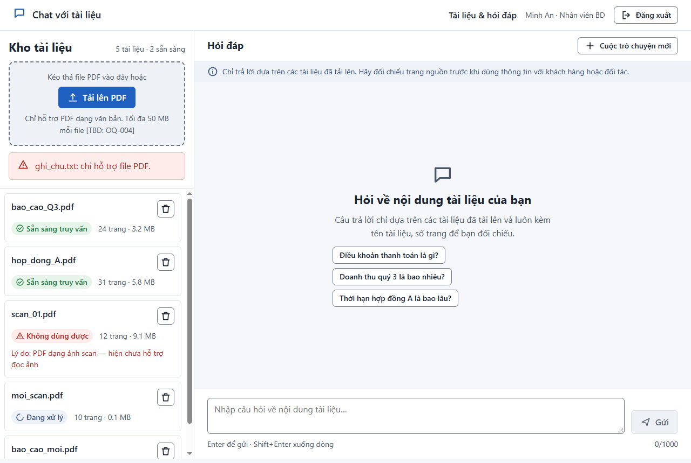

*File .txt bị từ chối ngay; các file PDF hiện "Đang xử lý".* [Mở bản mẫu](../04-design/UI_UX_design/02_workspace.html?demo=bd)

*Truy vết: BR-001 · AC-001*

---

### A2. Hỏi được trên toàn bộ kho, có giới hạn rõ ràng · `Bắt buộc` · US-102
> Là **nhân viên BD**, tôi muốn **hỏi một lần trên tất cả tài liệu**, để **không phải tự chọn file nào chứa thông tin**.

**Xong khi**
- Với kho đạt số tài liệu và số trang tối đa (**chờ quyết định #3**), câu hỏi có đáp án trong tài liệu X vẫn trả lời đúng và trích dẫn X.
- File quá lớn hoặc kho đã đầy bị từ chối **trước khi xử lý**, thông báo nêu rõ giới hạn và cách khắc phục (xóa bớt tài liệu cũ).

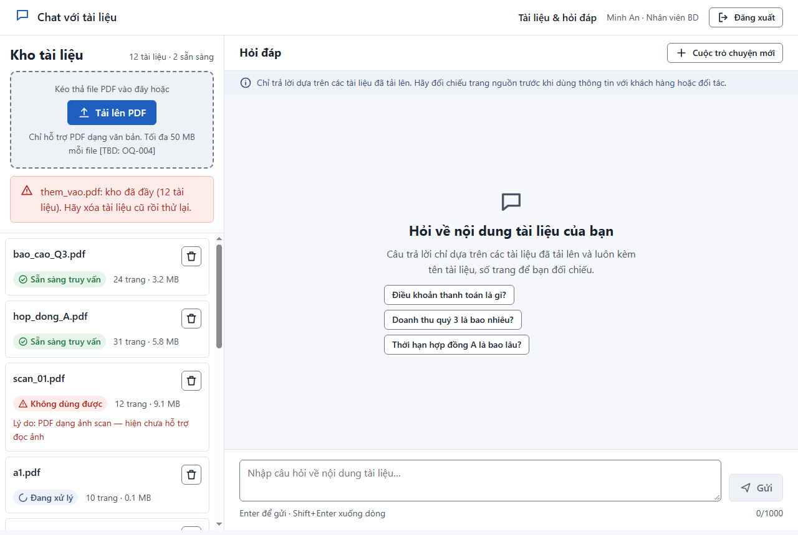

*Kho đã đầy: thông báo nêu giới hạn và hướng xử lý.* [Mở bản mẫu](../04-design/UI_UX_design/02_workspace.html?demo=bd)

**Chờ quyết định:** #3 (con số giới hạn; bản mẫu đang để tạm 12 tài liệu / 50 MB).
*Truy vết: BR-002 · AC-002*

---

### A3. Biết ngay tài liệu nào không dùng được và vì sao · `Bắt buộc` · US-103
> Là **nhân viên BD**, tôi muốn **được báo rõ tên file và lý do khi file không dùng được**, để **không tưởng nhầm file đã được tra cứu**.

**Xong khi**
- File ảnh scan, file có mật khẩu, file hỏng đều hiện "Không dùng được" kèm **tên file và lý do cụ thể**; không file nào bị coi là sẵn sàng.
- File không phải PDF bị từ chối ngay ("Chỉ hỗ trợ PDF").
- Nội dung của file lỗi **không bao giờ** xuất hiện trong câu trả lời hay trích dẫn.

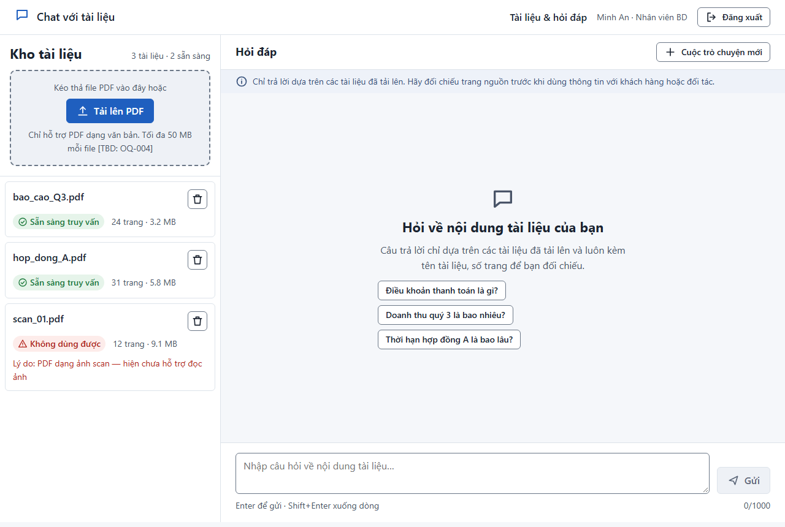

*`scan_01.pdf` hiện "Không dùng được" kèm lý do.* [Mở bản mẫu](../04-design/UI_UX_design/02_workspace.html?demo=bd)

**Lưu ý:** PDF dạng ảnh scan hiện **chưa được hỗ trợ** (xem A6). Nếu phần lớn tài liệu của đội là bản scan thì MVP sẽ ít giá trị.
*Truy vết: BR-003 · AC-003*

---

### A4. Xem danh sách tài liệu và trạng thái · `Bắt buộc` · US-104
> Là **nhân viên BD**, tôi muốn **thấy tài liệu nào đang có trong kho và tài liệu nào sẵn sàng**, để **biết câu trả lời được tìm trên phạm vi nào**.

**Xong khi**
- Ví dụ tải 5 file, trong đó 1 file lỗi: danh sách hiện đủ 5 tên, đúng 4 "Sẵn sàng" và 1 "Không dùng được".
- Danh sách luôn nằm cạnh khung chat.
- Kho chưa có tài liệu: hiện hướng dẫn "Tải lên PDF để bắt đầu", ô nhập câu hỏi bị khóa kèm giải thích (không để màn hình trống).

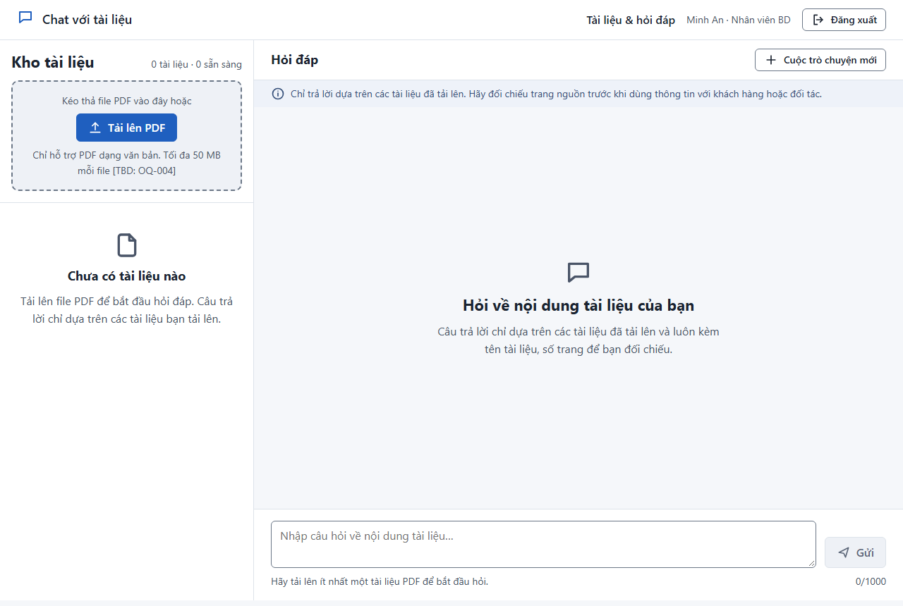

*Kho rỗng: hướng dẫn bước tiếp theo.* [Mở bản mẫu](../04-design/UI_UX_design/02_workspace.html?demo=bd&state=empty)

*Truy vết: BR-004 · AC-004*

---

### A5. Xóa tài liệu · `Nên có` · US-105
> Là **nhân viên BD**, tôi muốn **xóa một tài liệu khỏi kho**, để **tài liệu lỗi thời hoặc tải nhầm không làm sai câu trả lời**.

**Xong khi**
- Có hộp xác nhận nêu **tên tài liệu và hệ quả** trước khi xóa.
- Sau khi xóa, câu hỏi liên quan chỉ tài liệu đó sẽ được báo "không tìm thấy" và không câu trả lời nào còn trích dẫn nó.

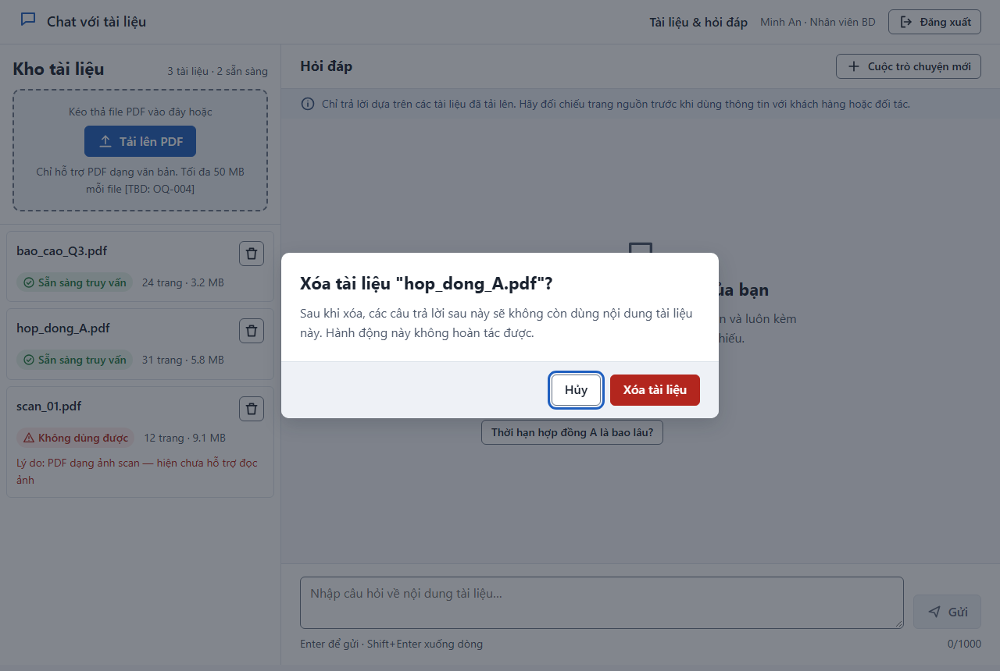

*Xác nhận xóa nêu tên tài liệu.* [Mở bản mẫu](../04-design/UI_UX_design/02_workspace.html?demo=bd)

**Chờ quyết định:** #7 (ai được xóa tài liệu của người khác nếu kho dùng chung).
*Truy vết: BR-005 · AC-005*

---

### A6. Đọc được PDF dạng ảnh scan (OCR) · `Để sau` · US-106
> Là **nhân viên BD**, tôi muốn **hỏi được trên cả PDF scan**, để **không bỏ sót tài liệu quan trọng**.

Chưa có thiết kế màn hình. **Nếu tỷ lệ tài liệu scan cao (OQ-005), câu chuyện này cần được nâng lên "Bắt buộc"** và BRD phải sửa. Nên kiểm tra sớm trên bộ tài liệu thật.

---

### A7. Chia kho theo dự án hoặc nhóm · `Để sau` · US-107
> Là **nhân viên BD**, tôi muốn **tách kho theo dự án**, để **câu trả lời không lẫn tài liệu dự án khác**.

Chưa có thiết kế màn hình. Phụ thuộc quyết định #7.

---

## 3. B. Hỏi và nhận câu trả lời đáng tin

### B1. Hỏi bằng ngôn ngữ tự nhiên · `Bắt buộc` · US-201
> Là **nhân viên BD**, tôi muốn **gõ câu hỏi như nói chuyện và nhận câu trả lời bằng văn bản**, để **không phải đọc từng file**.

**Xong khi**
- Gửi câu hỏi → thấy câu trả lời trong khung chat; trong lúc chờ có chỉ báo "đang tìm" và không gửi trùng được cùng câu hỏi.
- Với câu hỏi mà đáp án nằm trong **một** tài liệu, tỷ lệ đúng đạt **[mục tiêu — chờ quyết định #1]**.

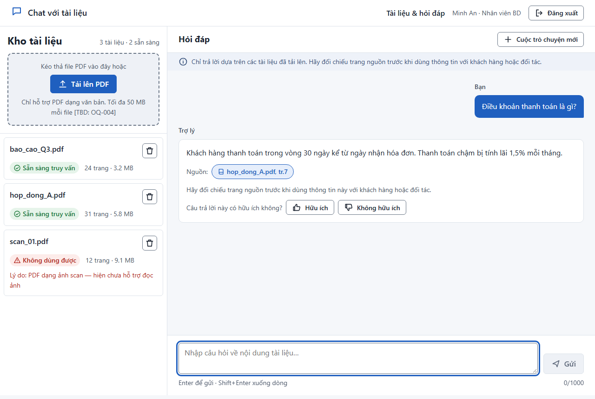

*Câu trả lời kèm nguồn.* [Mở bản mẫu](../04-design/UI_UX_design/02_workspace.html?demo=bd)

*Truy vết: BR-006 · AC-006*

---

### B2. Chỉ trả lời từ tài liệu đã tải lên · `Bắt buộc` · US-202
> Là **nhân viên BD**, tôi muốn **câu trả lời chỉ dựa trên tài liệu trong kho**, để **không nhận thông tin không có căn cứ**.

**Xong khi**
- Hỏi kiến thức chung (ví dụ "Thủ đô của Pháp là gì?") thì hệ thống nói không tìm thấy, **không** trả lời từ kiến thức bên ngoài.
- Chuyên gia rà soát bộ câu hỏi chuẩn: số nhận định không truy được về một trang trong kho không vượt **[ngưỡng — chờ quyết định #1]**.

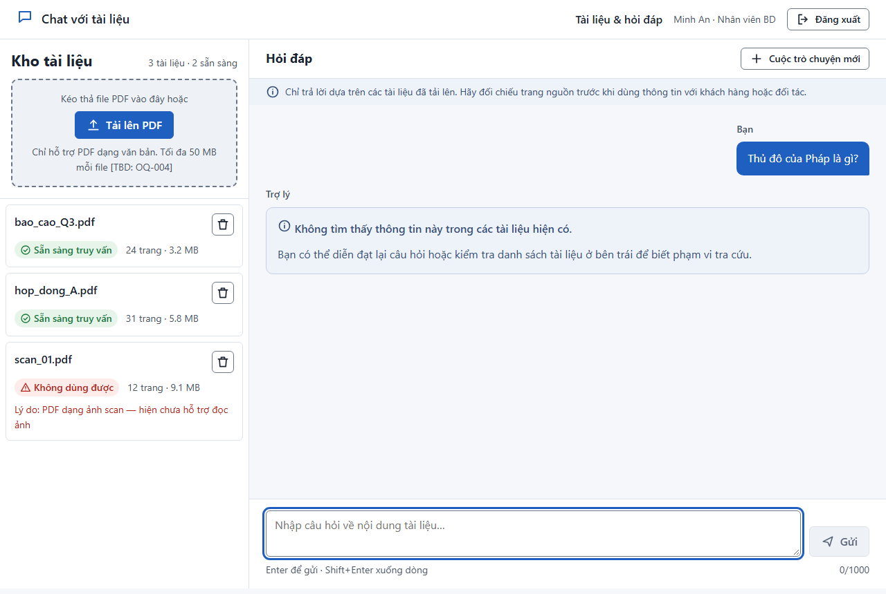

*Câu hỏi ngoài kho nhận "không tìm thấy".* [Mở bản mẫu](../04-design/UI_UX_design/02_workspace.html?demo=bd)

**Vì sao quan trọng:** đây là rủi ro lớn nhất của sản phẩm (AI trả lời sai nhưng nghe hợp lý, nhân viên dùng với khách hàng).
*Truy vết: BR-007 · AC-007*

---

### B3. Mỗi câu trả lời đều có nguồn · `Bắt buộc` · US-203
> Là **nhân viên BD**, tôi muốn **thấy tên tài liệu và số trang cho mỗi câu trả lời**, để **tự kiểm chứng trước khi dùng**.

**Xong khi**
- **100%** câu trả lời có nội dung đều kèm ít nhất một nguồn (tên tài liệu + số trang).
- Nguồn trỏ đúng trang chứa thông tin, đạt **[mục tiêu — chờ quyết định #1]**.
- Hệ thống không tự bịa số trang; không xác định được trang thì ghi rõ "không xác định trang" (đề xuất, cần PO xác nhận).

*Mỗi câu trả lời kèm nguồn (tên tài liệu, trang).* [Mở bản mẫu](../04-design/UI_UX_design/02_workspace.html?demo=bd)

*Truy vết: BR-008 · AC-008*

---

### B4. Báo "không tìm thấy" thay vì đoán · `Bắt buộc` · US-204
> Là **nhân viên BD**, tôi muốn **được báo rõ khi kho không có thông tin**, để **không tin vào một câu trả lời bịa**.

**Xong khi**
- Hỏi điều không có trong kho: nhận "Không tìm thấy thông tin trong các tài liệu hiện có", **không có nội dung suy đoán**, kèm gợi ý (diễn đạt lại hoặc kiểm tra danh sách tài liệu).
- Với ít nhất 10 câu hỏi ngoài kho, tỷ lệ báo đúng đạt **[mục tiêu — chờ quyết định #1]**.
- "Không tìm thấy" **khác hẳn** với "lỗi hệ thống" về màu, biểu tượng và nội dung.

*Kết quả "không tìm thấy".* [Mở bản mẫu](../04-design/UI_UX_design/02_workspace.html?demo=bd)

*Truy vết: BR-009 · AC-009*

---

### B5. Mở trang nguồn để đối chiếu · `Nên có` · US-205
> Là **nhân viên BD**, tôi muốn **bấm vào nguồn để xem đúng trang PDF**, để **đối chiếu nhanh mà không phải tự tìm trang**.

**Xong khi**
- Bấm nguồn mở đúng trang; nếu không mở được thì vẫn thấy tên tài liệu và số trang.
- Nếu tài liệu nguồn đã bị xóa, nguồn đó hiện "đã xóa" thay vì liên kết hỏng.

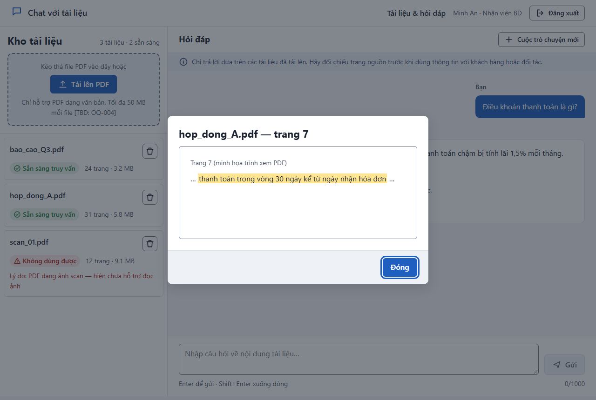

*Xem trang nguồn, đoạn được dùng được tô sáng.* [Mở bản mẫu](../04-design/UI_UX_design/02_workspace.html?demo=bd)

**Chờ quyết định:** #9. Chức năng này **chưa có trong BRD**; nếu PO muốn giữ thì cần thêm yêu cầu BR-018.
*Truy vết: PRD US-205 (đề xuất BR-018)*

---

### B6. Tổng hợp từ nhiều tài liệu · `Bắt buộc` · US-206
> Là **nhân viên BD**, tôi muốn **một câu trả lời tổng hợp khi thông tin nằm ở nhiều tài liệu**, để **khỏi tự ghép thủ công**.

**Xong khi**
- Câu hỏi cần thông tin từ hai tài liệu trở lên được trả lời đúng và **trích dẫn đủ mọi tài liệu cần thiết** (ít nhất 5 câu kiểm tra, tỷ lệ đạt **[mục tiêu — #1]**).
- Nếu hai tài liệu nói khác nhau, hệ thống nêu **cả hai giá trị kèm nguồn** (đề xuất, chờ quyết định #10).

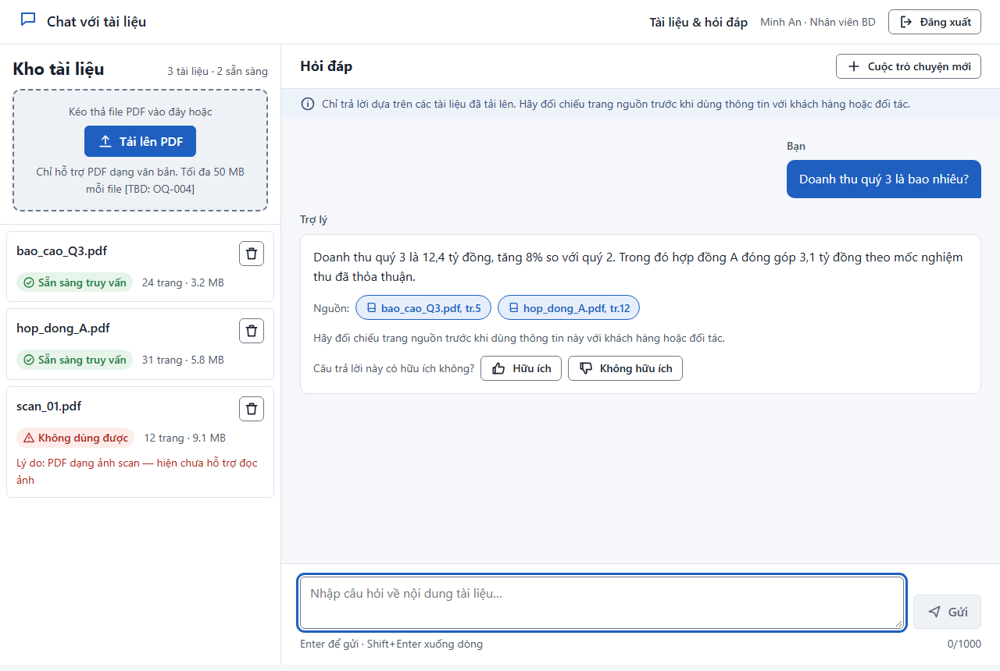

*Một câu trả lời trích dẫn hai tài liệu.* [Mở bản mẫu](../04-design/UI_UX_design/02_workspace.html?demo=bd)

*Truy vết: BR-010 · AC-010*

---

### B7. Hỏi tiếp không cần nhắc lại ngữ cảnh · `Nên có` · US-207
> Là **nhân viên BD**, tôi muốn **hỏi tiếp như trong một cuộc trò chuyện**, để **không phải nhắc lại câu hỏi trước**.

**Xong khi**
- Trong một phiên, câu như "còn thời hạn của nó thì sao?" được hiểu đúng; ít nhất 4/5 kịch bản kiểm tra đạt.
- Có nút "Cuộc trò chuyện mới" (có xác nhận) để xóa ngữ cảnh.
- Lịch sử **không** được lưu qua nhiều phiên trong MVP (xem B10).

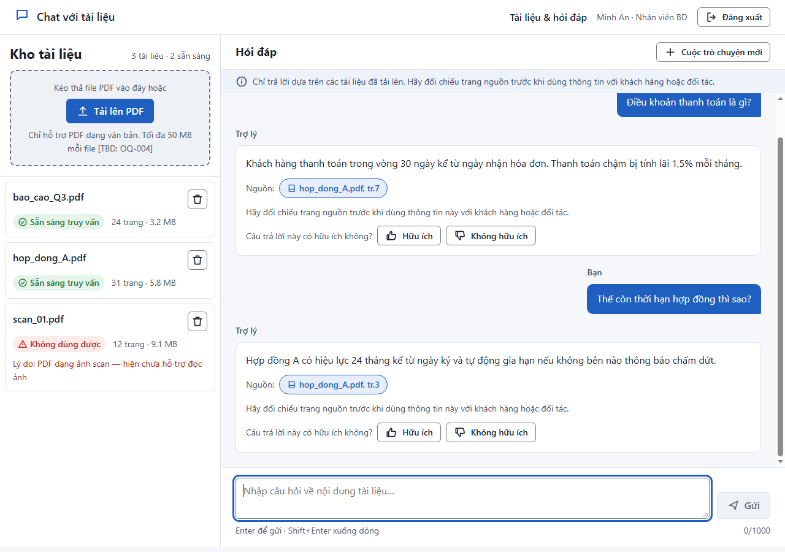

*Hai lượt hỏi liên tiếp trong cùng phiên.* [Mở bản mẫu](../04-design/UI_UX_design/02_workspace.html?demo=bd)

*Truy vết: BR-011 · AC-011*

---

### B8. Câu trả lời đủ nhanh · `Bắt buộc` · US-208
> Là **nhân viên BD**, tôi muốn **nhận câu trả lời nhanh**, để **công cụ thật sự nhanh hơn đọc thủ công**.

**Xong khi**
- **[x]%** câu hỏi được trả lời trong **[y] giây** khi kho ở mức dung lượng tối đa (**chờ quyết định #4**).
- Nếu lâu hơn bình thường: hiện thông báo và cho **Hủy**; nếu lỗi: báo lỗi rõ và cho **Gửi lại**, không nhầm với "không tìm thấy".

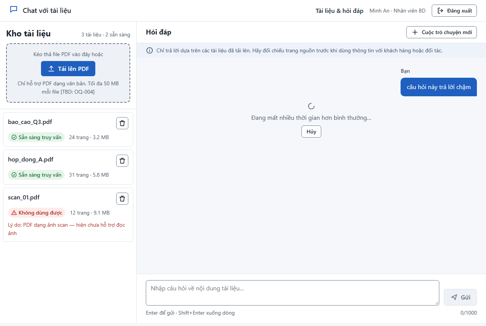

*Chờ lâu hơn bình thường: có thông báo và nút Hủy.* [Mở bản mẫu](../04-design/UI_UX_design/02_workspace.html?demo=bd)

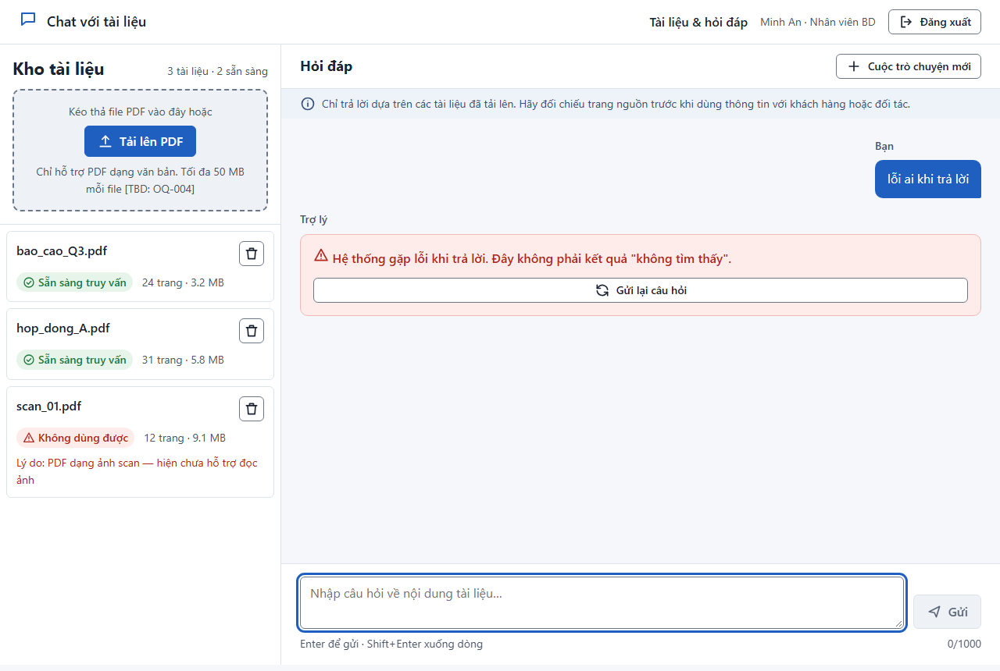

*Lỗi hệ thống: có nút Gửi lại.*

*Truy vết: BR-012 · AC-012*

---

### B9. Hỏi và nhận trả lời bằng ngôn ngữ của mình · `Bắt buộc` · US-209
> Là **nhân viên BD**, tôi muốn **hỏi và nhận trả lời bằng ngôn ngữ tôi dùng**, để **không phải dịch**.

**Xong khi**
- Câu trả lời dùng đúng ngôn ngữ của câu hỏi, với từng ngôn ngữ được chốt (**chờ quyết định #5**), độ chính xác đạt cùng mức với B1.

Không có màn hình riêng; hành vi thể hiện ở câu trả lời (B1).
*Truy vết: BR-013 · AC-013*

---

### B10. Lưu lịch sử hội thoại nhiều phiên · `Để sau` · US-210
Ngoài MVP. Chưa có thiết kế.

### B11. Xuất câu trả lời ra file · `Để sau` · US-211
Ngoài MVP. Chưa có thiết kế.

---

## 4. C. Truy cập an toàn

### C1. Chỉ người được cấp quyền mới vào được · `Bắt buộc` · US-301
> Là **IT/Bảo mật và quản lý**, tôi muốn **chỉ người được cấp quyền truy cập kho và chức năng hỏi đáp**, để **tài liệu kinh doanh không bị người lạ xem**.

**Xong khi**
- Người chưa đăng nhập hoặc không có quyền đều bị từ chối (10/10 lần thử); người có quyền vào được (10/10).
- Hết phiên làm việc: được đưa về đăng nhập và **không mất câu hỏi đang gõ**.
- Nhân viên BD không xem được trang thống kê của Quản lý.

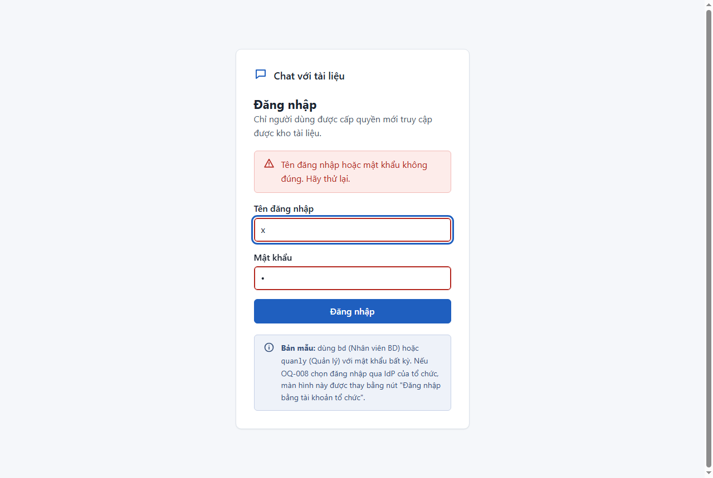

*Đăng nhập sai: thông báo rõ, nêu cách thử lại.* [Mở bản mẫu](../04-design/UI_UX_design/01_login.html)

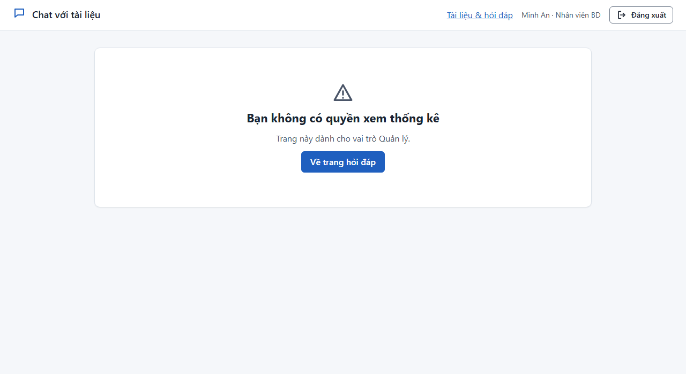

*Nhân viên BD mở trang thống kê: bị từ chối.*

**Chờ quyết định:** #6. Nếu MVP không cần đăng nhập thì câu chuyện này phải sửa lại cùng BRD (BR-014).
*Truy vết: BR-014 · AC-014*

---

### C2. Dữ liệu chỉ xử lý trong phạm vi IT/Bảo mật đã duyệt · `Bắt buộc` · US-302
> Là **IT/Bảo mật**, tôi muốn **tài liệu và câu hỏi chỉ được xử lý và lưu trong phạm vi tôi đã duyệt**, để **không lộ dữ liệu cho bên thứ ba**.

**Xong khi**
- Có **văn bản phê duyệt** của IT/Bảo mật về nơi xử lý/lưu trữ và nhà cung cấp AI; cấu hình thực tế khớp với văn bản.

**Đây là điều kiện chặn:** chưa có phê duyệt (**quyết định #2**) thì không nên bắt đầu thiết kế phần AI. Không có màn hình.
*Truy vết: BR-015 · AC-015*

---

### C3. Đăng nhập một lần (SSO) · `Để sau` · US-303
Ngoài MVP. Màn hình đăng nhập hiện tại sẽ được thay bằng nút "Đăng nhập bằng tài khoản tổ chức" nếu có.

---

## 5. D. Đo hiệu quả của pilot

### D1. Đánh giá câu trả lời · `Nên có` · US-401
> Là **nhân viên BD**, tôi muốn **đánh dấu một câu trả lời hữu ích hay không bằng một thao tác**, để **đội sản phẩm biết chất lượng thực tế**.

**Xong khi**
- Đánh giá được bằng một chạm, đổi được lựa chọn; mọi đánh giá xuất hiện trong thống kê của quản lý.

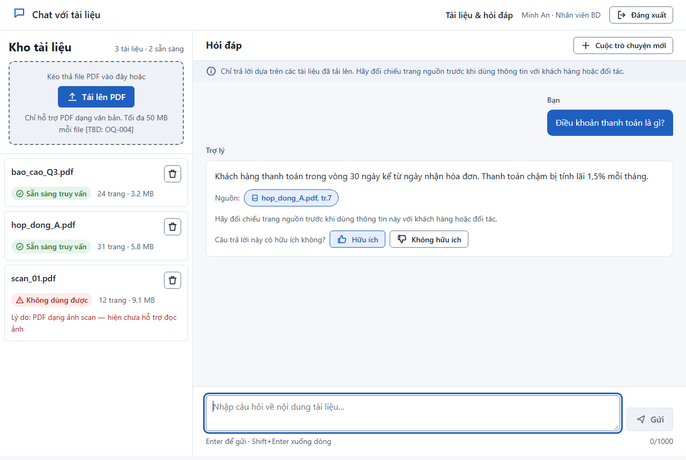

*Đã chọn "Hữu ích".* [Mở bản mẫu](../04-design/UI_UX_design/02_workspace.html?demo=bd)

*Truy vết: BR-016 · AC-016*

---

### D2. Quản lý xem thống kê theo tuần · `Nên có` · US-402
> Là **quản lý**, tôi muốn **xem số người dùng hoạt động và số câu hỏi theo tuần**, để **có dữ liệu quyết định có đầu tư tiếp sau MVP hay không**.

**Xong khi**
- Số người dùng hoạt động/tuần, số câu hỏi, tỷ lệ "hữu ích" hiển thị đúng; sau một tuần thử nghiệm có kịch bản, số liệu **khớp 100%**.
- Tuần chưa có hoạt động hiển thị trạng thái rõ ràng, không để trống.

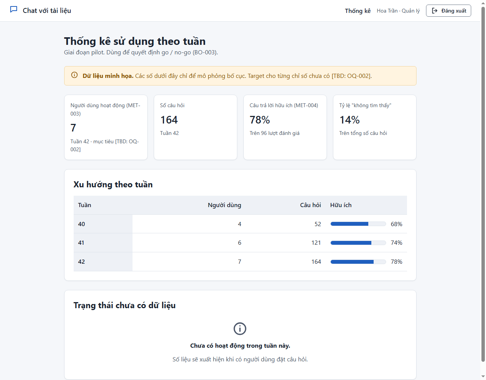

*Thống kê theo tuần (số liệu minh họa).* [Mở bản mẫu](../04-design/UI_UX_design/03_stats.html?demo=manager)

**Chờ quyết định:** #1 (mục tiêu cho từng chỉ số).
*Truy vết: BR-017 · AC-017*

---

## 6. Các câu chuyện chưa có tiêu chí hoàn chỉnh

Các câu chuyện có `[mục tiêu — chờ quyết định #1]` hoặc con số tạm chưa thể nghiệm thu cho đến khi quyết định liên quan được chốt: **A2, B1, B2, B3, B4, B6, B8, B9, D2.**
