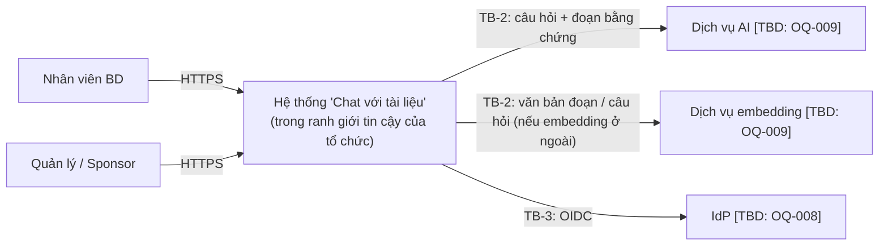
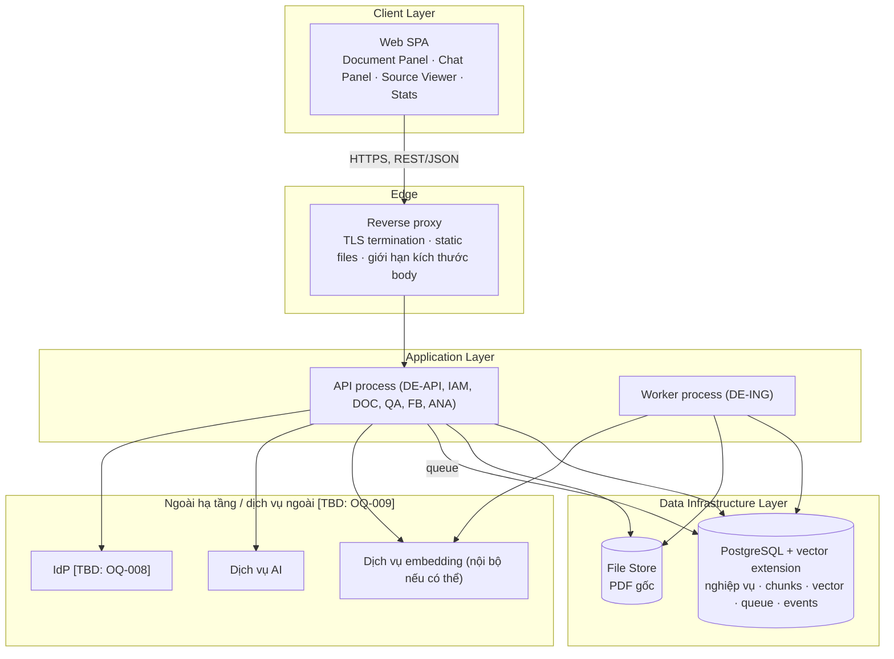
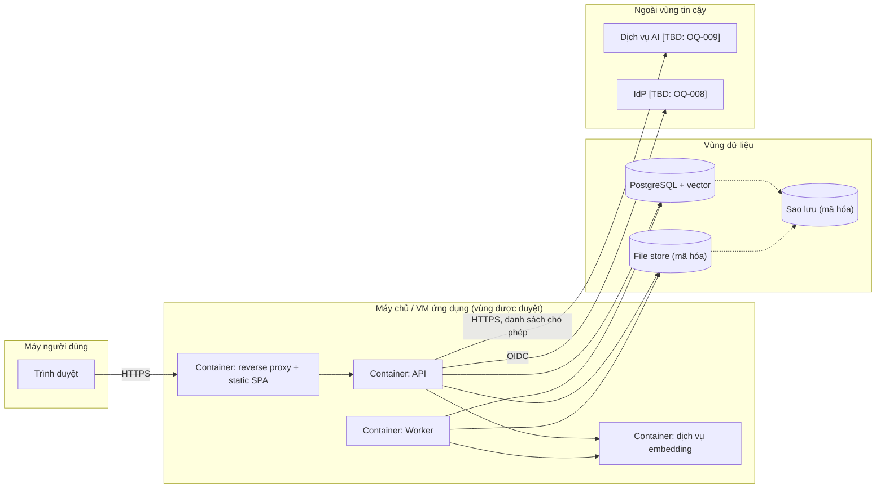

# Software Architecture Design Document (SADD) — "Chat với tài liệu" (MVP)

> **Chuẩn:** IEEE 1016-2009 · **Prompt:** [SAD_Prompt_IEEE_standard.md](../../References/design/SAD_Prompt_IEEE_standard.md)
> **Đầu vào:** [BRD.md](../01-requirements/BRD.md) · [PRD.md](../01-requirements/PRD.md) · [UseCase_Specification.md](../02-analysis/UseCase_Specification.md)
> **Quan hệ với SDD:** [SDD_Blueprint.md](../04-design/blueprint/SDD_Blueprint.md) (SDD-CWD-001) chứa 8 view chi tiết, ER, bảng API, thuật toán. **SAD này là mức kiến trúc tổng thể** (pattern, hạ tầng, bảo mật, độ tin cậy, quan sát, triển khai) và *tham chiếu SDD thay vì lặp lại*. Khi hai tài liệu khác nhau, SDD là nguồn cho chi tiết view; SAD là nguồn cho quyết định hạ tầng.
> **Thứ tự tài liệu:** theo quy trình chuẩn, SAD (kiến trúc) đi trước SDD (thiết kế chi tiết). Trong dự án này SDD được viết trước, nên các quyết định D-01…D-11 ra đời ở SDD. Từ nay **SAD là nguồn cho quyết định kiến trúc/hạ tầng**; SDD là nguồn cho chi tiết view. Khi hai tài liệu mâu thuẫn, sửa theo SAD cho quyết định và theo SDD cho chi tiết, rồi đồng bộ cả hai.
> **Quy ước:** `[TBD: OQ-xxx]` = chờ quyết định theo BRD §12 · `[Proposed]` = lựa chọn của tài liệu này, chưa được xác nhận · `[Initial]` = tham số khởi điểm cần hiệu chỉnh. Con số không có nguồn trong BRD/PRD thuộc một trong ba nhóm này, không phải requirement.

| Mục | Giá trị |
|---|---|
| Mã / Version / Trạng thái | SAD-CWD-001 / 0.1 / **Draft** |
| Ngày | 2026-10-21 |
| Tác giả | Software Architect — [TBD: OQ-014] (soạn với sự hỗ trợ của AI) |

---

## 0. Technical Constraints Summary (tóm tắt đầu vào)

### 0.1 System Foundation (5 trường của prompt)

| Trường | Giá trị | Nguồn |
|---|---|---|
| **System Name** | "Chat với tài liệu" (MVP) | BRD §1 |
| **Core Business Function** | Người dùng BD upload PDF vào kho tài liệu, hỏi bằng ngôn ngữ tự nhiên, nhận câu trả lời chỉ dựa trên kho, kèm tên tài liệu và số trang; trả "không tìm thấy" khi thiếu căn cứ | BR-001…013 |
| **Target Scale / Load** | Số tài liệu và trang tối đa `[TBD: OQ-004]`; số người dùng (một đội BD) `[TBD: OQ-008]`; thời gian phản hồi `[TBD: OQ-006]`. **Chưa có số tải nào**; kiến trúc dưới đây nhắm quy mô một đội, một nút | ASM-002 |
| **Preferred Tech Stack** | Chưa được chỉ định. Bộ công nghệ ở §2 là `[Proposed]` | — |
| **Critical Constraints** | Xem 0.2 | BRD §9 |

### 0.2 Ràng buộc kỹ thuật

| ID | Ràng buộc | Nguồn | Tác động kiến trúc |
|---|---|---|---|
| CON-001 | Là MVP | BRD | Ưu tiên ít thành phần vận hành |
| CON-002 | Ứng dụng web | BRD | Không có client native |
| CON-003 | Đầu vào chỉ PDF | BRD | Một pipeline ingestion |
| CON-004 | Tương tác qua chat với AI | BRD | Có dịch vụ AI là phụ thuộc bên ngoài |
| BR-015 | Dữ liệu chỉ xử lý/lưu trong phạm vi IT/Bảo mật duyệt bằng văn bản | BRD | Ports & adapters; danh sách cho phép mạng ra ngoài; log không chứa nội dung |
| BR-014 | Chỉ người được cấp quyền truy cập | BRD | Xác thực ở mọi route; phương thức `[TBD: OQ-008]` |
| BR-012 | Phản hồi trong ngưỡng | BRD | Pipeline đồng bộ ngắn, không streaming trước khi kiểm chứng (SDD D-10) |
| CON-005 | Timeline `[TBD: OQ-012]`, ngân sách `[TBD: OQ-013]` | BRD | Hạn mức chi phí AI là yêu cầu kiến trúc |

### 0.3 Những điều chưa biết ảnh hưởng kiến trúc

| OQ | Ảnh hưởng | Quyết định bị treo |
|---|---|---|
| **OQ-009** (bảo mật, nhà cung cấp AI, vị trí dữ liệu) | Có thể thay toàn bộ phương án: AI ngoài hay mô hình tự lưu trữ; triển khai ở đâu | §2.4, §4.1, §5 |
| **OQ-008** (đăng nhập, số người dùng) | Có/không IdP; kích cỡ hạ tầng | §4.1 |
| **OQ-004** (kích thước kho) | Kích cỡ DB, vector index, ngưỡng tách dịch vụ | §2.3, §5 |
| **OQ-006** (độ trễ) | Lựa chọn mô hình AI, số đoạn gửi đi | §4.2 |
| **OQ-007** (ngôn ngữ) | Mô hình embedding đa ngôn ngữ | §2.3 |

### 0.4 Context View và bản đồ các view

| Phía | Dịch vụ |
|---|---|
| **Hệ thống cung cấp** | Quản lý kho PDF tự phục vụ; hỏi đáp có trích dẫn; mở trang nguồn; thống kê pilot |
| **Hệ thống cần từ môi trường** | Sinh câu trả lời (dịch vụ AI); embedding; xác thực danh tính (nếu có IdP); hạ tầng chạy container, lưu trữ, sao lưu, TLS |
| **Ngoài ranh giới** | Việc dùng câu trả lời cho quyết định kinh doanh (BRD §5.4); OCR, SSO, tích hợp nguồn tài liệu (BRD §5.2–5.3) |

**Bản đồ view.** SAD tóm tắt từng view ở mức kiến trúc; chi tiết ở SDD.

| View (IEEE 1016) | Trong SAD | Chi tiết ở SDD |
|---|---|---|
| Context | §0.4 | §3.0 |
| Composition | §2 (sơ đồ lớp, thành phần) | §3.1 |
| Logical | §2.6 (thực thể cốt lõi) | §3.2 |
| Dependency | §2.6 (quy tắc phụ thuộc) | §3.3 |
| Interaction | §3.2 (luồng hỏi đáp đầu-cuối) | §3.4 |
| Information | §2.3, §3.1 | §3.5 |
| Interface | §2.4, §2.5 | §3.6 |
| State Dynamics | §2.6 (vòng đời tài liệu và tin nhắn) | §3.7 |
| Algorithm | §3.2 (các cổng) | §3.8 |
| Resource | §5.3 | §4.2 |
| Physical / Deployment | §5.1 | — |

---

## 1. Architectural Goals & Design Principles

### 1.1 Key Drivers

| # | Driver | Vì sao là driver (nguồn) | Thiết kế ưu tiên nó thế nào |
|---|---|---|---|
| 1 | **Groundedness & kiểm chứng được** | RSK-001 (High): câu trả lời bịa gây hại; BR-007/008/009 | Trích dẫn do hệ thống dựng từ mã bằng chứng, không do mô hình tự viết; ba cổng "không tìm thấy"; lỗi AI là trạng thái riêng, không nhầm với "không tìm thấy" (SDD §3.8, D-06) |
| 2 | **Bảo vệ dữ liệu & kiểm soát phạm vi phơi nhiễm** | RSK-002 (High): lộ tài liệu cho bên thứ ba; BR-015; STK-004 có quyền chặn | Ports & adapters; chỉ các đoạn liên quan (không phải PDF) rời hạ tầng; embedding chạy nội bộ `[Proposed]`; danh sách cho phép tên miền ra ngoài; log không chứa nội dung |
| 3 | **Đơn giản & thay thế được (MVP)** | CON-001; nhà cung cấp AI chưa chốt (OQ-009) | Modular monolith, DB-backed queue, một CSDL cho mọi dữ liệu; mọi dịch vụ ngoài sau một port |

**Đánh đổi chấp nhận:** không streaming câu trả lời (đổi lấy kiểm chứng trích dẫn trước khi hiển thị), không mở rộng ngang (đổi lấy ít thành phần), chưa OCR (đổi lấy phạm vi MVP, RSK-003).

### 1.2 Architectural Patterns

| Pattern | Áp dụng | Lý do chọn | Vì sao không chọn lựa chọn thay thế |
|---|---|---|---|
| **Modular monolith** (một codebase, ranh giới module, một tiến trình API + một tiến trình worker) | Toàn backend | Đội nhỏ, MVP, giao dịch chung khi xóa tài liệu và chỉ mục (AC-005) | Microservices: chi phí vận hành/tích hợp không có yêu cầu mở rộng độc lập hỗ trợ (OQ-004) |
| **Ports & Adapters (Hexagonal)** | LLM, embedding, xác thực, kho tệp | Nhà cung cấp chưa chốt; đổi adapter không đổi lõi (CN-10) | Gọi SDK nhà cung cấp trực tiếp từ logic nghiệp vụ: khóa chặt vào một nhà cung cấp |
| **Retrieval-Augmented Generation có kiểm chứng** | Hỏi đáp | Trả lời từ tài liệu thay đổi thường xuyên, có trích dẫn trang | Fine-tune: không xóa chọn lọc, không trích dẫn; gửi nguyên PDF cho AI: phơi nhiễm dữ liệu nhiều hơn |
| **Asynchronous job processing** (hàng đợi trong CSDL) | Ingestion | Xử lý PDF có thể lâu; cần trạng thái từng file | Xử lý đồng bộ trong request upload: dễ timeout |
| **Hybrid retrieval** (vector + từ khóa) | Truy xuất | Mã hợp đồng, tên riêng, số liệu | Chỉ vector hoặc chỉ từ khóa (SDD D-03) |

---

## 2. System Component Decomposition

Phân rã chi tiết và ID phần tử (DE-*) ở [SDD §3.1](../04-design/blueprint/SDD_Blueprint.md). Dưới đây là bố cục lớp và công nghệ `[Proposed]`.

### 2.1 Frontend / Client Layer

| Hạng mục | Quyết định `[Proposed]` | Lý do |
|---|---|---|
| Kiểu giao hàng | **SPA** build tĩnh, phục vụ qua reverse proxy; không SSR | Ứng dụng nội bộ sau đăng nhập, không cần SEO; đơn giản hơn SSR |
| CDN | Không dùng trong MVP | Người dùng nội bộ một đội |
| Quản lý state | State phía server (danh sách tài liệu, phiên hội thoại) lấy qua API với bộ nhớ đệm yêu cầu; state UI cục bộ (đang gõ, đang gửi) trong component. Không dùng kho state toàn cục | Dữ liệu nguồn nằm ở server; giảm đồng bộ hai chiều |
| Giao thức tới backend | **REST/JSON qua HTTPS**; cookie phiên `HttpOnly`, `Secure`, `SameSite` | Mô hình tài nguyên đơn giản (SDD §3.6); không cần GraphQL/gRPC |
| Trạng thái tài liệu | **Polling** `GET /documents` chu kỳ ngắn `[Initial: 2 giây]` khi có tài liệu `PROCESSING` | Tránh duy trì kết nối dài; đủ cho MVP. Server-Sent Events là bước nâng cấp |
| Xem nguồn | Trình xem PDF phía client, nhận tệp từ `GET /documents/{id}/file` (hỗ trợ range) | Mở đúng trang được trích dẫn (UC-12) |
| Phát sự kiện | Gửi `POST /events` theo danh sách sự kiện đóng (PRD §5.2), không gửi nội dung | G-10 |
| UI chi tiết | Ngoài phạm vi SAD; xem PRD §4 và SDD §2.4–2.5 | — |

### 2.2 Application / Business Logic Layer

| Thành phần | Ranh giới | Xử lý | Tiến trình |
|---|---|---|---|
| Identity & Access | Phiên, vai trò (BD, MANAGER) | Xác thực, kiểm tra quyền mỗi route | API |
| Document Library | Vòng đời tài liệu, kiểm tra sơ bộ | Nhận file, từ chối sớm, tạo job, xóa | API |
| Ingestion | Kiểm tra PDF, trích văn bản theo trang, chia đoạn, embedding, lập chỉ mục | Thuật toán A1 (SDD §3.8) | **Worker** |
| Index & Retrieval | Truy xuất hybrid | Thuật toán A2 bước 2–5 | API |
| Q&A Orchestrator | Hội thoại, soạn trả lời, kiểm chứng trích dẫn | A2 đầy đủ | API |
| Feedback · Analytics & Stats | Đánh giá, sự kiện, thống kê tuần | Ghi và tổng hợp | API |

**Asynchronous workers.** Một tiến trình worker cùng codebase, lấy job bằng khóa dòng không chặn (`SELECT … FOR UPDATE SKIP LOCKED`) trên bảng `processing_jobs`. Số job song song có giới hạn cấu hình `[Initial: thấp]`. Job có thời hạn (timeout) và thử lại có giới hạn; quá giới hạn → tài liệu `UNUSABLE(processing_failed)`; worker chết giữa chừng → job quá hạn được nhận lại, không để tài liệu kẹt `PROCESSING` (PRD N-4).

### 2.3 Data Infrastructure Layer

| Hạng mục | Quyết định `[Proposed]` | Chi tiết | Phụ thuộc |
|---|---|---|---|
| **CSDL chính** | Một PostgreSQL | Dữ liệu nghiệp vụ, đoạn nội dung, vector, hàng đợi, sự kiện, audit | OQ-004 |
| **Chỉ mục vector** | Phần mở rộng vector của PostgreSQL, chỉ mục **HNSW**, khoảng cách cosine | Truy vấn xấp xỉ, nhanh ở quy mô một đội; số chiều theo mô hình embedding | OQ-004, OQ-007 |
| **Chỉ mục từ khóa** | `tsvector` với chỉ mục **GIN** | Hỗ trợ mã/tên riêng; cấu hình ngôn ngữ phân tích theo OQ-007 | OQ-007 |
| **Lọc tài liệu sẵn sàng** | Mọi truy vấn truy xuất join `documents.status = 'READY'` | Đảm bảo bất biến READY-only (BR-003) | — |
| **Caching tier** | **Không** có cache riêng (không Redis) trong MVP | Không có điểm nóng dữ liệu được đo; thêm khi có số đo | — |
| **Message broker / queue** | Hàng đợi trong bảng `processing_jobs` | Giảm thành phần; chuyển sang broker khi throughput vượt khả năng (SDD D-05) | OQ-004 |
| **File store** | Hệ thống tệp có mã hóa hoặc object storage được duyệt; tên tệp theo ID, không theo tên người dùng | Truy cập chỉ qua ứng dụng, không có URL công khai | OQ-009 |
| **Mô hình embedding** | Mô hình **đa ngôn ngữ** chạy trong hạ tầng của tổ chức | Giữ toàn văn tài liệu trong nội bộ (SDD D-08); chạy CPU nếu đủ hiệu năng | OQ-007, OQ-009 |
| **Retention** | Xóa tài liệu → xóa cứng `chunks` cùng giao dịch; xóa tệp gốc ngay sau đó hoặc theo lịch `[TBD: OQ-009]`. `messages.text`: chỉ lưu nếu chính sách cho phép `[TBD: OQ-009]`. `analytics_events`, `audit_log`: thời gian giữ `[TBD: OQ-009]` | Đáp ứng AC-005 và nguyên tắc tối thiểu hóa dữ liệu | OQ-009 |
| **Sao lưu** | Sao lưu CSDL định kỳ và kho tệp cùng thời điểm; thử khôi phục trước khi pilot. RPO/RTO `[TBD]` | CN-12 | OQ-012 |

### 2.4 Backend / API Layer

Hợp đồng API đầy đủ (14 endpoint, mô hình lỗi chuẩn, quyền) ở [SDD §3.6](../04-design/blueprint/SDD_Blueprint.md). Tóm tắt kiến trúc:

| Hạng mục | Quyết định |
|---|---|
| **Kiểu** | REST/JSON, đường dẫn tài nguyên (`/documents`, `/conversations`, `/messages`, `/stats`) |
| **Input** | Kiểm tra tại biên API: loại tệp, kích thước, độ dài câu hỏi; từ chối trước khi vào nghiệp vụ. Giới hạn body ở reverse proxy |
| **Output** | `kind ∈ {ANSWER, NOT_FOUND, ERROR}`; `NOT_FOUND` là kết quả hợp lệ (HTTP 200), lỗi hệ thống là mã 4xx/5xx riêng |
| **Idempotency** | Upload trả `documentId` từng file; gửi lại tin nhắn tạo tin nhắn mới (không idempotent) và client chặn gửi trùng khi đang chờ |
| **Versioning** | Tiền tố `/api/v1` `[Proposed]` |
| **Ranh giới dịch vụ ngoài** | Port `LlmPort`, `EmbeddingPort`, `AuthPort`, `FileStorePort` (SDD §3.2). Lõi không import SDK nhà cung cấp; kiểm tra bằng quy tắc phụ thuộc trong CI (SDD §3.3) |
| **Nhà cung cấp AI** | Adapter sau `LlmPort`. Mô hình mặc định `[TBD: OQ-009]`; chọn theo kết quả chạy bộ câu hỏi chuẩn (DEP-002), chi phí (OQ-013) và độ trễ (OQ-006) |

### 2.5 External Interfaces

Hợp đồng chi tiết của từng nhà cung cấp chưa thể chốt vì phụ thuộc OQ-009; bảng dưới là hợp đồng *mà hệ thống đòi hỏi* ở mỗi dịch vụ ngoài (qua port), để mọi nhà cung cấp phải đáp ứng.

| ID | Dịch vụ ngoài | Port | Giao thức / định dạng | Hướng và tần suất | Xác thực | Dữ liệu qua ranh giới | Hành vi khi lỗi |
|---|---|---|---|---|---|---|---|
| EI-1 | Dịch vụ AI sinh câu trả lời | `LlmPort` | HTTPS, JSON; đầu ra có cấu trúc `{status, claims[{text, evidenceIds[]}]}` | Ra ngoài; 1–2 lời gọi mỗi câu hỏi (viết lại câu hỏi tiếp nối `[nếu có]`, soạn trả lời) | Khóa API trong kho bí mật | Câu hỏi, các đoạn bằng chứng kèm mã, và (khi hỏi tiếp nối) các lượt hỏi–đáp trước trong phiên. **Không** gửi PDF gốc, tên tệp, định danh người dùng `[Proposed]` | Timeout cứng; retry có giới hạn chỉ với lỗi tạm thời; circuit breaker; ánh xạ sang `AI_TIMEOUT`, `AI_QUOTA`, `AI_UNAVAILABLE`, `LlmInvalidOutput` |
| EI-2 | Dịch vụ embedding | `EmbeddingPort` | HTTPS (hoặc gọi nội bộ), JSON; vào là danh sách văn bản, ra là danh sách vector | Ra; theo lô khi xử lý tài liệu, 1 lời gọi mỗi câu hỏi | Nội bộ hoặc khóa API | Văn bản đoạn và câu hỏi | Retry có giới hạn; lỗi khi xử lý tài liệu → `UNUSABLE(processing_failed)` |
| EI-3 | IdP `[TBD: OQ-008]` | `AuthPort` | OIDC (authorization code) | Vào/ra; mỗi lần đăng nhập | OIDC client credentials | Định danh và vai trò | Không cho vào; thông báo lỗi hệ thống |
| EI-4 | Kho tệp | `FileStorePort` | Hệ thống tệp hoặc API object storage được duyệt | Vào/ra; mỗi lần upload, xem nguồn, xóa | Thông tin truy cập trong kho bí mật | PDF gốc | `StorageUnavailable` → báo lỗi, không tạo bản ghi nửa vời |
| EI-5 | Trình duyệt người dùng (giao diện bên trong) | REST | HTTPS, JSON; hợp đồng đầy đủ ở SDD §3.6 | Vào; theo thao tác người dùng | Cookie phiên | Theo từng endpoint | Mô hình lỗi chuẩn kèm `correlationId` |

> Đường dẫn ở SDD §3.6 ghi không kèm tiền tố; khi hiện thực áp dụng tiền tố `/api/v1` (§2.4).

### 2.6 Tóm tắt Logical, Dependency và State

**Thực thể cốt lõi** (chi tiết SDD §3.2): `User`, `Document`, `Chunk`, `Conversation`, `Message`, `Citation`, `Feedback`, `ProcessingJob`, cộng `AnalyticsEvent` và `AuditLog`. Quan hệ chính: một `Document` có nhiều `Chunk`; một `Message` có nhiều `Citation` trỏ về `Chunk`.

**Quy tắc phụ thuộc** (kiểm tra tự động trong CI `[Proposed]`):
1. API → module nghiệp vụ → ports; module nghiệp vụ không import adapter, framework web hay SDK nhà cung cấp.
2. Adapter chỉ import port mà nó hiện thực.
3. Giao tiếp giữa Document Library và Ingestion chỉ qua hàng đợi công việc.
4. Mỗi bảng chỉ được ghi bởi module sở hữu nó.

**Vòng đời trạng thái.** Tài liệu: `PROCESSING → READY` hoặc `UNUSABLE` (thử lại được nếu lỗi xử lý), xóa từ bất kỳ trạng thái. Bất biến: chỉ `READY` được truy xuất và trích dẫn. Câu hỏi: `RECEIVED → RETRIEVING → COMPOSING → ANSWERED | NOT_FOUND | ERROR`; `ERROR` không bao giờ đồng nhất với `NOT_FOUND`. Chi tiết SDD §3.7.

---

## 3. Data Architecture & Integration Flows

### 3.1 Core Data Model Strategy

| Quyết định | Nội dung | Lý do |
|---|---|---|
| **Shared schema, một CSDL** | Mọi module cùng schema; mỗi bảng *thuộc về một module* (chỉ module đó ghi), module khác đọc qua dịch vụ của module đó | Modular monolith; giữ khả năng tách database-per-service về sau |
| **Quan hệ + vector trong cùng CSDL** | Không có NoSQL hay kho vector riêng | Xóa tài liệu và chỉ mục trong một giao dịch (AC-005); không phải đồng bộ hai kho |
| **Nguồn sự thật cho trạng thái** | `documents.status` do DE-DOC/DE-ING quản lý; UI chỉ đọc | Tránh trạng thái giả (CN-06) |
| **Phạm vi kho** | Một kho dùng chung cho đội BD (SDD D-09); `uploaded_by` đã có sẵn để thêm phạm vi theo người/dự án | OQ-010 |
| **Trích dẫn bất biến** | `citations.page` và `document_id` sao chép tại thời điểm trả lời | Trích dẫn không đổi dù chỉ mục thay đổi sau đó |
| **Phân tách PII/nội dung** | `analytics_events` chỉ chứa định danh đã băm/ẩn danh và thuộc tính, không chứa nội dung | G-10 |
| **Nhất quán** | Giao dịch ACID cho mọi thay đổi nghiệp vụ. Không có sự nhất quán cuối cùng (eventual) giữa các kho nội bộ | Chỉ một CSDL |

Schema logic chi tiết: [SDD §3.5](../04-design/blueprint/SDD_Blueprint.md).

### 3.2 Critical Flow: Hỏi đáp đầu-cuối (UC-07)

Sơ đồ sequence ở [SDD §3.4b](../04-design/blueprint/SDD_Blueprint.md). Diễn giải theo mạng:

| # | Bước | Từ → Đến | Giao thức / dữ liệu | Xử lý lỗi |
|---|---|---|---|---|
| 1 | Người dùng gửi câu hỏi | SPA → Reverse proxy → API | `POST /api/v1/conversations/{id}/messages`, HTTPS, cookie phiên | `401` nếu hết phiên; SPA giữ nguyên câu hỏi (AC-301.3) |
| 2 | Kiểm tra quyền và đầu vào | API (nội bộ) | Phiên → principal; kiểm tra độ dài, rỗng | `422 QUESTION_*` |
| 3 | Lưu tin nhắn người dùng | API → PostgreSQL | Một câu lệnh INSERT | `5xx` nếu CSDL lỗi |
| 4 | Viết lại câu hỏi nếu tham chiếu ngầm | API → Dịch vụ AI (TB-2) | Chỉ văn bản lượt hỏi trước + câu hỏi; chỉ chạy khi có lịch sử | Lỗi → `ERROR(AI_*)`; không tự đoán |
| 5 | Tạo embedding câu hỏi | API → Dịch vụ embedding | Văn bản câu hỏi | Lỗi → `ERROR` |
| 6 | Truy xuất | API → PostgreSQL | Truy vấn HNSW (cosine) + GIN (từ khóa), lọc `READY`, hợp nhất xếp hạng | Rỗng/dưới ngưỡng → **NOT_FOUND** (cổng 1) |
| 7 | Soạn trả lời có căn cứ | API → Dịch vụ AI (TB-2) | Câu hỏi độc lập + các đoạn bằng chứng (kèm mã) + chỉ thị hệ thống; yêu cầu đầu ra có cấu trúc | Timeout/quota/unavailable → `ERROR`; `INSUFFICIENT_EVIDENCE` → **NOT_FOUND** (cổng 2) |
| 8 | Kiểm chứng trích dẫn | API (nội bộ) | Mọi mã bằng chứng ∈ tập đã truy xuất; mỗi nhận định có ≥ 1 mã | Không hợp lệ → thử lại 1 lần `[Initial]` → **NOT_FOUND** (cổng 3) |
| 9 | Dựng trích dẫn, lưu kết quả | API → PostgreSQL | `messages` + `citations` | — |
| 10 | Trả về | API → SPA | `{kind, text, citations[{documentName, page}], messageId}` | SPA hiển thị theo `kind`, phân biệt rõ ba loại |
| 11 | Sau đó | SPA → API | `GET /documents/{id}/file` (UC-12), `PUT /messages/{id}/feedback` (UC-13), `POST /events` | — |

**Dữ liệu qua ranh giới TB-2 gồm văn bản câu hỏi, các đoạn bằng chứng và (khi hỏi tiếp nối) các lượt hỏi–đáp trước trong phiên**; không gửi PDF gốc, tên người dùng, hay tên tệp `[Proposed]`.

**Luồng thứ hai: upload và xử lý** — SPA → API (`POST /documents`) → kiểm tra sơ bộ → lưu tệp + `Document(PROCESSING)` + `ProcessingJob` → trả `202` → Worker nhận job → mở tệp → kiểm tra → trích văn bản theo trang → chia đoạn → embedding → ghi `chunks` → `READY` hoặc `UNUSABLE`. Sequence ở [SDD §3.4a](../04-design/blueprint/SDD_Blueprint.md).

---

## 4. Cross-Cutting Concerns & Infrastructure

### 4.1 Security & Compliance

**Trust boundaries** (SDD §1.2): TB-1 trình duyệt ↔ ứng dụng; TB-2 ứng dụng ↔ dịch vụ AI/embedding ngoài; TB-3 ứng dụng ↔ IdP; TB-4 nội dung PDF là *dữ liệu không tin cậy*.

| Lĩnh vực | Quyết định `[Proposed]` | Phụ thuộc |
|---|---|---|
| **Authentication** | `AuthPort` với 2 adapter: (a) tài khoản local do quản trị cấp (không tự đăng ký), mật khẩu băm bằng thuật toán băm mật khẩu hiện hành; (b) **OIDC** tới IdP của tổ chức nếu OQ-008 yêu cầu. Chọn bằng cấu hình | OQ-008 |
| **Session** | Phiên phía server, cookie `HttpOnly; Secure; SameSite`, hết hạn tuyệt đối và hết hạn khi nhàn rỗi `[TBD]`; không dùng JWT dài hạn trong trình duyệt | OQ-008 |
| **Authorization** | RBAC 2 vai trò (BD, MANAGER); kiểm tra ở mỗi route phía server; `/stats/*` chỉ MANAGER; phạm vi tài liệu theo `[TBD: OQ-010]` | OQ-010 |
| **Encryption in transit** | TLS cho trình duyệt ↔ proxy và cho mọi kết nối tới dịch vụ ngoài; kết nối nội bộ tới CSDL dùng TLS nếu CSDL không cùng máy | OQ-009 |
| **Encryption at rest** | Mã hóa đĩa/volume của CSDL và kho tệp; sao lưu được mã hóa | OQ-009 |
| **Secret management** | Khóa dịch vụ AI, mật khẩu CSDL, khóa ký phiên nằm ngoài mã nguồn (biến môi trường từ kho bí mật của nền tảng); không ghi vào log; xoay vòng được mà không build lại | — |
| **Egress control** | Danh sách cho phép tên miền ra ngoài (chỉ nhà cung cấp được STK-004 duyệt); chặn mặc định | OQ-009 |
| **Prompt injection (TB-4)** | Bằng chứng và câu hỏi tách khỏi chỉ thị hệ thống; đầu ra có cấu trúc, hệ thống chỉ chấp nhận định dạng đã định; mô hình **không có công cụ/hành động** (D-11); trích dẫn do hệ thống kiểm chứng; có bộ kiểm thử đối kháng chạy trước khi phát hành | G-11 |
| **Upload an toàn** | Kiểm tra loại tệp theo nội dung (không chỉ đuôi), giới hạn kích thước/số trang, đọc PDF trong tiến trình worker tách khỏi API, thời hạn xử lý; tệp không bao giờ được thực thi hoặc phục vụ như HTML | OQ-004 |
| **Input & output hardening** | Chống lỗ hổng web thường gặp (XSS khi hiển thị câu trả lời, CSRF với cookie phiên, injection) | G-11 |
| **Audit** | `audit_log`: đăng nhập thành công/thất bại, upload, xóa, truy cập bị từ chối, đổi cấu hình; không ghi nội dung | CN-04 |
| **Compliance** | Chưa có yêu cầu pháp lý/chuẩn nào được nêu trong BRD (không có GDPR, SOC2…). Nếu OQ-009 phát sinh ràng buộc vị trí dữ liệu, kiến trúc xử lý bằng chọn vùng triển khai và nhà cung cấp, không đổi lõi | OQ-009 |

**Mô hình đe dọa tóm tắt (STRIDE ở mức kiến trúc)**

| Đe dọa | Kịch bản | Biện pháp |
|---|---|---|
| Spoofing | Truy cập không xác thực | AuthPort, phiên an toàn, 10/10 từ chối (AC-014) |
| Tampering | PDF độc hại, chỉ dẫn ẩn trong PDF | Upload an toàn, prompt-injection controls |
| Repudiation | Không biết ai xóa tài liệu | `audit_log` |
| Information disclosure | Lộ tài liệu cho bên thứ ba; lộ qua log; URL tệp công khai | Egress control, tối thiểu dữ liệu qua TB-2, log không nội dung, tệp chỉ qua ứng dụng |
| Denial of service | Upload hàng loạt, spam câu hỏi làm cạn hạn mức AI | Giới hạn tốc độ, hạn mức token, giới hạn job song song |
| Elevation of privilege | BD gọi `/stats` | RBAC phía server |

### 4.2 Reliability & Fault Tolerance

Mục tiêu sẵn sàng tổng thể chưa được nêu trong BRD `[TBD]`. Thiết kế nhắm tới **suy giảm có kiểm soát**, không phải HA đa vùng, vì MVP một đội, một nút (CON-001).

| Rủi ro | Chiến lược | Chi tiết |
|---|---|---|
| Dịch vụ AI chậm/lỗi | **Timeout cứng** trên mọi lời gọi; **retry giới hạn với exponential backoff + jitter** chỉ cho lỗi tạm thời (không retry khi quota); **circuit breaker** khi tỷ lệ lỗi vượt ngưỡng `[Initial]` để thất bại nhanh | Khi lỗi: trả `ERROR(AI_*)` rõ ràng, *không* là `NOT_FOUND` (PRD N-3); các chức năng quản lý tài liệu vẫn chạy |
| Hết hạn mức AI (RSK-006) | **Rate limiting** theo người dùng và theo ngày; cảnh báo vận hành ở ngưỡng `[TBD: OQ-013]`; thông báo thân thiện khi hết | PRD N-6 |
| Embedding lỗi khi xử lý tài liệu | Retry có giới hạn → `UNUSABLE(processing_failed)` + nút thử lại | Job không kẹt `PROCESSING` |
| Worker chết giữa job | Job có khóa hết hạn; nhận lại job quá hạn; thao tác ghi `chunks` + `READY` trong một giao dịch nên không có trạng thái nửa vời | Tính idempotent của job |
| Mất kết nối khi upload | Client hiển thị thất bại + thử lại; server không tạo bản ghi khi chưa nhận đủ tệp | PRD N-1 |
| Sập CSDL / mất dữ liệu | Sao lưu định kỳ, kiểm thử khôi phục; không có replica trong MVP `[Proposed]` | RPO/RTO `[TBD]`; nâng cấp bằng replica khi pilot cho thấy cần |
| Bộ nhớ chỉ mục vượt cấu hình | Giám sát kích thước chỉ mục; ngưỡng cảnh báo | Theo OQ-004 |
| Triển khai lỗi | Migration có thể chạy lại; rollback về image trước; migration tương thích ngược một phiên bản | Deployability |
| Điểm lỗi đơn (SPOF) | **Chấp nhận có chủ đích** ở MVP: một nút ứng dụng, một CSDL. Ghi nhận ở §6 là rủi ro R-A1 | CON-001 |

### 4.3 Observability

| Lớp | Chiến lược |
|---|---|
| **Logging** | Log JSON có cấu trúc ra stdout, thu gom bởi nền tảng; mỗi request có `correlationId` (cũng trả về trong mô hình lỗi). **Không ghi nội dung tài liệu, câu hỏi hay câu trả lời** ngoài phạm vi được duyệt (G-10) |
| **Metrics** | Định dạng Prometheus. Tối thiểu: độ trễ API theo route (p50/p95), độ trễ từng bước pipeline hỏi đáp (truy xuất, soạn, kiểm chứng), tỷ lệ `ANSWER/NOT_FOUND/ERROR`, tỷ lệ lỗi AI theo loại, số token/chi phí AI theo ngày, độ sâu hàng đợi và tuổi job cũ nhất, thời gian xử lý tài liệu, số tài liệu theo trạng thái |
| **Tracing** | Distributed tracing (OpenTelemetry) `[Proposed]` giữa API → CSDL → các lời gọi dịch vụ ngoài, để thấy bước nào làm chậm BR-012. Không đính kèm nội dung vào span |
| **Business analytics** | Sự kiện PRD §5.2 ghi vào `analytics_events`; dashboard pilot cho Quản lý (UC-14) |
| **Alerting** | Tỷ lệ `ERROR` tăng, hàng đợi tồn, chi phí AI vượt ngưỡng, dung lượng đĩa, sao lưu thất bại; ngưỡng `[TBD]` |
| **Health** | `/healthz` (sống) và kiểm tra sẵn sàng (CSDL, kho tệp; *không* gọi dịch vụ AI để tránh báo sai) |
| **Đo chất lượng trả lời** | Bộ câu hỏi chuẩn chạy tự động trên môi trường kiểm thử để theo dõi MET-002 và MET-005 theo từng thay đổi mô hình/tham số (hồi quy chất lượng) |

---

## 5. Deployment View và Decision Log (bổ sung cho prompt)

### 5.1 Deployment View `[Proposed]`

Môi trường và nơi đặt `[TBD: OQ-009, DEP-003]`. Thiết kế cố ý không phụ thuộc đám mây cụ thể.

| Hạng mục | Quyết định |
|---|---|
| Đóng gói | Container cho từng tiến trình; cấu hình qua biến môi trường |
| Môi trường | `dev`, `test` (chạy bộ câu hỏi chuẩn với dữ liệu mẫu), `pilot`/`prod`. Dữ liệu thật của BD **không** vào `dev` |
| Điều phối | Một máy chủ chạy nhiều container (compose) cho MVP; chưa cần bộ điều phối cụm. Chuyển khi OQ-004/OQ-008 vượt khả năng một nút |
| Mạng | Chỉ reverse proxy lộ ra ngoài; API, worker, CSDL, embedding trong mạng nội bộ; egress theo danh sách cho phép |
| Triển khai | Một lệnh triển khai; migration chạy trước khi khởi động API; rollback về image trước |
| GPU | Chỉ khi mô hình embedding/AI tự lưu trữ cần; mặc định không `[TBD: OQ-009]` |

### 5.2 Decision Log

Chi tiết lý do và phương án bị loại ở [SDD §5.1–5.2](../04-design/blueprint/SDD_Blueprint.md) (D-01…D-11). Quyết định riêng ở mức hạ tầng của SAD:

Cột *Driver* trỏ về §1.1 (1 Groundedness, 2 Bảo vệ dữ liệu, 3 Đơn giản/thay thế được) hoặc yêu cầu nghiệp vụ.

| ID | Quyết định | Driver / yêu cầu | Lý do | Phương án bị loại |
|---|---|---|---|---|
| A-01 | SPA, không SSR/CDN | 3 | Ứng dụng nội bộ sau đăng nhập | SSR: phức tạp không mang lợi |
| A-02 | Polling trạng thái tài liệu | 3; BR-004 | Đơn giản, đủ cho MVP | WebSocket/SSE: thêm kết nối dài, chưa cần |
| A-03 | Không cache riêng | 3 | Không có số đo cho thấy cần | Redis: thêm thành phần |
| A-04 | Phiên phía server (cookie) | 2; BR-014 | Có thể thu hồi, không lộ token cho JS | JWT lưu ở trình duyệt: khó thu hồi |
| A-05 | Một nút + sao lưu, không replica | 3; CON-001 | MVP, một đội | HA đa nút: chi phí vượt lợi ích chưa đo được |
| A-06 | Embedding nội bộ | 2; BR-015 | Toàn văn tài liệu không rời hạ tầng | Embedding qua dịch vụ ngoài: nhiều dữ liệu qua TB-2 hơn |
| A-07 | Circuit breaker + rate limit cho AI | 1; BR-012; RSK-006 | Bảo vệ chi phí và trải nghiệm khi nhà cung cấp lỗi | Gọi trực tiếp không bảo vệ |
| A-08 | Tracing OpenTelemetry | BR-012 | Khoanh vùng độ trễ pipeline nhiều bước | Chỉ log: khó thấy bước chậm |

### 5.3 Resource View

Kích cỡ chưa xác định được vì chờ OQ-004 (kho), OQ-008 (người dùng), OQ-013 (ngân sách). Bảng là cách phân bổ tài nguyên cho từng thành phần; chi tiết ở [SDD §4.2](../04-design/blueprint/SDD_Blueprint.md).

| Tài nguyên | Thành phần dùng | Phân bổ | Cách xác định kích cỡ |
|---|---|---|---|
| CPU | Worker (trích văn bản), API, embedding | Worker và API là hai tiến trình riêng để upload nặng không làm chậm hỏi đáp | Đo thời gian xử lý tài liệu cỡ tối đa |
| Bộ nhớ | PostgreSQL (chỉ mục HNSW), embedding | Chỉ mục vector nằm gọn trong RAM của máy CSDL | Số đoạn × số chiều × kích thước phần tử |
| GPU | Embedding/AI tự lưu trữ (nếu có) | Mặc định không dùng; chỉ khi OQ-009 buộc mô hình tự lưu trữ | Đo thông lượng với kho tối đa |
| Lưu trữ | PostgreSQL, kho tệp, sao lưu | Ba volume riêng, có mã hóa | Tổng dung lượng PDF + chỉ mục |
| Mạng ra ngoài | API → dịch vụ AI, embedding | Danh sách cho phép; chặn mặc định | Do STK-004 duyệt |
| Ngân sách token AI | Adapter AI | Hạn mức theo ngày/người dùng | OQ-013 |
| Song song hóa | Worker | Số job song song có giới hạn cấu hình `[Initial: thấp]` | Thời gian chờ "Sẵn sàng" chấp nhận được |

---

## 6. Traceability, Risks và Điểm mở

### 6.1 Traceability: BR → quyết định kiến trúc

| BR / yêu cầu | Quyết định kiến trúc | Mục |
|---|---|---|
| BR-001, BR-002 | Upload bất đồng bộ; kiểm tra sớm; giới hạn kho | §2.2, §2.4 |
| BR-003, BR-004 | Trạng thái tài liệu, bất biến READY-only, worker an toàn | §2.2, §2.3, §4.2 |
| BR-005 | Xóa `chunks` và `documents` cùng giao dịch | §2.3, §3.1 |
| BR-006, BR-010 | RAG, hybrid retrieval, đa dạng hóa top-K | §1.2, §3.2 |
| BR-007, BR-008, BR-009 | Trích dẫn do hệ thống dựng; ba cổng NOT_FOUND | §1.1, §3.2 |
| BR-011 | Viết lại câu hỏi độc lập | §3.2 bước 4 |
| BR-012 | Pipeline đồng bộ ngắn; timeout; đo từng bước | §4.2, §4.3 |
| BR-013 | Embedding đa ngôn ngữ | §2.3 |
| BR-014 | AuthPort, RBAC, phiên an toàn | §4.1 |
| BR-015 | Ports & adapters, egress control, tối thiểu dữ liệu qua TB-2, log không nội dung | §1.1, §4.1, §4.3 |
| BR-016, BR-017 | `feedback`, `analytics_events`, `/stats` | §3.1, §4.3 |

### 6.2 Rủi ro kiến trúc

| ID | Rủi ro | Mức | Giảm thiểu |
|---|---|---|---|
| R-A1 | Một nút = điểm lỗi đơn; mất dịch vụ khi sự cố hạ tầng | Medium | Chấp nhận có chủ đích ở MVP; sao lưu; kế hoạch nâng cấp |
| R-A2 | Chất lượng truy xuất kém với PDF nhiều bảng/ảnh (RSK-003) | Medium | Cổng not-found; đo `document_unusable`; kiến trúc để chỗ cho OCR/xử lý bảng ở bước A1.4 |
| R-A3 | Nhà cung cấp AI bị IT/Bảo mật từ chối (RSK-002) | High | Port & adapter cho phép đổi sang mô hình tự lưu trữ; ảnh hưởng chất lượng, chi phí hạ tầng |
| R-A4 | Độ trễ pipeline nhiều bước không đạt OQ-006 | Medium | Đo từng bước (tracing); giảm số đoạn; chọn mô hình nhanh hơn |
| R-A5 | Tham số truy xuất `[Initial]` không đạt MET-002/005 | Medium | Hiệu chỉnh bằng bộ câu hỏi chuẩn (DEP-002); hồi quy tự động |
| R-A6 | Prompt injection qua nội dung PDF | High | Phòng thủ nhiều lớp §4.1; kiểm thử đối kháng là cổng phát hành |

### 6.3 Điểm mở cho bước kế tiếp

1. Chốt OQ-009 và OQ-008 trước khi hiện thực adapter và module IAM.
2. Thu OQ-004, OQ-006, OQ-007 để chốt kích cỡ, mô hình embedding và mô hình AI.
3. Xác nhận các quyết định `[Proposed]` với Engineering và IT/Bảo mật.
4. Bước thiết kế chi tiết: OpenAPI, schema CSDL vật lý, hạ tầng IaC, kế hoạch kiểm thử hiệu năng.
