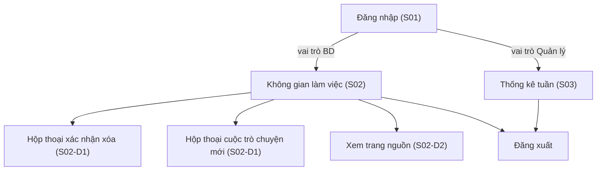
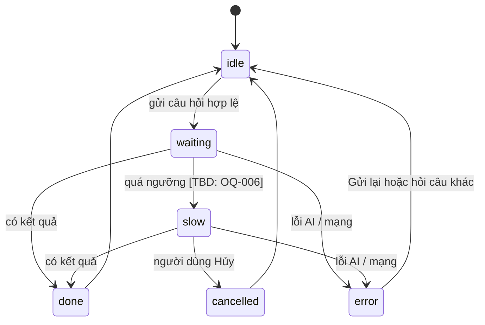

# UI/UX Design — "Chat với tài liệu" (MVP)

> **Prompt:** [UI-UX-Design_prompt.md](../../../References/design/UI-UX-Design_prompt.md) · **Checklist:** [UI_UX_Design_IEEE-1016-2009_Checklist.xlsx](../../../References/design/UI_UX_Design_IEEE-1016-2009_Checklist.xlsx) → kết quả ở [UI_UX_Checklist_Review.xlsx](UI_UX_Checklist_Review.xlsx)
> **Đầu vào:** [SDD_Blueprint.md](../blueprint/SDD_Blueprint.md) (blueprint) · [SAD.md](../../03-architecture/SAD.md) · [PRD.md](../../01-requirements/PRD.md) §4 · [UseCase_Specification.md](../../02-analysis/UseCase_Specification.md)
> **Đầu ra:** bản mẫu HTML chạy được (mở bằng trình duyệt, không cần máy chủ) + tài liệu này. **Không có Figma frames**, xem §0.
> **Quy ước:** `[TBD: OQ-xxx]` = chờ quyết định theo BRD §12 · `[Proposed]` = lựa chọn của thiết kế này, chưa được xác nhận.

| Mục | Giá trị |
|---|---|
| Mã / Version / Trạng thái | UIX-CWD-001 / 0.1 / **Draft** |
| Ngày | 2026-10-21 |
| Tác giả | UX/UI Designer — [TBD: OQ-014] (soạn với sự hỗ trợ của AI) |

---

## 0. Phạm vi giao hàng và các điểm lệch so với prompt

| Mục | Tình trạng | Xử lý |
|---|---|---|
| **Figma frames** | Prompt yêu cầu Figma, nhưng không có Figma file ID và phiên làm việc không có công cụ Figma MCP | Giao **HTML prototype** (prompt cho phép "Figma Frames *and/or* HTML Pages"). Khi có file Figma, dùng khối `:root` trong thẻ `<style>` (cũng là mục 8) làm nguồn token để dựng lại |
| **Thư mục lưu** | Prompt chỉ định `./docs/04-design/UI_UX_design` | Theo đúng prompt. Cấu trúc `docs/` đã được sắp xếp lại theo giai đoạn (xem `docs/README.md`), nên đường dẫn này khớp với cấu trúc chung |
| **Cấu trúc blueprint** | Prompt trích từ blueprint các mục "2.1 User Personas", "3.5 UI State Model", "3.6 UI Component Interface", "Design System Token Interface". SDD hiện tại **không có** các mục này (chỉ có §2.4 UX/UI scenarios, §2.5 constraints, §3.7 state, §3.6 REST) | Persona lấy từ PRD §2.1; UI state, component, token **được định nghĩa mới ở tài liệu này (§5, §7, §8)**. Đề xuất đưa lại vào SDD ở bản cập nhật sau |
| **Prompt bị cắt** | Prompt kết thúc ở "3.1 Figma File Structure", không có phần đặc tả đầu ra chi tiết | Cấu trúc đầu ra dưới đây là của mình, theo mục "Extract" §2.2–2.7 của prompt và checklist UI/UX |
| **Mobile** | PRD P-4 và SDD §2.4: desktop-first, mobile web không là yêu cầu `[TBD: PQ-06]` | Bản mẫu *suy giảm có kiểm soát* dưới 1024 px (cột đơn, không cuộn ngang) nhưng không thiết kế riêng cho mobile |

### Bản mẫu HTML — cách xem

Mở trực tiếp các file trong thư mục này bằng trình duyệt (không cần server). Toàn bộ dữ liệu và hành vi là **giả lập**, không có backend.

| File | Nội dung | UC / US |
|---|---|---|
| [01_login.html](01_login.html) | Đăng nhập; dùng `bd` (Nhân viên BD) hoặc `quanly` (Quản lý) + mật khẩu bất kỳ | UC-01 / US-301 |
| [02_workspace.html](02_workspace.html) | Không gian làm việc: kho tài liệu + chat. `?state=empty` để xem kho rỗng | UC-02…13 |
| [03_stats.html](03_stats.html) | Thống kê tuần (Quản lý). BD vào sẽ thấy trạng thái 403 | UC-14 |

> **Mở thẳng không cần đăng nhập** (để import Figma hoặc chụp ảnh): `02_workspace.html?demo=bd`, `02_workspace.html?demo=bd&state=empty`, `03_stats.html?demo=manager`, `03_stats.html?demo=bd` (xem trạng thái 403). Nếu không có `?demo=`, 02 và 03 chuyển về `01_login.html` khi chưa đăng nhập.

| [04_components.html](04_components.html) | Thư viện thành phần, token, mọi trạng thái | Handoff |
| *(không có file ngoài)* | Mỗi file HTML **tự chứa**: CSS (token + kiểu) và JS (hành vi mẫu, sự kiện analytics `track()`) nằm trong thẻ `<style>` và `<script>`, để import vào Figma bằng plugin HTML-to-Figma | — |

**Ảnh chụp tham chiếu** (Chrome headless, 1280 px) trong [screenshots/](screenshots/): `01_login.png`, `02_workspace_start.png`, `02_workspace_answer.png`, `03_stats.png`, `04_components.png`.

**Kịch bản thử trong `02_workspace.html`:**

| Hành động | Kết quả hiển thị |
|---|---|
| Hỏi "Điều khoản thanh toán là gì?" | Trả lời + trích dẫn `hop_dong_A.pdf, tr.7`; bấm trích dẫn mở trang nguồn |
| Hỏi "Doanh thu quý 3 là bao nhiêu?" | Trả lời tổng hợp, 2 trích dẫn từ 2 tài liệu |
| Hỏi câu bất kỳ khác (ví dụ "Thủ đô của Pháp?") | "Không tìm thấy" (kiểu hiển thị riêng) |
| Hỏi có chữ "lỗi ai" | Lỗi hệ thống, nút "Gửi lại" (khác "không tìm thấy") |
| Hỏi có chữ "chậm" | Sau 3 giây hiện "Đang mất nhiều thời gian hơn bình thường" và nút Hủy |
| Tải lên `.txt` | Bị từ chối: "chỉ hỗ trợ PDF" |
| Tải lên PDF có chữ `scan`, `matkhau`, `loi`, `thatbai` trong tên | Trạng thái "Không dùng được" với lý do tương ứng (`thatbai` có nút Thử lại) |
| Tải lên quá 12 tài liệu hoặc file > 50 MB | Từ chối: kho đầy / quá lớn (giá trị demo `[TBD: OQ-004]`) |
| Xóa tài liệu | Hộp thoại xác nhận; trích dẫn cũ của tài liệu đó chuyển thành "đã xóa" |

---

## 1. Personas (từ PRD §2.1)

| Persona | Vai trò | Mục tiêu | Pain points | Thành thạo kỹ thuật | Tần suất | Tác vụ chính |
|---|---|---|---|---|---|---|
| **Nhân viên BD** (STK-001) | Người dùng chính | Có câu trả lời nhanh, đầy đủ, biết lấy từ đâu (SN-001…004) | Mở từng file, tìm thủ công, tự tổng hợp | Dùng thành thạo ứng dụng web, không có kỹ năng kỹ thuật `[Unverified]` | `[TBD: OQ-001]` | Upload, hỏi, kiểm chứng nguồn, đánh giá |
| **Quản lý / Sponsor** (STK-002) | Phụ | Bằng chứng định lượng để quyết định tiếp (SN-005) | Thiếu dữ liệu để ra quyết định `[Unverified]` | Thấp | Hàng tuần trong pilot | Xem thống kê tuần |
| **BD lead / SME** | Phụ, nghiệm thu | Chấm độ chính xác bằng bộ câu hỏi chuẩn | Không có bộ đánh giá chuẩn (OQ-003) | Trung bình | Theo đợt | Kiểm tra trích dẫn (dùng cùng giao diện của Nhân viên BD) |

---

## 2. Yêu cầu UX/UI (từ SDD §2.4–2.5 và PRD §4)

| Hạng mục | Yêu cầu | Tiêu chí | Ưu tiên | Đáp ứng ở |
|---|---|---|---|---|
| **Usability** | Người dùng lần đầu tự upload và hỏi không cần hướng dẫn | 15/15 file sẵn sàng khi 3 BD tự làm (AC-001) | High | §4 Flow F1; §6 màn hình S02 |
| **Accessibility** | Thao tác bàn phím; không chỉ dựa màu; tương phản | WCAG 2.1 AA `[Proposed]` | High | §9 |
| **Performance** | Chỉ báo tiến trình hiển thị nhanh | ≤ 300 ms sau thao tác `[Proposed]`; LCP `[TBD]` | High | §5 trạng thái chờ |
| **Responsiveness** | Desktop-first | Không cuộn ngang ≥ 1024 px; suy giảm dưới đó | Med | §10 |
| **Visual consistency** | Ba trạng thái tài liệu, ba loại kết quả luôn cùng kiểu | 100% dùng token và component trong §7–8 | High | §7, §8 |
| **Error recovery** | Lỗi gắn với tác vụ, có hành động khắc phục, không mất câu hỏi | AC-301.3; PRD §4.2 | High | §6, §11 |
| **Feedback & affordance** | Trạng thái hover/active/focus/disabled; chỉ báo xử lý | Mọi điều khiển có đủ trạng thái | High | §7, 04_components.html |
| **Information architecture** | Danh sách tài liệu luôn cạnh khung chat; mọi chức năng P0 trong 1 màn hình | ≤ 2 thao tác từ màn hình chính | High | §3 |
| **Internationalization** | Chuỗi UI tách khỏi logic; ngôn ngữ theo OQ-007 | Thêm ngôn ngữ không sửa logic | Med | §11 (copy deck) |
| **Mobile** | Không thuộc phạm vi MVP | — | N/A | §10 |

---

## 3. Information Architecture và điều hướng



| Quy tắc | Nội dung |
|---|---|
| **Cấu trúc** | 4 màn hình chính + 2 loại hộp thoại; không có menu lồng. Thanh trên cùng chỉ có tên sản phẩm, liên kết theo vai trò, người dùng, Đăng xuất |
| **Số bước tới chức năng** | Upload: 1 (nút trên màn hình chính). Hỏi: 1. Xem nguồn: 1 (bấm trích dẫn). Xóa: 2 (nút + xác nhận). Xem thống kê (Quản lý): 0 (trang đích sau đăng nhập). Đạt yêu cầu "trong 2 thao tác" |
| **Vai trò** | BD thấy S02; Quản lý thấy S03. BD mở S03 → trạng thái 403. Quản lý mở S02 → chuyển về S03 (ASM-UC-01 `[Unverified]`) |
| **Luôn hiển thị** | Kho tài liệu cạnh khung chat (PRD P-5); dòng mô tả phạm vi trên khung chat (PRD §4.1 #9) |

---

## 4. User flows

| Flow | Bước | Điểm quyết định | Đường lỗi | Tiêu chí thành công |
|---|---|---|---|---|
| **F1 — Upload** (UC-02…04) | Chọn/kéo-thả PDF → thấy file "Đang xử lý" → tự chuyển "Sẵn sàng truy vấn" | File hợp lệ? | Không phải PDF / quá lớn / kho đầy → từ chối ngay, nêu lý do và giới hạn. Scan / mật khẩu / hỏng / xử lý thất bại → "Không dùng được" + lý do + Xóa (hoặc Thử lại) | AC-101.1…4, AC-103.1 |
| **F2 — Hỏi đáp** (UC-07…10) | Nhập → Enter → chỉ báo "Đang tìm trong N tài liệu…" → kết quả | Kho đủ căn cứ? | "Không tìm thấy" (kiểu riêng); lỗi hệ thống (kiểu riêng + Gửi lại); chậm → thông báo + Hủy | AC-201.1, 203.1, 204.1 |
| **F3 — Kiểm chứng nguồn** (UC-12) | Bấm trích dẫn → xem đúng trang → đóng, focus về trích dẫn | Tài liệu còn trong kho? | Đã xóa → chip "đã xóa", vô hiệu | US-205 |
| **F4 — Đánh giá** (UC-13) | Bấm Hữu ích / Không hữu ích (có thể đổi) | — | Ghi thất bại → thông báo, thử lại | AC-016 |
| **F5 — Hỏi tiếp nối** (UC-11) | Hỏi tiếp trong cùng phiên | Có thể "Cuộc trò chuyện mới" (xác nhận) | — | AC-011 |
| **F6 — Xóa tài liệu** (UC-06) | Bấm thùng rác → xác nhận nêu tên + hệ quả → xóa | Xác nhận? | Hủy → không đổi gì | AC-005 |
| **F7 — Thống kê** (UC-14) | Đăng nhập (Quản lý) → trang thống kê | Có dữ liệu? | Trống → empty state; BD → 403 | AC-017 |

---

## 5. Mô hình trạng thái UI

| UI state | Loại | Mô tả | Lưu trữ | Phạm vi |
|---|---|---|---|---|
| `session` | Global | Vai trò, tên hiển thị | Cookie phiên phía server; bản mẫu dùng `sessionStorage` | App |
| `documents[]` | Global (server state) | Danh sách + trạng thái `PROCESSING/READY/UNUSABLE`, lý do | Lấy từ `GET /documents`, polling `[Initial: 2 giây]` khi có `PROCESSING` | Route S02 |
| `conversation[]` | Page | Các lượt hỏi–đáp trong phiên; mỗi bot message có `kind ∈ {ANSWER, NOT_FOUND, ERROR}` | Bộ nhớ trang; **không** lưu nhiều phiên (BRD §5.3) | Route S02 |
| `composer` | Component | Nội dung câu hỏi, độ dài, đang chờ | Bộ nhớ component; giữ lại nếu hết phiên (AC-301.3) | Component |
| `pendingQuestion` | Component | `idle → waiting → slow → done/cancelled/error` | Bộ nhớ | Component |
| `uploadErrors[]` | Component | Danh sách file bị từ chối kèm lý do | Bộ nhớ, xóa ở lần upload sau | Component |
| `dialog` | Component | Xác nhận / xem nguồn đang mở; nút đã mở để trả focus | Bộ nhớ | Route |
| `feedback[messageId]` | Component | `none/helpful/not_helpful` | Server (`PUT /messages/{id}/feedback`) | Message |

**Máy trạng thái chờ câu trả lời**



Trạng thái tài liệu và tin nhắn phía server: xem [SDD §3.7](../blueprint/SDD_Blueprint.md). UI chỉ hiển thị, không tự suy ra trạng thái.

---

## 6. Màn hình

### S01 — Đăng nhập (`01_login.html`) · UC-01
Thẻ giữa trang: tên đăng nhập, mật khẩu, nút "Đăng nhập". Sai thông tin → thông báo `role="alert"` trên đầu form, hai ô đánh dấu `aria-invalid`, focus về ô tên đăng nhập. Nếu OQ-008 dùng IdP: thay form bằng nút "Đăng nhập bằng tài khoản tổ chức".

### S02 — Không gian làm việc (`02_workspace.html`) · UC-02…13

```
+---------------------------------------------------------------------------+
| ◻ Chat với tài liệu              Tài liệu & hỏi đáp   Minh An · BD [Đăng xuất]|
+--------------------------+------------------------------------------------+
| Kho tài liệu   3 · 2 sẵn  | Hỏi đáp                    [+ Cuộc trò chuyện mới]|
| ┌ - - - - - - - - - - ┐   | ⓘ Chỉ trả lời dựa trên tài liệu đã tải lên ...   |
| | Kéo thả PDF  [Tải lên]|  |                                                  |
| └ - - - - - - - - - - ┘   |   Bạn:  Điều khoản thanh toán là gì?   (phải)   |
| ┌ bao_cao_Q3.pdf   [🗑] ┐  |   Trợ lý: Thanh toán trong 30 ngày ...           |
| | ✓ Sẵn sàng · 24 trang|  |     Nguồn: [📖 hop_dong_A.pdf, tr.7]             |
| └──────────────────────┘  |     Hữu ích không? [👍 Hữu ích] [👎 Không hữu ích]|
| ┌ scan_01.pdf       [🗑] ┐  |                                                  |
| | ⚠ Không dùng được     |  +--------------------------------------------------+
| | Lý do: PDF dạng scan  |  | [ Nhập câu hỏi ...                    ] [ Gửi ] |
| └──────────────────────┘  | Enter để gửi · Shift+Enter xuống dòng     12/1000|
+--------------------------+------------------------------------------------+
```

| Vùng | Hành vi chính | Trạng thái đặc biệt |
|---|---|---|
| **Kho tài liệu** (cột trái, 360 px) | Upload (nút + kéo-thả, nhiều file); danh sách có badge trạng thái, số trang, dung lượng; nút xóa có nhãn đọc màn hình nêu tên file | Rỗng: hướng dẫn tải lên. Có lỗi upload: vùng `role="alert"` liệt kê từng file + lý do |
| **Khung chat** | Thread có `role="log"`; tin nhắn người dùng bên phải, trợ lý bên trái; trích dẫn là nút; đánh giá 1 chạm có thể đổi | Phiên mới: 3 câu hỏi gợi ý (chỉ khi có tài liệu sẵn sàng). "Không tìm thấy", "Lỗi" khác kiểu |
| **Composer** | Enter gửi, Shift+Enter xuống dòng; bộ đếm ký tự; Gửi bị vô hiệu khi rỗng/quá dài/đang chờ/không có tài liệu sẵn sàng | Kho rỗng hoặc chưa có tài liệu sẵn sàng: ô nhập bị vô hiệu kèm dòng giải thích bước tiếp theo |

### S02-D1 — Hộp thoại xác nhận · UC-06, UC-11
Dùng `<dialog>`: tiêu đề nêu *tên tài liệu*, nội dung nêu *hệ quả*, nút phá hủy dùng màu lỗi. Focus mặc định vào **Hủy** (hành động an toàn). Esc hủy. Đóng → trả focus về nút đã mở.

### S02-D2 — Xem trang nguồn · UC-12
`<dialog>` hiển thị tên tài liệu + số trang, đoạn được dùng được tô sáng. Trong sản phẩm thật thay phần minh họa bằng trình xem PDF mở đúng trang (`GET /documents/{id}/file`). Nếu không mở được trang: vẫn hiện tên tài liệu và số trang.

### S03 — Thống kê (`03_stats.html`) · UC-14
Bốn KPI (người dùng hoạt động MET-003, số câu hỏi, % hữu ích MET-004, % "không tìm thấy") và bảng theo tuần. **Mọi biểu đồ có bảng số tương đương** (thanh tiến độ có `aria-label`); số liệu trong bản mẫu là minh họa và có thông báo "Dữ liệu minh họa". Target `[TBD: OQ-002]`. Trạng thái: không có dữ liệu → empty state; BD → 403.

---

## 7. Component

| Component | Mục đích | Props / đầu vào | Sự kiện | Trạng thái | Dùng ở |
|---|---|---|---|---|---|
| `Button` | Hành động | `variant` (primary/secondary/danger/ghost), `size`, `icon`, `disabled` | `click` | default, hover, active, focus, disabled | Mọi màn |
| `StatusBadge` | Trạng thái tài liệu | `status` (PROCESSING/READY/UNUSABLE) | — | 3 trạng thái; luôn icon + chữ | S02 |
| `DocumentItem` | Một tài liệu | `name`, `pages`, `sizeMb`, `status`, `reason?`, `retryable?` | `delete`, `retry` | ready, processing, unusable, unusable+retry | S02 |
| `UploadDropzone` | Nhận file | `accept`, `maxMb`, `maxDocs` | `files` | idle, dragover, disabled (kho đầy) | S02 |
| `UploadErrors` | Liệt kê file bị từ chối | `items[{name, reason}]` | — | hidden, visible (`role="alert"`) | S02 |
| `ChatThread` | Danh sách tin nhắn | `messages[]` | — | empty (có gợi ý), có tin | S02 |
| `AnswerMessage` | Trả lời có nguồn | `text`, `citations[]`, `messageId` | `openCitation`, `rate` | có trích dẫn, trích dẫn đã xóa | S02 |
| `NotFoundMessage` | Kết quả "không tìm thấy" | `suggestions?` | — | mặc định | S02 |
| `ErrorMessage` | Lỗi hệ thống | `errorType` | `retry` | mặc định | S02 |
| `PendingIndicator` | Đang xử lý câu hỏi | `docCount`, `slow` | `cancel` | waiting, slow | S02 |
| `CitationChip` | Trích dẫn | `docName`, `page`, `gone` | `click` | default, hover, focus, gone | S02 |
| `FeedbackButtons` | Đánh giá | `value` | `change` | none, helpful, not_helpful (`aria-pressed`) | S02 |
| `Composer` | Nhập câu hỏi | `value`, `max`, `disabledReason?` | `submit`, `input` | enabled, disabled (kèm lý do), quá dài (lỗi) | S02 |
| `ConfirmDialog` | Xác nhận | `title`, `body`, `confirmLabel`, `danger` | `confirm`, `cancel` | open/closed | S02 |
| `SourceDialog` | Xem trang nguồn | `docName`, `page`, `snippet` | `close` | open/closed | S02 |
| `Notice` | Thông báo | `type` (info/success/warning/error) | — | 4 loại | Mọi màn |
| `Toast` | Phản hồi ngắn | `message` | — | hiện 5 giây, `aria-live` | S02 |
| `EmptyState` | Hướng dẫn khi trống | `icon`, `title`, `body`, `action?` | `action` | các biến thể E-1…E-4 | S02, S03 |
| `KpiCard`, `WeeklyTable` | Thống kê | `label`, `value`, `rows[]` | — | có dữ liệu, trống | S03 |

Tất cả trạng thái được trình bày trong [04_components.html](04_components.html) phục vụ bàn giao.

---

## 8. Design tokens

Nguồn: khối `:root` ở đầu thẻ `<style>` của mỗi file HTML (biến CSS, giống hệt nhau ở cả 4 file). Tỷ lệ tương phản đã tính theo công thức WCAG, đối chiếu nền cặp đôi.

| Nhóm | Token | Giá trị | Dùng cho |
|---|---|---|---|
| **Color** | `--c-text` | #1B2330 (15.6:1 trên trắng) | Chữ nội dung |
| | `--c-text-muted` | #4A5568 (7.6:1) | Chữ phụ, gợi ý |
| | `--c-primary` | #1F5FBF (trắng trên nó 6.1:1) | Nút chính, liên kết, trích dẫn |
| | `--c-border-strong` | #6B7787 (4.5:1 trên trắng) | Viền ô nhập và điều khiển (≥ 3:1 cho thành phần UI) |
| | `--c-success / -bg` | #1E7A3C / #E6F4EA | "Sẵn sàng truy vấn" |
| | `--c-info / -bg` | #36507A / #EEF2F9 | "Đang xử lý", "Không tìm thấy" |
| | `--c-warning / -bg` | #8A5300 / #FFF4E0 | Cảnh báo |
| | `--c-error / -bg` | #B3261E / #FDECEA | Lỗi, "Không dùng được", hành động xóa |
| **Typography** | Font | `system-ui` stack (không tải font ngoài) | Tất cả |
| | Cỡ | 14 / 16 / 18 / 22 / 28 px; chữ nội dung ≥ 16 px; 14 px chỉ cho metadata | — |
| | Độ đậm | 400, 600 | — |
| | Line-height | 1.55 nội dung, 1.3 tiêu đề | — |
| **Spacing** | Lưới 4pt | 4, 8, 12, 16, 20, 24, 32, 40, 48 | Padding, gap |
| **Border radius** | `--r-sm / -md / -pill` | 6 / 10 / 999 px | Nút, thẻ, badge |
| **Shadow** | `--shadow-1 / -2` | nhẹ / hộp thoại | Thẻ, dialog |
| **Animation** | `--t-fast / -base` | 120 / 200 ms; **0 ms khi `prefers-reduced-motion`** | Hover, spinner |
| **Layout** | `--sidebar-w`, `--content-max` | 360 px, 880 px | S02 |

Chưa có design system của đơn vị; toàn bộ token là `[Proposed]` và thay được bằng cách đổi khối `:root` (sửa đồng bộ cả 4 file). Chưa có chế độ tối.

---

## 9. Accessibility (WCAG 2.1 AA `[Proposed]`)

| Yêu cầu | Hiện thực trong bản mẫu |
|---|---|
| **Bàn phím** | Mọi điều khiển là phần tử gốc (`button`, `input`, `textarea`, `dialog`); thứ tự Tab theo thứ tự trực quan; "Skip link" tới ô nhập; Enter gửi, Shift+Enter xuống dòng; Esc đóng hộp thoại |
| **Focus** | Viền 3 px màu primary, offset 2 px, hiển thị trên mọi điều khiển (`:focus-visible`); hộp thoại đưa focus vào nút an toàn và trả về nút đã mở |
| **Không chỉ dựa màu** | Trạng thái có icon + chữ; lỗi có icon + thông báo; "đã chọn" dùng `aria-pressed` chứ không chỉ đổi màu |
| **Tương phản** | Xem §8; cặp chữ/nền ≥ 4.5:1, viền điều khiển ≥ 3:1 |
| **Đọc màn hình** | Landmarks (`header`, `nav`, `main`, `aside`, `section`); `role="log"` cho thread; `role="status"`/`aria-live` thông báo "Đã có câu trả lời", "tài liệu đã sẵn sàng", "đã ghi nhận đánh giá"; `role="alert"` cho lỗi; nút chỉ có icon có `aria-label` nêu tên tài liệu |
| **Biểu mẫu** | Mỗi ô có `<label>`; lỗi nêu bằng text và `aria-invalid` |
| **Chuyển động** | Tôn trọng `prefers-reduced-motion` |
| **Mục tiêu chạm** | Desktop-first: điều khiển ≥ 32–40 px. 44×44 px chưa áp dụng vì không có yêu cầu mobile `[TBD: PQ-06]` |
| **Chưa kiểm** | Chưa chạy bộ kiểm tự động (axe/Lighthouse) và chưa thử bằng trình đọc màn hình thật; mức WCAG chưa được chốt `[TBD]` |

---

## 10. Responsive

| Dải | Bố cục | Trạng thái |
|---|---|---|
| ≥ 1024 px | Hai cột (kho 360 px + chat), chiều cao khung nhìn | Thiết kế chính |
| < 1024 px | Một cột: kho (cao tối đa ½ màn hình) rồi chat; header xuống dòng; không cuộn ngang | Suy giảm có kiểm soát, **không phải yêu cầu**; chưa kiểm thử thiết bị thật |
| Mobile riêng | Không thiết kế | Ngoài phạm vi (CON-002, PRD P-4) |

---

## 11. Nội dung, thông báo và trạng thái đặc biệt

Copy deck (tiếng Việt; mọi chuỗi đặt trong thẻ `<script>` / HTML để dễ tách i18n khi OQ-007 chốt).

| Tình huống (PRD §4.2) | Thông điệp / hành vi |
|---|---|
| E-1 kho rỗng | "Chưa có tài liệu nào. Tải lên file PDF để bắt đầu hỏi đáp." Ô nhập vô hiệu + giải thích |
| E-2 chưa có tài liệu sẵn sàng | "Tài liệu đang được xử lý. Bạn có thể hỏi khi có tài liệu sẵn sàng." (đề xuất: không cho hỏi, PQ-04) |
| E-3 phiên mới | Tiêu đề + 3 câu hỏi gợi ý |
| E-4 / UC-10 không tìm thấy | "Không tìm thấy thông tin này trong các tài liệu hiện có." + gợi ý diễn đạt lại / xem danh sách |
| I-1 không phải PDF | "`<tên>`: chỉ hỗ trợ file PDF." |
| I-3 quá lớn / kho đầy | "`<tên>`: file X MB vượt giới hạn Y MB." / "kho đã đầy (N tài liệu). Hãy xóa tài liệu cũ rồi thử lại." |
| I-2 không dùng được | "Lý do: PDF dạng ảnh scan / có mật khẩu / bị hỏng / xử lý thất bại" + Xóa (và Thử lại nếu thất bại tạm thời) |
| I-5, I-6 câu hỏi rỗng / quá dài | Nút Gửi vô hiệu; bộ đếm chuyển màu lỗi khi vượt `[TBD]` ký tự |
| N-2 mất mạng khi chờ trả lời | Lỗi gắn với câu hỏi + "Gửi lại"; giữ câu hỏi (bản mẫu chỉ mô phỏng lỗi AI) |
| N-3 AI chậm / lỗi | "Đang mất nhiều thời gian hơn bình thường…" + Hủy; lỗi: "Hệ thống gặp lỗi khi trả lời. Đây không phải kết quả "không tìm thấy."" |
| N-5 hết phiên | Về đăng nhập, giữ nội dung đang nhập (chưa mô phỏng trong bản mẫu) |
| C-2 trích dẫn không xác định trang | Hiển thị "không xác định trang", không bịa số `[TBD: PQ-05]` |
| BRU-002 | Dòng cố định trên khung chat và dưới mỗi câu trả lời: đối chiếu nguồn trước khi dùng ngoài tổ chức `[TBD: OQ-011]` |

---

## 12. Analytics (PRD §5.2) trong bản mẫu

Hàm `track(name, props)` phát sự kiện ra `console.debug` và `window.__events` với đúng tên và thuộc tính của PRD: `session_started`, `auth_failed`, `document_upload_started/failed`, `document_ready`, `document_unusable`, `document_deleted`, `question_submitted`, `answer_returned`, `answer_failed`, `citation_opened`, `answer_feedback_submitted`, `chat_reset`, `empty_state_shown`. Không có nội dung câu hỏi hay tài liệu trong thuộc tính (G-10).

---

## 13. Handoff cho Engineering

| Hạng mục | Nội dung |
|---|---|
| **Token** | Khối `:root` là nguồn token (đang lặp ở 4 file; khi lên sản phẩm gom về một nơi); không dùng giá trị màu/khoảng cách cứng trong component |
| **Component và trạng thái** | `04_components.html` liệt kê đủ default/hover/active/focus/disabled/error. Bản mẫu là tham chiếu hành vi, **không phải mã sản xuất** (không có framework, kiểm thử, i18n) |
| **Hợp đồng dữ liệu** | Theo [SDD §3.6](../blueprint/SDD_Blueprint.md): `kind ∈ {ANSWER, NOT_FOUND, ERROR}`, `citations[{documentName, page}]`, mã lỗi chuẩn |
| **Icon** | 16 icon SVG inline (stroke 2 px, bo tròn) trong thẻ `<script>`; xuất được SVG |
| **Chưa có** | File Figma / Dev Mode; ảnh xuất WebP/PNG riêng; redline từng màn hình. Nên bổ sung khi có Figma |

---

## 14. Traceability

| Yêu cầu | Story / UC | Nơi đáp ứng trong thiết kế |
|---|---|---|
| BR-001, BR-002 | US-101, 102 / UC-02 | Dropzone, UploadErrors, §4 F1 |
| BR-003 | US-103 / UC-03, 04 | DocumentItem + StatusBadge, lý do hiển thị |
| BR-004 | US-104 / UC-05 | Danh sách luôn cạnh chat, số lượng tổng/sẵn sàng |
| BR-005 | US-105 / UC-06 | ConfirmDialog, trích dẫn "đã xóa" |
| BR-006…010 | US-201…206 / UC-07…10 | ChatThread, AnswerMessage, NotFoundMessage |
| BR-008 | US-203 / UC-09 | CitationChip luôn hiển thị, nút có nhãn |
| BR-009 | US-204 / UC-10 | NotFoundMessage khác ErrorMessage |
| BR-011 | US-207 / UC-11 | Cuộc trò chuyện mới + ngữ cảnh trong phiên |
| BR-012 | US-208 / UC-07 | PendingIndicator, trạng thái slow |
| BR-013 | US-209 | Copy deck tách khỏi logic |
| BR-014 | US-301 / UC-01 | S01, guard theo vai trò, 403 |
| BR-016 | US-401 / UC-13 | FeedbackButtons |
| BR-017 | US-402 / UC-14 | S03 |
| — | US-205 / UC-12 | SourceDialog (chờ PQ-01) |

---

## 15. Open issues

| ID | Vấn đề | Ảnh hưởng |
|---|---|---|
| PQ-06 | Mobile web có cần không? | §10, touch target |
| PQ-07 | *(Đã giải quyết 2026-10-21)* Thống nhất thư mục: `docs/` theo giai đoạn 01–04 | — |
| OQ-007 | Ngôn ngữ giao diện và trả lời | Copy deck, font |
| OQ-008 | Có đăng nhập không / qua IdP nào | S01 |
| OQ-004 | Giới hạn tài liệu, kích thước (đang là giá trị demo 12 tài liệu, 50 MB) | Thông báo upload |
| OQ-006 | Ngưỡng "lâu hơn bình thường" (demo 3 giây) | PendingIndicator |
| OQ-002 | Target các chỉ số | S03 |
| — | Mức WCAG chính thức, kiểm thử tự động, kiểm thử với người dùng | §9 |
| — | Cung cấp Figma file ID để dựng frames | §0 |
