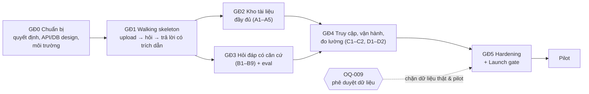

# Implementation Plan — "Chat với tài liệu" (MVP)

> **Đầu vào:** [BRD](../01-requirements/BRD.md) · [PRD](../01-requirements/PRD.md) · [User Stories (PO)](../01-requirements/User_Stories.md) · [Use case](../02-analysis/UseCase_Specification.md) · [SAD](../03-architecture/SAD.md) · [SDD Blueprint](../04-design/blueprint/SDD_Blueprint.md) · [UI/UX](../04-design/UI_UX_design/UI_UX_Design.md)
> **Dành cho:** Tech lead, đội phát triển, QA, PM/PO.
> **Quy ước:** `[TBD: OQ-xxx]` = chờ quyết định theo BRD §12 · `[Proposed]` = đề xuất của kế hoạch này, chưa được xác nhận. Kích thước công việc dùng **S/M/L** (tương đối), không phải ngày công, vì chưa biết quy mô đội.

| Mục | Giá trị |
|---|---|
| Mã / Version / Trạng thái | IMP-CWD-001 / 0.1 / **Draft** |
| Ngày | 2026-10-21 |
| Tác giả | Tech lead — [TBD: OQ-014] (soạn với sự hỗ trợ của AI) |

---

## 0. Tóm tắt

- **Cách làm:** 6 giai đoạn, mỗi giai đoạn một sprint `[Proposed: 2 tuần]`. Bắt đầu bằng **một lát cắt dọc chạy được đầu-cuối** (upload → hỏi → trả lời có trích dẫn) để giảm rủi ro sớm, rồi hoàn thiện theo nhóm câu chuyện.
- **Không có ngày cụ thể:** timeline và quy mô đội chưa có (OQ-012, OQ-014). Khi có, gắn ngày vào các mốc M0…M5 ở §4.
- **Điểm chặn lớn nhất:** **OQ-009** (được gửi dữ liệu cho dịch vụ AI nào). Kế hoạch tránh bị chặn bằng cách xây sau *port* (SAD §1.2) với adapter giả lập, nhưng **không được đưa dữ liệu thật vào hệ thống và không pilot** cho tới khi có phê duyệt bằng văn bản (BR-015).
- **Điều kiện thành công của MVP** không chỉ là "chạy được": phải đạt ngưỡng chất lượng đo bằng **bộ câu hỏi chuẩn** (MET-002, MET-005). Bộ này do đội BD soạn (DEP-002) và phải có từ giai đoạn 1.

---

## 1. Điều kiện tiên quyết và quyết định cần chốt

### 1.1 Quyết định nghiệp vụ (từ BRD/PRD) và hạn chót theo kế hoạch

| # | Quyết định | Owner | Cần trước | Nếu trễ |
|---|---|---|---|---|
| OQ-009 | Chính sách dữ liệu, nhà cung cấp AI, nơi triển khai | IT/Bảo mật | **Cuối Giai đoạn 1** (chọn adapter thật); **bắt buộc trước Giai đoạn 5** | Tiếp tục với adapter giả lập; không có dữ liệu thật; pilot trễ tương ứng |
| OQ-008 | Có đăng nhập không, qua IdP nào | Sponsor | Đầu Giai đoạn 4 | Làm tài khoản local (adapter mặc định), thêm OIDC sau |
| OQ-004 | Số tài liệu, trang, MB tối đa | BD lead | Đầu Giai đoạn 2 | Dùng giá trị tạm của bản mẫu (12 tài liệu, 50 MB) và ghi là tạm |
| OQ-007 | Ngôn ngữ tài liệu và câu hỏi | BD lead | Đầu Giai đoạn 1 (chọn mô hình embedding) | Chọn mô hình đa ngôn ngữ (an toàn hơn, có thể chậm hơn) |
| OQ-006 | Thời gian chờ chấp nhận được | Sponsor/BD lead | Đầu Giai đoạn 3 | Không có ngưỡng nghiệm thu BR-012 |
| OQ-002, OQ-001 | Target và baseline các chỉ số | Sponsor/BD lead | Đầu Giai đoạn 3 | Không nghiệm thu được chất lượng; không quyết định go/no-go |
| OQ-003 / DEP-002 | Bộ tài liệu mẫu + bộ câu hỏi chuẩn | BD lead | **Bản đầu: Giai đoạn 1**, đầy đủ: Giai đoạn 3 | Không đo được chất lượng; nghiệm thu bị chặn |
| OQ-010 | Kho dùng chung hay riêng | Sponsor | Đầu Giai đoạn 2 | Làm kho dùng chung (SDD D-09), mô hình dữ liệu đã chừa chỗ |
| OQ-011 | Chấp thuận nguyên tắc "AI chỉ là tham khảo" | Sponsor | Trước Giai đoạn 5 | Thiếu nội dung hướng dẫn người dùng (G-15) |
| OQ-012, 013, 014 | Timeline, ngân sách AI, nhân sự/approver | Sponsor | Trước Giai đoạn 0 | Không lập được lịch và hạn mức chi phí |
| PQ-01…06 | Quyết định mức PRD (xem trang nguồn, mâu thuẫn tài liệu, trùng file…) | PO | Trước giai đoạn có story liên quan | Làm theo phương án đề xuất trong PRD |

### 1.2 Thiết kế kỹ thuật còn thiếu (làm ở Giai đoạn 0)

| Hạng mục | Lý do | Prompt sẵn có |
|---|---|---|
| **Chọn ngôn ngữ/framework backend và frontend** | SAD chưa chỉ định; cần cho mọi việc khác | — (quyết định của đội, ghi thành ADR) |
| **API design (OpenAPI)** | SDD §3.6 mới ở mức hợp đồng | `References/design/apiDesign_prompt.md` |
| **Database design (schema vật lý, migration, chỉ mục)** | SDD §3.5 mới ở mức logic | `References/design/databaseDesign_SQL_prompt.md` (+ `_VectorDB_`) |
| Xác nhận các quyết định `[Proposed]` D-01…D-11, A-01…A-08 | Chưa được Engineering và IT/Bảo mật duyệt | — |

---

## 2. Chiến lược thực hiện

1. **Walking skeleton trước, tính năng sau.** Giai đoạn 1 dựng một luồng mỏng chạy đầu-cuối với mọi lớp (SPA → API → worker → DB → retrieval → LLM adapter). Mọi rủi ro tích hợp lộ ra sớm.
2. **Xây sau port, bắt đầu bằng adapter giả lập.** `LlmPort`, `EmbeddingPort`, `AuthPort`, `FileStorePort` (SDD §3.2) có adapter giả lập từ ngày đầu; adapter thật thay vào khi OQ-009/OQ-008 chốt, không sửa lõi.
3. **Đo chất lượng từ sớm, như một bài test hồi quy.** Bộ câu hỏi chuẩn chạy tự động mỗi lần đổi mô hình/tham số (SAD §4.3). Không chốt tham số `[Initial]` (SDD §3.8) khi chưa có số đo.
4. **Bảo mật và grounding không để cuối.** Ba cổng "không tìm thấy" và kiểm chứng trích dẫn (SDD D-06) làm ngay trong giai đoạn hỏi đáp, không phải "hardening".
5. **Dữ liệu thật chỉ sau phê duyệt.** Trước khi có văn bản của IT/Bảo mật, chỉ dùng tài liệu mẫu không nhạy cảm.

GĐ2 và GĐ3 có thể chạy song song nếu có đủ người (một nhánh kho tài liệu, một nhánh hỏi đáp).

---

## 3. Giai đoạn và công việc

Cột **Trace** trỏ về story (PRD/User Stories), use case và phần tử thiết kế (SDD DE-*). Kích thước S/M/L là tương đối.

> **Chi tiết từng task** (các bước, đặc tả, tiêu chí chấp nhận, kiểm thử, Definition of Done, phụ thuộc chính xác): [tasks/](tasks/README.md). Khi bảng dưới và file task khác nhau, **file task là chuẩn**.

### Giai đoạn 0 — Chuẩn bị · Mốc M0

**Mục tiêu:** đủ điều kiện để bắt đầu viết code.

| ID | Công việc | Trace | Kích thước | Phụ thuộc |
|---|---|---|---|---|
| T0.1 | Chốt ngôn ngữ/framework backend, frontend, thư viện đọc PDF; ghi ADR | SAD §2, D-01 | S | — |
| T0.2 | API design (OpenAPI) cho 14 endpoint, mô hình lỗi chuẩn | SDD §3.6, SAD §2.4–2.5 | M | T0.1 |
| T0.3 | Database design: schema vật lý, migration đầu tiên, chỉ mục HNSW + GIN | SDD §3.5, SAD §2.3 | M | T0.1 |
| T0.4 | Repo, cấu trúc module theo SDD §3.1, quy tắc phụ thuộc kiểm tra trong CI | SDD §3.3 | M | T0.1 |
| T0.5 | CI: build, lint, unit test, kiểm tra quy tắc phụ thuộc | SAD §5.1 | S | T0.4 |
| T0.6 | Môi trường `dev` chạy bằng container (DB + vector, file store, API, worker) | SAD §5.1 | M | T0.3 |
| T0.7 | Theo dõi quyết định: đưa OQ ở §1.1 vào lịch họp với owner | §1.1 | S | — |
| T0.8 | Đội BD bắt đầu soạn **bộ tài liệu mẫu (không nhạy cảm) + bộ câu hỏi chuẩn** 3 nhóm | DEP-002, OQ-003 | M (đội BD) | — |

**Tiêu chí kết thúc M0:** ADR công nghệ đã duyệt; OpenAPI và schema được review; `dev` chạy được bằng một lệnh; CI xanh; lịch chốt OQ có owner.

### Giai đoạn 1 — Walking skeleton · Mốc M1

**Mục tiêu:** một luồng đầu-cuối chạy được: tải 1 PDF → xử lý → hỏi → trả lời có trích dẫn tên tài liệu + trang.

| ID | Công việc | Trace | Kích thước | Phụ thuộc |
|---|---|---|---|---|
| T1.1 | Ports + adapter giả lập: `LlmPort` (trả lời theo bằng chứng, có chế độ lỗi), `EmbeddingPort`, `FileStorePort` | SDD §3.2, D-04 | M | T0.4 |
| T1.2 | `POST /documents` tối thiểu + lưu file + tạo `Document(PROCESSING)` + job | US-101 / UC-02 / DE-DOC | M | T0.2, T0.3 |
| T1.3 | Worker: lấy job (khóa không chặn), trích văn bản **theo trang**, chia đoạn không vượt ranh giới trang, embedding, ghi chunks, `READY` | US-101 / UC-03 / DE-ING, SDD A1 | L | T1.1 |
| T1.4 | Truy xuất vector đơn giản (chưa hybrid) chỉ trên tài liệu `READY` | US-201 / UC-08 / DE-IDX | M | T1.3 |
| T1.5 | `POST /conversations/{id}/messages`: truy xuất → `LlmPort.compose` → dựng trích dẫn từ mã bằng chứng | US-201, 203 / UC-07, 09 / DE-QA | M | T1.4 |
| T1.6 | Frontend khung S02: tải lên, danh sách (polling), gửi câu hỏi, hiển thị trả lời + nguồn | S02 / UI_UX §6 | M | T1.2, T1.5 |
| T1.7 | Adapter embedding thật (mô hình đa ngôn ngữ chạy nội bộ) | SAD A-06, OQ-007 | M | T1.1 |
| T1.8 | Khung đánh giá chất lượng: chạy bộ câu hỏi chuẩn (bản đầu) qua API, xuất báo cáo | DEP-002, SAD §4.3 | M | T1.5, T0.8 |
| T1.9 | Spike: thử adapter dịch vụ AI thật **với tài liệu mẫu không nhạy cảm**, nếu IT/Bảo mật cho phép thử | OQ-009 | S | T1.1 |

**Tiêu chí kết thúc M1:** demo đầu-cuối trên `dev`; báo cáo chất lượng đầu tiên (chưa cần đạt ngưỡng); quyết định OQ-009 đã có hoặc có lịch chốt rõ.

### Giai đoạn 2 — Kho tài liệu đầy đủ · Mốc M2

**Mục tiêu:** hoàn thành nhóm A (A1–A5).

| ID | Công việc | Trace | Kích thước | Phụ thuộc |
|---|---|---|---|---|
| T2.1 | Kiểm tra sớm trước xử lý: PDF theo nội dung (không chỉ đuôi), kích thước, số trang, kho đầy; lỗi chuẩn `NOT_A_PDF`, `FILE_TOO_LARGE`, `TOO_MANY_PAGES`, `LIBRARY_FULL` | US-102, 103 / UC-02 E1–E3 | M | T1.2, OQ-004 |
| T2.2 | Worker: phát hiện mật khẩu, file hỏng, PDF scan → `UNUSABLE(reason)`; timeout, retry có giới hạn, nhận lại job quá hạn | US-103 / UC-03, 04 / SDD §3.7 | M | T1.3 |
| T2.3 | `POST /documents/{id}/retry` cho lỗi xử lý | UC-04 A1 | S | T2.2 |
| T2.4 | `DELETE /documents/{id}`: xóa chunks + document trong **một giao dịch**, rồi xóa file | US-105 / UC-06 / AC-005 | M | T1.3 |
| T2.5 | Upload nhiều file, trạng thái từng file; phát hiện trùng nội dung (`content_hash`) theo quyết định PQ-03 | US-101 / UC-02 A1–A2 | S | T2.1 |
| T2.6 | Frontend: badge 3 trạng thái, lý do lỗi, vùng lỗi upload, kho rỗng, hộp thoại xóa, kho đầy | S02, S02-D1 / UI_UX §7 | M | T1.6 |
| T2.7 | Test: AC-001 (15/15), AC-003 (3 loại file lỗi), AC-004, AC-005 | PRD §3.1 | M | T2.1–T2.6 |

**Tiêu chí kết thúc M2:** mọi AC Given-When-Then của US-101…104 đạt; US-105 đạt tiêu chí kiểm chứng; không có tài liệu kẹt `PROCESSING` trong test lỗi worker.

### Giai đoạn 3 — Hỏi đáp có căn cứ · Mốc M3

**Mục tiêu:** hoàn thành nhóm B (B1–B9), đạt ngưỡng chất lượng trên bộ câu hỏi chuẩn.

| ID | Công việc | Trace | Kích thước | Phụ thuộc |
|---|---|---|---|---|
| T3.1 | Hybrid retrieval: vector + từ khóa, hợp nhất xếp hạng, đa dạng tài liệu trong top-K | US-206 / UC-08 / SDD A2 bước 3–4, D-03 | M | T1.4 |
| T3.2 | **Ba cổng "không tìm thấy"**: ngưỡng liên quan, `INSUFFICIENT_EVIDENCE`, kiểm chứng trích dẫn ⊆ bằng chứng (thử lại 1 lần) | US-202, 204 / UC-09, 10 / D-06 | L | T1.5 |
| T3.3 | Chỉ thị hệ thống cho LLM: chỉ dùng bằng chứng, đầu ra có cấu trúc, bằng chứng là dữ liệu không phải chỉ dẫn; mâu thuẫn → nêu cả hai nguồn (PQ-02) | US-202, 206 / SDD §3.8 | M | T3.2 |
| T3.4 | Phân loại lỗi AI (`AI_TIMEOUT`, `AI_QUOTA`, `AI_UNAVAILABLE`) **tách khỏi** `NOT_FOUND`; timeout cứng, retry có backoff, circuit breaker | US-208 / SAD §4.2 | M | T1.1 |
| T3.5 | Hỏi tiếp nối: viết lại câu hỏi độc lập, `POST /conversations` để bắt đầu mới, yêu cầu làm rõ khi không xác định được | US-207 / UC-11 | M | T1.5 |
| T3.6 | Ngôn ngữ: trả lời theo ngôn ngữ câu hỏi; cấu hình phân tích từ khóa theo OQ-007 | US-209 | S | OQ-007 |
| T3.7 | Adapter dịch vụ AI thật (nhà cung cấp được duyệt) + hạn mức token, đo chi phí | SAD A-07, RSK-006 | M | **OQ-009** |
| T3.8 | Frontend: 3 loại kết quả (trả lời / không tìm thấy / lỗi), chờ lâu + Hủy, gửi lại, hỏi tiếp, cuộc trò chuyện mới, xem trang nguồn (nếu PQ-01 đồng ý) | S02, S02-D2 / US-205 | M | T1.6 |
| T3.9 | `GET /documents/{id}/file` hỗ trợ mở đúng trang; kiểm tra quyền | US-205 / UC-12 | S | PQ-01 |
| T3.10 | **Hiệu chỉnh tham số** (kích thước đoạn, K, ngưỡng liên quan, mô hình) bằng bộ câu hỏi chuẩn đầy đủ; ghi kết quả từng lần | SDD §3.8 `[Initial]`, MET-002, MET-005 | M | T1.8, T3.1–T3.7, DEP-002 |

**Tiêu chí kết thúc M3:** AC của US-201…204, 206, 208, 209 đạt; MET-002, MET-005, tỷ lệ trích dẫn đúng trang đạt ngưỡng OQ-002 trên bộ câu hỏi chuẩn; 100% câu trả lời có nội dung có trích dẫn hợp lệ.

### Giai đoạn 4 — Truy cập, vận hành, đo lường · Mốc M4

**Mục tiêu:** hoàn thành nhóm C và D, đủ điều kiện vận hành pilot.

| ID | Công việc | Trace | Kích thước | Phụ thuộc |
|---|---|---|---|---|
| T4.1 | Xác thực: adapter local (tài khoản do quản trị cấp) và/hoặc OIDC; phiên phía server, cookie an toàn; hết phiên giữ câu hỏi đang nhập | US-301 / UC-01 / SAD §4.1 | M | OQ-008 |
| T4.2 | RBAC hai vai trò ở **mọi route**; `/stats/*` chỉ MANAGER | US-301 / AC-014 | S | T4.1 |
| T4.3 | Kiểm soát dữ liệu: danh sách cho phép mạng ra ngoài, log không chứa nội dung, mã hóa khi lưu, quản lý secret | US-302 / BR-015 / SAD §4.1 | M | OQ-009 |
| T4.4 | `audit_log`: đăng nhập, upload, xóa, truy cập bị từ chối | SDD §3.5 | S | T4.1 |
| T4.5 | Đánh giá câu trả lời `PUT /messages/{id}/feedback` + UI | US-401 / UC-13 | S | T1.5 |
| T4.6 | Sự kiện analytics theo PRD §5.2 (`/events`, danh sách đóng, không nội dung) | PRD §5.2 | M | T1.6 |
| T4.7 | `/stats/weekly` + trang S03 (KPI, bảng tuần, trạng thái trống) | US-402 / UC-14 | M | T4.6 |
| T4.8 | Quan sát: log có cấu trúc + correlationId, metrics (độ trễ từng bước, tỷ lệ ANSWER/NOT_FOUND/ERROR, token/chi phí, hàng đợi), tracing, cảnh báo | SAD §4.3 | M | — |
| T4.9 | Môi trường `test` và `pilot`; triển khai một lệnh; migration chạy lại được; sao lưu + thử khôi phục | SAD §5.1, CN-12 | M | OQ-009, DEP-003 |

**Tiêu chí kết thúc M4:** AC-014 (10/10 từ chối, 10/10 cho phép); AC-016, AC-017 đạt; dashboard vận hành hoạt động; đã thử khôi phục từ bản sao lưu.

### Giai đoạn 5 — Hardening và Launch gate · Mốc M5

**Mục tiêu:** đạt toàn bộ Launch Gate G-01…G-17 (PRD §5.1).

| ID | Công việc | Trace | Kích thước | Phụ thuộc |
|---|---|---|---|---|
| T5.1 | Test hiệu năng với kho ở dung lượng tối đa | G-05, G-06, BR-012 | M | OQ-004, OQ-006 |
| T5.2 | Test bảo mật: lỗi web thường gặp, upload độc hại, **prompt injection qua nội dung PDF và câu hỏi** | G-09, G-11 | M | T4.x |
| T5.3 | Kiểm tra accessibility (công cụ tự động + bàn phím + trình đọc màn hình) theo mức WCAG được chốt | UI_UX §9 | S | — |
| T5.4 | Đo baseline MET-001 (làm thủ công) với đội BD trước pilot | G-04, OQ-001 | S (đội BD) | DEP-002 |
| T5.5 | UAT với 3 nhân viên BD theo kịch bản AC-001 và các luồng chính | G-01, AC-001 | M | — |
| T5.6 | Hướng dẫn người dùng ngắn: phạm vi, giới hạn (scan, bảng biểu), nguyên tắc đối chiếu nguồn | G-15, OQ-011 | S | OQ-011 |
| T5.7 | Runbook vận hành: triển khai, rollback, sao lưu/khôi phục, xử lý hết hạn mức AI | CN-12 | S | T4.9 |
| T5.8 | Hồ sơ Launch gate cho Sponsor: bảng G-01…G-17 đạt/không đạt, kèm bằng chứng | PRD §5.1 | S | Tất cả |

**Tiêu chí kết thúc M5:** Sponsor ký Go. **No-go bắt buộc nếu G-03 (chất lượng), G-08 (phê duyệt bảo mật) hoặc G-09 (kiểm soát truy cập) không đạt** (PRD §5.1).

### Pilot (sau M5)

Chạy theo độ dài `[TBD: OQ-012]`; theo dõi hàng tuần MET-003, MET-004, tỷ lệ lỗi, tỷ lệ file không dùng được; cuối pilot so MET-001…005 với target để quyết định go/no-go giai đoạn sau (BO-003).

---

## 4. Mốc và phạm vi

| Mốc | Nội dung | Story hoàn thành | Bằng chứng |
|---|---|---|---|
| M0 | Sẵn sàng phát triển | — | ADR, OpenAPI, schema, CI xanh |
| M1 | Walking skeleton | (một phần US-101, 201, 203) | Demo đầu-cuối, báo cáo chất lượng đầu tiên |
| M2 | Kho tài liệu | US-101…105 | Kết quả test AC |
| M3 | Hỏi đáp có căn cứ | US-201…209 | Báo cáo chất lượng đạt ngưỡng |
| M4 | Vận hành được | US-301, 302, 401, 402 | Test quyền, dashboard, thử khôi phục |
| M5 | Launch gate | Toàn bộ P0 + P1 | Hồ sơ G-01…G-17 |

**Ngoài phạm vi kế hoạch này (Để sau):** US-106 (OCR), 107, 210, 211, 303. Nếu OQ-005 cho thấy tỷ lệ PDF scan cao, US-106 phải đưa vào trước M3 và kế hoạch cần sửa.

---

## 5. Definition of Done

Một story được coi là xong khi:

1. Mọi AC trong PRD §3 của story đạt; với P1, đạt tiêu chí kiểm chứng.
2. Có test tự động tương ứng (unit/integration; E2E cho luồng chính) và chạy trong CI.
3. Không vi phạm quy tắc phụ thuộc (SDD §3.3); lõi không import SDK nhà cung cấp.
4. Lỗi dùng mã chuẩn (SDD §3.6); `NOT_FOUND` và `ERROR` không bị lẫn.
5. Không ghi nội dung tài liệu/câu hỏi vào log hay analytics (G-10).
6. Giao diện khớp thiết kế UI/UX (token, trạng thái, thông điệp), thao tác được bằng bàn phím.
7. Sự kiện analytics liên quan (PRD §5.2) đã phát.
8. Với story thuộc nhóm B: **bộ câu hỏi chuẩn chạy lại không làm giảm** MET-002/MET-005 so với lần trước.
9. Code review đã duyệt; tài liệu (OpenAPI, README) đã cập nhật.

---

## 6. Chiến lược kiểm thử

| Mức | Nội dung | Khi nào |
|---|---|---|
| Unit | Logic module, ánh xạ trích dẫn, ba cổng not-found, kiểm tra đầu vào | Mỗi commit |
| Integration | API + DB + worker + adapter giả lập; vòng đời tài liệu; xóa trong một giao dịch | Mỗi commit |
| Contract | Adapter thật so với port (LLM, embedding, IdP) | Khi đổi adapter |
| **Chất lượng (eval)** | Bộ câu hỏi chuẩn: một tài liệu, nhiều tài liệu, ngoài kho → MET-002, MET-005, % trích dẫn đúng trang | Mỗi thay đổi mô hình/tham số/chỉ thị; hàng đêm |
| Đối kháng | Prompt injection trong câu hỏi và trong PDF | Từ GĐ3; bắt buộc ở GĐ5 |
| E2E | Luồng F1–F7 (UI_UX §4) | Từ GĐ2 |
| Hiệu năng | Kho ở dung lượng tối đa | GĐ5 |
| UAT | 3 nhân viên BD, kịch bản AC-001 và luồng chính | GĐ5 |

Tiêu chí nghiệm thu đầy đủ: PRD §3 (Given-When-Then) và PRD §5.1 (Launch gate).

---

## 7. Môi trường

| Môi trường | Dữ liệu | Adapter AI | Mục đích |
|---|---|---|---|
| `dev` | Tài liệu mẫu không nhạy cảm | Giả lập (mặc định), thật nếu được phép thử | Phát triển |
| `test` | Bộ tài liệu mẫu + bộ câu hỏi chuẩn | Thật (nhà cung cấp được duyệt) | Eval, E2E, hiệu năng |
| `pilot` | **Dữ liệu thật của BD — chỉ sau G-08** | Thật | Pilot |

Nơi đặt và cấu hình chi tiết: `[TBD: OQ-009, DEP-003]` (SAD §5.1).

---

## 8. Vai trò

| Vai trò | Trách nhiệm chính trong kế hoạch |
|---|---|
| Product Owner | Chốt PQ-01…06, ưu tiên backlog, nghiệm thu story |
| Sponsor | Chốt OQ-002, 006, 008, 010, 011, 012, 013; ký Go ở M5 |
| BD lead / SME | Bộ tài liệu mẫu, bộ câu hỏi chuẩn, baseline MET-001, UAT |
| IT/Bảo mật | OQ-009, phê duyệt G-08, review T4.3 và T5.2 |
| Tech lead | ADR, API/DB design, quy tắc phụ thuộc, hiệu chỉnh chất lượng |
| Dev backend / frontend | T1–T4 |
| QA | Test plan, eval tự động, E2E, UAT, hồ sơ launch gate |

Tên người cụ thể: `[TBD: OQ-014]`.

---

## 9. Rủi ro của kế hoạch

| ID | Rủi ro | Ảnh hưởng | Giảm thiểu |
|---|---|---|---|
| RP-01 | OQ-009 chốt muộn hoặc bị từ chối dịch vụ AI ngoài | Trễ T3.7, T4.3, pilot; có thể phải chuyển sang mô hình tự lưu trữ | Port + adapter giả lập; chuẩn bị phương án mô hình tự lưu trữ từ GĐ1 (spike T1.9) |
| RP-02 | Bộ câu hỏi chuẩn đến muộn hoặc quá nhỏ | Không hiệu chỉnh và không nghiệm thu được chất lượng | Bản đầu ở GĐ1; T0.8 có owner và hạn |
| RP-03 | Không đạt ngưỡng chất lượng sau hiệu chỉnh | Trễ M3; có thể không Go | Hiệu chỉnh sớm từ GĐ1; xem lại mô hình, cách chia đoạn; chấp nhận giảm phạm vi câu hỏi |
| RP-04 | Tỷ lệ PDF scan/bảng biểu cao (OQ-005) | Giá trị MVP thấp; phải thêm OCR | Kiểm tra mẫu tài liệu thật ở GĐ0; nếu cao thì đưa US-106 vào kế hoạch |
| RP-05 | Độ trễ dịch vụ AI không đạt OQ-006 | Không đạt BR-012 | Đo từng bước (tracing) từ GĐ1; giảm số đoạn; chọn mô hình nhanh hơn |
| RP-06 | Quyết định `[Proposed]` trong SAD/SDD bị thay đổi khi review | Làm lại một phần | Review ở GĐ0 trước khi viết code |
| RP-07 | Chưa có quy mô đội và timeline | Không gắn được ngày | Gắn ngày cho M0…M5 ngay khi có OQ-012, OQ-014 |

---

## 10. Việc tiếp theo ngay

1. Sponsor và owner chốt lịch cho các OQ ở §1.1, ưu tiên **OQ-009, OQ-012, OQ-014, OQ-007**.
2. Tech lead chạy T0.1 (ADR công nghệ), rồi T0.2 (API design) và T0.3 (DB design).
3. BD lead bắt đầu T0.8 (bộ tài liệu mẫu và bộ câu hỏi chuẩn).
4. Khi có quy mô đội và độ dài sprint: chuyển các task T* thành ticket, ước lượng theo thang điểm của đội và gắn ngày cho mốc.
