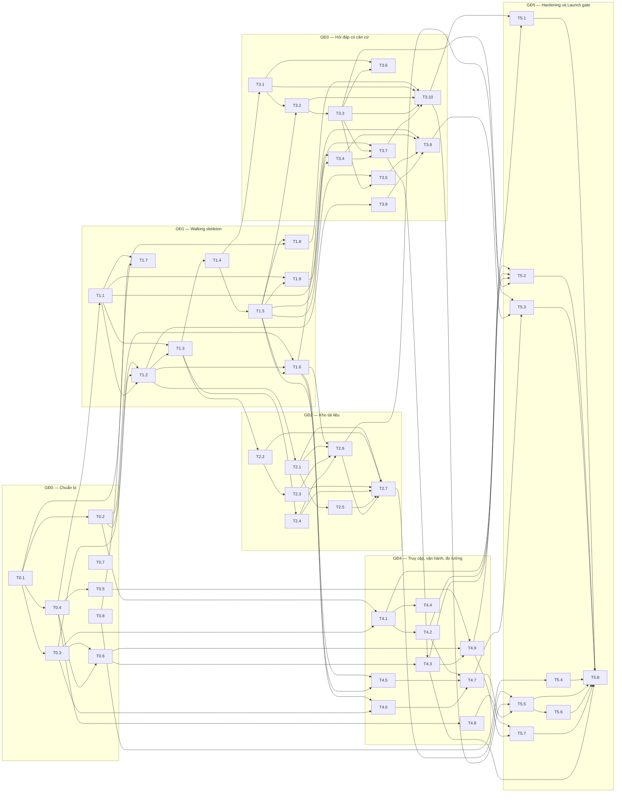

# Danh sách task triển khai — "Chat với tài liệu" (MVP)

> Chi tiết hóa từ [Implementation Plan](../Implementation_Plan.md) §3. Mỗi task một file: mục tiêu, phạm vi, các bước, đặc tả, tiêu chí chấp nhận, kiểm thử, Definition of Done, truy vết.
> **Kích thước** S/M/L là tương đối; quy đổi sang story point khi có quy mô đội (OQ-014) và độ dài sprint. **Chờ quyết định** in đậm = không bắt đầu được nếu chưa chốt.

**Tổng cộng: 51 task.** Bắt đầu được ngay (không phụ thuộc task khác): [T0.1](T0.1-tech-stack-adr.md), [T0.7](T0.7-decision-tracking.md), [T0.8](T0.8-golden-question-set.md).

## GĐ0 — Chuẩn bị (M0)

| Task | Tiêu đề | Loại | Cỡ | Phụ thuộc | Chờ quyết định | Story |
|---|---|---|---|---|---|---|
| [T0.1](T0.1-tech-stack-adr.md) | Chốt công nghệ và ghi ADR | Kiến trúc | S | — | OQ-007, OQ-009 | — |
| [T0.2](T0.2-api-design-openapi.md) | Thiết kế API (OpenAPI) | Thiết kế | M | T0.1 | PQ-01, OQ-008 | Tất cả US P0/P1 |
| [T0.3](T0.3-database-design.md) | Thiết kế database và migration đầu tiên | Thiết kế | M | T0.1 | OQ-009, OQ-010 | Tất cả |
| [T0.4](T0.4-repo-skeleton-modules.md) | Dựng repo, cấu trúc module và quy tắc phụ thuộc | Backend/Frontend | M | T0.1 | — | — |
| [T0.5](T0.5-ci-pipeline.md) | Thiết lập CI | DevOps | S | T0.4 | — | — |
| [T0.6](T0.6-dev-environment.md) | Môi trường dev chạy bằng một lệnh | DevOps | M | T0.3, T0.4 | — | — |
| [T0.7](T0.7-decision-tracking.md) | Theo dõi các quyết định mở (OQ/PQ) | Quản lý | S | — | OQ-001…015, PQ-01…07 | — |
| [T0.8](T0.8-golden-question-set.md) | Bộ tài liệu mẫu và bộ câu hỏi chuẩn | Nghiệp vụ / QA | M | — | OQ-003, OQ-007, OQ-009 | US-201, 202, 203, 204, 206, 209 |

## GĐ1 — Walking skeleton (M1)

| Task | Tiêu đề | Loại | Cỡ | Phụ thuộc | Chờ quyết định | Story |
|---|---|---|---|---|---|---|
| [T1.1](T1.1-ports-fake-adapters.md) | Ports và adapter giả lập (LLM, embedding, file store) | Backend | M | T0.4 | — | US-201, 203, 204, 208 |
| [T1.2](T1.2-upload-endpoint-minimal.md) | API upload tài liệu (bản tối thiểu) | Backend | M | T0.2, T0.3, T1.1 | — | US-101 |
| [T1.3](T1.3-ingestion-worker.md) | Worker xử lý tài liệu: trích văn bản theo trang, chia đoạn, embedding | Backend | L | T1.1, T1.2 | OQ-007 | US-101, 103 |
| [T1.4](T1.4-retrieval-vector-basic.md) | Truy xuất vector cơ bản | Backend | M | T1.3 | — | US-201 |
| [T1.5](T1.5-qa-endpoint-basic.md) | API hỏi đáp cơ bản và dựng trích dẫn | Backend | M | T1.4 | — | US-201, 203 |
| [T1.6](T1.6-frontend-workspace-skeleton.md) | Frontend: khung màn hình S02 (tải lên, danh sách, chat) | Frontend | M | T0.2, T1.2, T1.5 | — | US-101, 104, 201, 203 |
| [T1.7](T1.7-embedding-adapter-real.md) | Adapter embedding thật (mô hình chạy nội bộ) | Backend / ML | M | T1.1, T0.1 | OQ-007, OQ-009 | US-201, 206, 209 |
| [T1.8](T1.8-quality-eval-harness.md) | Công cụ đánh giá chất lượng (eval) với bộ câu hỏi chuẩn | QA / Backend | M | T1.5, T0.8 | OQ-002 | US-201, 202, 203, 204, 206, 207, 208 |
| [T1.9](T1.9-spike-real-llm.md) | Spike: thử adapter dịch vụ AI thật | Spike | S | T1.1, T1.5 | OQ-009 | US-201, 202, 208 |

## GĐ2 — Kho tài liệu (M2)

| Task | Tiêu đề | Loại | Cỡ | Phụ thuộc | Chờ quyết định | Story |
|---|---|---|---|---|---|---|
| [T2.1](T2.1-upload-validation.md) | Kiểm tra file trước khi xử lý (định dạng, kích thước, số trang, kho đầy) | Backend | M | T1.2 | OQ-004 | US-102, US-103 |
| [T2.2](T2.2-ingestion-failures-retry.md) | Worker: phân loại tài liệu lỗi, timeout và retry | Backend | M | T1.3 | OQ-005 | US-103 |
| [T2.3](T2.3-document-retry-endpoint.md) | API thử lại tài liệu xử lý thất bại | Backend | S | T2.2 | — | US-103 |
| [T2.4](T2.4-document-delete.md) | Xóa tài liệu (một giao dịch, không còn được trích dẫn) | Backend | M | T1.3 | OQ-010 | US-105 |
| [T2.5](T2.5-multi-upload-duplicates.md) | Upload nhiều file và xử lý file trùng | Backend | S | T2.1 | PQ-03 | US-101 |
| [T2.6](T2.6-frontend-document-library.md) | Frontend: kho tài liệu đầy đủ (lỗi, kho rỗng, xóa, kho đầy) | Frontend | M | T1.6, T2.1, T2.3, T2.4 | PQ-04 | US-101…105 |
| [T2.7](T2.7-library-acceptance-tests.md) | Kiểm thử nghiệm thu nhóm kho tài liệu | QA | M | T2.1, T2.2, T2.3, T2.4, T2.5, T2.6 | — | US-101…105 |

## GĐ3 — Hỏi đáp có căn cứ (M3)

| Task | Tiêu đề | Loại | Cỡ | Phụ thuộc | Chờ quyết định | Story |
|---|---|---|---|---|---|---|
| [T3.1](T3.1-hybrid-retrieval.md) | Truy xuất kết hợp ngữ nghĩa và từ khóa | Backend | M | T1.4 | OQ-007 | US-201, 206 |
| [T3.2](T3.2-grounding-gates.md) | Ba cổng "không tìm thấy" và kiểm chứng trích dẫn | Backend | L | T1.5, T3.1 | PQ-05 | US-202, 203, 204 |
| [T3.3](T3.3-llm-system-instructions.md) | Chỉ thị hệ thống cho mô hình AI và chống chỉ dẫn độc hại | Backend / ML | M | T3.2 | PQ-02, OQ-007 | US-202, 206, 209 |
| [T3.4](T3.4-ai-error-handling.md) | Xử lý lỗi dịch vụ AI: timeout, retry, circuit breaker | Backend | M | T1.1, T1.5 | OQ-006, OQ-013 | US-208 |
| [T3.5](T3.5-followup-questions.md) | Hỏi tiếp nối trong cùng phiên | Backend | M | T1.5, T3.3 | — | US-207 |
| [T3.6](T3.6-language-support.md) | Hỗ trợ ngôn ngữ theo OQ-007 | Backend | S | T3.1, T3.3 | OQ-007 | US-209 |
| [T3.7](T3.7-llm-adapter-production.md) | Adapter dịch vụ AI production và hạn mức chi phí | Backend | M | T1.9, T3.3, T3.4 | **OQ-009, OQ-013 | US-201, 208, 302 |
| [T3.8](T3.8-frontend-qa-states.md) | Frontend: các trạng thái hỏi đáp (lỗi, chờ lâu, hỏi tiếp, xem nguồn) | Frontend | M | T1.6, T3.4, T3.5, T3.9 | PQ-01 | US-204, 205, 207, 208 |
| [T3.9](T3.9-document-file-endpoint.md) | API lấy file PDF nguồn để đối chiếu | Backend | S | T1.2 | PQ-01 | US-205 |
| [T3.10](T3.10-quality-tuning.md) | Hiệu chỉnh chất lượng bằng bộ câu hỏi chuẩn | Backend / ML / QA | M | T1.8, T3.1, T3.2, T3.3, T3.7 | OQ-002, OQ-003 | US-201…206, 208 |

## GĐ4 — Truy cập, vận hành, đo lường (M4)

| Task | Tiêu đề | Loại | Cỡ | Phụ thuộc | Chờ quyết định | Story |
|---|---|---|---|---|---|---|
| [T4.1](T4.1-authentication.md) | Xác thực và phiên đăng nhập | Backend + Frontend | M | T0.2, T0.3 | **OQ-008**, Thời hạn phiên [TBD] | US-301 |
| [T4.2](T4.2-rbac.md) | Phân quyền theo vai trò ở mọi route | Backend + Frontend | S | T4.1 | OQ-010 | US-301 |
| [T4.3](T4.3-data-protection-controls.md) | Kiểm soát bảo vệ dữ liệu (egress, log, mã hóa, secret) | DevOps + Backend | M | T0.6, T3.7 | **OQ-009** | US-302 |
| [T4.4](T4.4-audit-log.md) | Nhật ký kiểm toán | Backend | S | T4.1 | OQ-009 | US-301, 302 |
| [T4.5](T4.5-answer-feedback.md) | Đánh giá câu trả lời (Hữu ích / Không hữu ích) | Backend + Frontend | S | T1.5, T1.6 | — | US-401 |
| [T4.6](T4.6-analytics-events.md) | Sự kiện analytics theo PRD §5.2 | Backend + Frontend | M | T1.6, T0.3 | OQ-009 | US-401, 402 |
| [T4.7](T4.7-weekly-stats.md) | Thống kê theo tuần cho Quản lý (S03) | Backend + Frontend | M | T4.2, T4.5, T4.6 | OQ-002, OQ-009 | US-402 |
| [T4.8](T4.8-observability.md) | Quan sát hệ thống: log, metrics, tracing, cảnh báo | DevOps + Backend | M | T0.4 | Ngưỡng cảnh báo [TBD] | US-208 |
| [T4.9](T4.9-environments-deploy-backup.md) | Môi trường test/pilot, triển khai, sao lưu và khôi phục | DevOps | M | T0.5, T0.6, T4.3 | **OQ-009, DEP-003**, RPO/RTO [TBD] | — |

## GĐ5 — Hardening và Launch gate (M5)

| Task | Tiêu đề | Loại | Cỡ | Phụ thuộc | Chờ quyết định | Story |
|---|---|---|---|---|---|---|
| [T5.1](T5.1-performance-test.md) | Kiểm thử hiệu năng | QA | M | T3.10, T4.9 | OQ-004, OQ-006, OQ-008 | US-102, 208 |
| [T5.2](T5.2-security-test.md) | Kiểm thử bảo mật (gồm prompt injection) | QA / Bảo mật | M | T4.1, T4.2, T4.3, T3.3 | — | US-301, 302, 202 |
| [T5.3](T5.3-accessibility-check.md) | Kiểm tra accessibility | QA / Frontend | S | T2.6, T3.8, T4.7 | Mức WCAG chính thức [TBD; đề xuất 2.1 AA] | Tất cả có giao diện |
| [T5.4](T5.4-baseline-measurement.md) | Đo baseline thời gian tra cứu thủ công (MET-001) | Nghiệp vụ / QA | S | T0.8 | OQ-001 | — |
| [T5.5](T5.5-uat.md) | Kiểm thử chấp nhận người dùng (UAT) | QA / Nghiệp vụ | M | T2.7, T3.10, T4.7 | — | Tất cả P0, P1 |
| [T5.6](T5.6-user-guide.md) | Hướng dẫn người dùng ngắn | Tài liệu | S | T5.5 | OQ-011 | US-203, 205 |
| [T5.7](T5.7-runbook.md) | Runbook vận hành | DevOps / Tài liệu | S | T4.8, T4.9 | — | — |
| [T5.8](T5.8-launch-gate-dossier.md) | Hồ sơ Launch gate cho Sponsor | Quản lý / QA | S | T5.1, T5.2, T5.3, T5.4, T5.5, T5.6, T5.7, T4.3 | Tất cả OQ chặn ở BRD §16 | Tất cả |

## Sơ đồ phụ thuộc

## Cách dùng

1. Chuyển mỗi file thành ticket (tiêu đề = `ID — tiêu đề`, mô tả = nội dung file).
2. Cập nhật dòng **Trạng thái** trong file (To do / In progress / Blocked / Done) hoặc chỉ theo dõi trên công cụ của đội — chọn một nơi duy nhất.
3. Khi một quyết định OQ/PQ được chốt: thay giá trị tạm trong các task liên quan (tìm theo mã OQ).
4. Task loại *Nghiệp vụ* (T0.8, T5.4) do đội BD thực hiện; theo dõi như phụ thuộc quan trọng.
