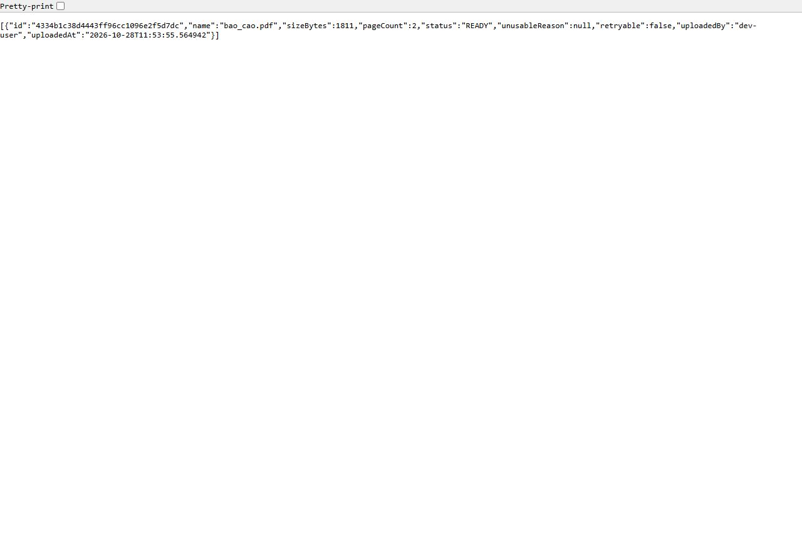
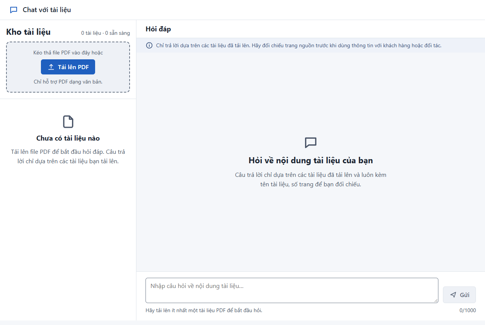
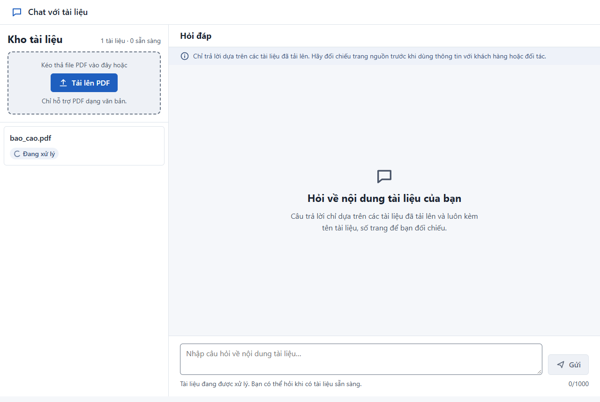
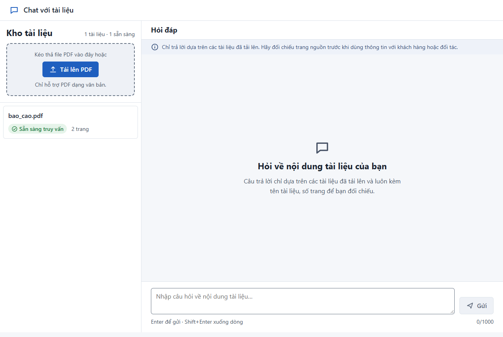

# Test Report — TC-101-02 Trạng thái tự chuyển "Sẵn sàng truy vấn" không cần tải lại

| Mục | Giá trị |
|---|---|
| Ca kiểm thử | [TC-101-02](../../test-cases/TC-101-02.md) |
| Kết luận | **Pass** |
| Ngày giờ thực thi | 2026-10-28 18:53–18:54 (UTC+7) |
| Người/agent thực thi | Agent (Claude Code) |
| Commit | `9b7e78c` **+ thay đổi chưa commit** sửa BUG-001 (`frontend/src/components/DocumentPanel.tsx`, `frontend/src/api/client.ts`) |
| Ứng dụng | http://localhost:5173 (API `http://localhost:8000`) |
| Cấu hình | `CWD_LLM_ADAPTER=fake`, `CWD_EMBEDDING_ADAPTER=fake` (mặc định); SQLite trong thư mục tạm **mới**; worker **chạy** |
| Trình duyệt | Chrome 155.0.8059.86, headless, 1280×860 (Playwright qua `frontend/e2e/evidence.mjs`) |
| Dữ liệu | TD-02 `bao_cao.pdf` (2 trang, sinh bằng `backend/tests/make_test_data.py`) |
| Script thực thi | [`frontend/e2e/run-TC-101-02.mjs`](../../../../frontend/e2e/run-TC-101-02.mjs) |

## 1. Kết quả từng bước

### Bước của đặc tả

| # | Bước | Kết quả mong đợi | Kết quả thực tế | Đạt | Bằng chứng |
|---|---|---|---|---|---|
| 1 | Upload TD-02 | 202, có `documentId` | 202; `fileName`=`bao_cao.pdf`, `documentId`=`4334b1c3…`, `error`=null (tại 0:00.6 của video) | ✅ | [network/02_POST__api_v1_documents.json](network/02_POST__api_v1_documents.json) |
| 2 | Worker xử lý hết job | Job được xử lý, không lỗi | Worker ghi `ingestion_job_finished` lúc 18:53:56, không có lỗi; tài liệu `READY` | ✅ | [logs/worker.log](logs/worker.log) |
| 3 | `GET /api/v1/documents` | `bao_cao.pdf`: `status`=`READY`, `pageCount`=2 | `status`=`READY`, `pageCount`=2, `unusableReason`=null | ✅ |  · [network/05_…json](network/05_GET__api_v1_documents.json) |
| 4 | Trên UI, tải TD-02, **không** tải lại trang | Badge "Đang xử lý" tự đổi thành "Sẵn sàng truy vấn" (polling 2 giây) | Đạt — chi tiết ở U1–U3 bên dưới | ✅ | video 0:00.7 → 0:03.1 |
| — | Phần tự động (bước 1–3) | Test xanh | `test_ac_101_2_status_becomes_ready_after_processing` **PASSED** | ✅ | [logs/automated.log](logs/automated.log) |

### Bước tại http://localhost:5173

| # | Thao tác | Kết quả mong đợi | Kết quả thực tế | Đạt | Bằng chứng |
|---|---|---|---|---|---|
| U0 | Mở http://localhost:5173 với kho trống | (điều kiện trước) | Kho hiện "Chưa có tài liệu nào" | ✅ |  · video 0:00.5 |
| U1 | Tải `bao_cao.pdf` lên | Mục `bao_cao.pdf` hiện "Đang xử lý" | Hiện sau **0,2 giây**: badge "Đang xử lý" (icon xoay + chữ); tiêu đề "1 tài liệu · 0 sẵn sàng"; ô hỏi khóa với gợi ý "Tài liệu đang được xử lý…" | ✅ |  · video 0:00.7 |
| U2 | Không tải lại trang, chờ tối đa 15 giây | Badge tự đổi "Sẵn sàng truy vấn", hiện "2 trang" | Tự đổi sau **2,6 giây** kể từ lúc tải lên: "Sẵn sàng truy vấn · 2 trang". Trang chỉ điều hướng **1 lần** (lần mở ban đầu) trước bước này → không có tải lại. Network cho thấy polling: GET lúc 0:00.6 trả `PROCESSING`, GET lúc 0:02.6 trả `READY` | ✅ |  · video 0:03.1 · [network/03](network/03_GET__api_v1_documents.json), [04](network/04_GET__api_v1_documents.json) |
| U3 | Đọc tiêu đề cột kho | "1 tài liệu · 1 sẵn sàng" | "1 tài liệu · 1 sẵn sàng" | ✅ |  · video 0:03.1 |

## 2. Bằng chứng

- Video toàn phiên: [video/session.webm](video/session.webm) (311 KB, khoảng 3,5 giây); mốc từng bước: [logs/steps.json](logs/steps.json)
- Ảnh chụp: `screenshots/` (5 ảnh, toàn trang)
- Network: `network/` (5 request `/api/v1/documents`: 1 GET ban đầu, 1 POST, 2 GET polling, 1 GET mở trực tiếp ở bước 3)
- Log: [logs/automated.log](logs/automated.log), [logs/browser-console.log](logs/browser-console.log), [logs/api.log](logs/api.log), [logs/worker.log](logs/worker.log), [logs/env.txt](logs/env.txt)

## 3. Sai lệch so với đặc tả

- Bước 2 của đặc tả ("cho worker xử lý hết job") được thực hiện bằng worker chạy nền thật thay vì `process_all` của test; bằng chứng là log worker.
- Có thêm bước U0 (ảnh kho trống trước khi tải lên) để chứng minh điều kiện trước.

## 4. Lỗi phát hiện

| Mã | Mức độ | Mô tả | Tái hiện | Bằng chứng | Trạng thái |
|---|---|---|---|---|---|
| BUG-001 | High | Kho trống, tải lên ngay khi trang vừa mở: tài liệu vừa tải không hiện và không polling cho tới khi tải lại trang (vi phạm AC-101.1/101.2 trên UI) | 1. Mở trang với kho trống 2. Tải PDF lên trước khi request danh sách ban đầu trả về | Phát hiện khi chạy thử helper lần đầu (tái hiện 3/3 trước khi sửa); test hồi quy `frontend/src/App.test.tsx` | **Đã sửa, chưa commit.** Lần chạy này dùng đúng điều kiện tái hiện (kho trống, tải lên ngay) và đạt |

## 5. Ghi chú

- Console trình duyệt có 1 lỗi `404 (Not Found)` không thuộc API (không có trong `logs/api.log`) — là `favicon.ico` do frontend chưa có favicon. Không ảnh hưởng ca này; mức Low, đề xuất thêm favicon.
- Kết luận Pass áp dụng cho mã **đã sửa BUG-001 nhưng chưa commit**. Cần chạy lại sau khi commit để gắn kết quả với một commit cụ thể.
