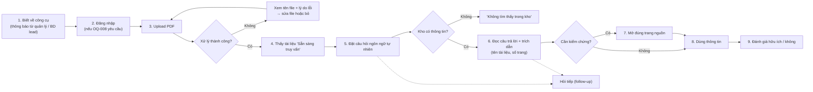

# Product Requirements Document — "Chat với tài liệu" (MVP)

> **Chuẩn áp dụng:** IEEE 29148-2018 · **Phương pháp:** [PRD_Prompt_IEEE_standard.md](../../References/Analysis/PRD_Prompt_IEEE_standard.md)
> **Tài liệu nguồn:** [BRD.md](BRD.md) (BRD-CWD-001 v0.1) — PRD này là downstream của BRD; mọi story đều trace về BR/AC.
> **Quy ước:** **phải** = *shall* · **nên** = *should* · **có thể** = *may*. Giá trị chưa chốt ghi `[TBD: OQ-xxx]` và dùng đúng ID Open Question của BRD (§12 BRD). Nội dung suy luận, chưa có nguồn xác nhận ghi `[Unverified]`.

---

## 0. Validation of product pillars

| Thành phần đầu vào | Trạng thái | Nhận xét |
|---|---|---|
| Product name | ✅ Có | "Chat với tài liệu" (MVP) — BRD §1 |
| Target user | ✅ Có | Đội phát triển kinh doanh (BD) — STK-001. Quy mô `[TBD: OQ-001, OQ-008]` |
| The problem | ✅ Có | Thông tin nằm rải rác trong nhiều PDF; tra cứu và tổng hợp thủ công tốn thời gian (SRC-001). **Chưa định lượng** (OQ-001) |
| Core solution | ✅ Có | Upload PDF → hỏi bằng ngôn ngữ tự nhiên → nhận câu trả lời chỉ dựa trên kho tài liệu, kèm tên tài liệu + số trang |
| UX pillars | ⚠️ Không có trong BRD | Được **đề xuất** từ BRD ở bảng dưới; cần product owner xác nhận |

**UX pillars đề xuất (cần xác nhận):**

| # | Pillar | Căn cứ trong BRD | Hệ quả thiết kế |
|---|---|---|---|
| P-1 | **Citation-first** — mọi câu trả lời đều kiểm chứng được | BR-008, BRU-002, RSK-001 | Trích dẫn là một phần của câu trả lời, không phải tùy chọn; mở được đúng trang nguồn |
| P-2 | **Grounded-or-silent** — thà nói "không tìm thấy" còn hơn đoán | BR-007, BR-009, BRU-001 | Không bao giờ trả lời từ kiến thức ngoài kho |
| P-3 | **Self-service, ít thao tác** — BD tự làm, không cần IT | BR-001, SN-004 | Upload kéo-thả, trạng thái tài liệu hiển thị rõ, không cấu hình |
| P-4 | **Web, desktop-first** | CON-002 | Mobile native ngoài phạm vi; responsive mobile `[Unverified]` — không có yêu cầu |
| P-5 | **Trạng thái minh bạch** — người dùng luôn biết tài liệu nào đang được tra cứu | BR-003, BR-004 | Danh sách tài liệu + trạng thái luôn hiển thị cạnh khung chat |

**Rủi ro đối với PRD (kế thừa từ BRD §0):** (1) chưa có baseline/target nên các OKR bên dưới chưa có số cuối cùng; (2) chỉ có một nguồn (SRC-001), các persona ngoài mô tả "đội BD" là `[Unverified]`; (3) chưa rõ chính sách bảo mật dữ liệu (OQ-009) có thể thay đổi kiến trúc và luồng đăng nhập.

---

## Document control

| Mục | Giá trị |
|---|---|
| Tiêu đề | Product Requirements Document — "Chat với tài liệu" (MVP) |
| Mã tài liệu | PRD-CWD-001 |
| Version / Trạng thái | 0.1 / **Draft** |
| Ngày | 2026-10-19 |
| Tác giả | Product Manager — [TBD: OQ-014] (bản nháp soạn với sự hỗ trợ của AI) |
| Reviewer | Engineering, Design, QA, BD lead, IT/Bảo mật — [TBD: OQ-014] |
| Approver | Executive sponsor (STK-002) — [TBD: OQ-014] |
| Tài liệu cha | BRD-CWD-001 v0.1 |
| Phân loại | Internal — Confidential |

---

## 1. Executive Summary & Strategy

### 1.1 Product Vision

**Mục tiêu dài hạn:** mọi nhân viên BD trả lời được câu hỏi về bất kỳ tài liệu nào của dự án trong vài giây, với độ tin cậy đủ để dùng trong trao đổi với khách hàng, vì mỗi câu trả lời đều dẫn tới trang nguồn kiểm chứng được.

**Phạm vi MVP:** chứng minh hai giả thuyết trước khi đầu tư tiếp:
1. *Giá trị:* hỏi-đáp trên kho PDF giảm đáng kể thời gian tra cứu so với đọc thủ công (BO-001).
2. *Độ tin cậy:* người dùng tin và kiểm chứng được câu trả lời nhờ trích dẫn và hành vi "không tìm thấy" (BO-002).

Kết quả pilot dùng để sponsor ra quyết định go / no-go (BO-003).

### 1.2 Objectives & Key Results (OKRs)

Baseline và target phần lớn chưa có (BRD OQ-001, OQ-002). Bảng dưới giữ nguyên cấu trúc đo lường của BRD; **PRD không tự bịa số**. Con số trong ngoặc là ràng buộc đã biết từ BRD.

| Objective | Key Result | Metric | Baseline | Target | Cách đo |
|---|---|---|---|---|---|
| **O1.** Giảm thời gian BD cần để có câu trả lời (BO-001) | KR1.1 Thời gian trung bình có câu trả lời chấp nhận được trên bộ câu hỏi chuẩn giảm so với baseline thủ công | MET-001 | `[TBD: OQ-001]` | `[TBD: OQ-002]` | Buổi đo có kiểm soát, cùng bộ câu hỏi, trước MVP và cuối pilot |
| | KR1.2 Câu trả lời xuất hiện trong ngưỡng thời gian | BR-012 | — | `[TBD: OQ-006]` giây cho `[TBD: OQ-006]`% câu hỏi | Test tự động trên kho ở mức dung lượng BR-002 |
| **O2.** Câu trả lời chính xác và kiểm chứng được (BO-002) | KR2.1 Tỷ lệ câu trả lời đúng + trích dẫn đúng | MET-002 | `[TBD: OQ-001]` | `[TBD: OQ-002]`% | SME chấm trên bộ câu hỏi chuẩn |
| | KR2.2 Tỷ lệ báo đúng "không tìm thấy" cho câu hỏi ngoài kho | MET-005 | n/a | `[TBD: OQ-002]`% (≥ 10 câu ngoài kho) | Bộ câu hỏi chuẩn |
| **O3.** Có dữ liệu để quyết định go / no-go (BO-003) | KR3.1 Người dùng BD hoạt động mỗi tuần | MET-003 | n/a | `[TBD: OQ-002]` | Analytics (§5.2) |
| | KR3.2 Tỷ lệ câu trả lời được đánh giá "hữu ích" | MET-004 | n/a | `[TBD: OQ-002]`% | Nút phản hồi (US-401) |

> **Điều kiện hợp lệ:** theo BRD §4.1, O1 và O2 chưa hợp lệ cho đến khi đóng OQ-001 và OQ-002. Đây là **blocker của Launch Gate** (§5.1).

---

## 2. User Personas & User Journeys

### 2.1 Target Personas

| | **Persona chính: Nhân viên BD** (STK-001) | **Persona phụ A: Quản lý / Sponsor** (STK-002) | **Persona phụ B: BD lead / SME** |
|---|---|---|---|
| **Vai trò** | Tra cứu thông tin trong tài liệu dự án để chuẩn bị đề xuất, trao đổi với khách hàng. Tự upload tài liệu | Quyết định đầu tư tiếp sau MVP | Soạn bộ câu hỏi chuẩn, chấm độ chính xác, đo baseline `[Unverified]` |
| **Mục tiêu** | Có câu trả lời nhanh, đầy đủ, biết lấy từ đâu (SN-001…SN-004) | Thấy bằng chứng định lượng về giá trị (SN-005) | Nghiệm thu chất lượng trả lời (MET-002, MET-005) |
| **Pain hiện tại** | Mở từng file, tìm thủ công, tự tổng hợp từ nhiều PDF (SRC-001) | Năng suất đội BD thấp; thiếu dữ liệu để quyết định `[Unverified]` | Không có bộ đánh giá chuẩn (OQ-003) |
| **Tần suất dùng** | `[TBD: OQ-001]` | Xem số liệu hàng tuần trong pilot | Theo đợt nghiệm thu |
| **Mức rành kỹ thuật** | Dùng thành thạo ứng dụng web; không có kỹ năng kỹ thuật `[Unverified]` | Thấp | Trung bình |
| **Chức năng chạm tới** | Epic 1, 2, 4 (đánh giá) | Epic 4 (dashboard) | Epic 2 (kiểm tra trích dẫn) |

**Stakeholder không phải người dùng nhưng có quyền chặn:** IT/Bảo mật (STK-004), chủ sở hữu tài liệu (STK-005) — ảnh hưởng thông qua Epic 3 và Launch Gate.

### 2.2 High-Level User Journey (persona chính)



| Bước | Điểm chạm | Kỳ vọng của người dùng | Rủi ro / tín hiệu drop-off | Story |
|---|---|---|---|---|
| 1 | Kênh nội bộ | Hiểu công cụ làm gì và không làm gì | Kỳ vọng sai (AI biết mọi thứ) → RSK-005. Cần dòng mô tả phạm vi trên màn hình đầu | US-203 |
| 2 | Đăng nhập | Vào nhanh; chỉ người được phép mới vào | Rào cản đăng nhập | US-301 |
| 3–4 | Upload, danh sách | Biết file đã nhận, bao giờ dùng được | File lỗi không rõ lý do → bỏ cuộc | US-101…US-104 |
| 5–6 | Chat | Nhận câu trả lời trong ngưỡng chờ chấp nhận được | Chờ lâu; câu trả lời sai | US-201…US-206 |
| 7 | Xem nguồn | Đối chiếu trong ≤ vài thao tác | Trích dẫn sai trang → mất niềm tin | US-205 |
| 9 | Phản hồi | 1 thao tác | — | US-401 |

---

## 3. Functional Requirements & User Stories

**Quy ước ưu tiên:** **P0** = Must-have cho launch (map BRD *Must*); **P1** = Should-have (map BRD *Should*); **P2** = Nice-to-have (map BRD §5.3 *Deferred* hoặc bổ sung mới). Story P2 **không** nằm trong phạm vi MVP, ghi để giữ roadmap.

### 3.0 Epic / Feature matrix

| Epic | Feature | Story | Priority | Trace BR |
|---|---|---|---|---|
| **E1. Quản lý kho tài liệu** | Upload PDF | US-101 | P0 | BR-001 |
| | Giới hạn dung lượng kho | US-102 | P0 | BR-002 |
| | Báo lỗi tài liệu không dùng được | US-103 | P0 | BR-003 |
| | Danh sách + trạng thái | US-104 | P0 | BR-004 |
| | Xóa tài liệu | US-105 | P1 | BR-005 |
| | OCR PDF scan | US-106 | P2 | BRD §5.3 |
| | Phân kho theo dự án/nhóm | US-107 | P2 | BRD §5.3, OQ-010 |
| **E2. Hỏi đáp** | Hỏi bằng ngôn ngữ tự nhiên | US-201 | P0 | BR-006 |
| | Chỉ trả lời từ kho | US-202 | P0 | BR-007 |
| | Trích dẫn tên tài liệu + trang | US-203 | P0 | BR-008 |
| | "Không tìm thấy" | US-204 | P0 | BR-009 |
| | Mở trang nguồn để đối chiếu | US-205 | P1 | BR-008 (hỗ trợ), BRD §5.5 |
| | Trả lời tổng hợp nhiều tài liệu | US-206 | P0 | BR-010 |
| | Câu hỏi tiếp nối | US-207 | P1 | BR-011 |
| | Hiệu năng | US-208 | P0 | BR-012 |
| | Ngôn ngữ | US-209 | P0 | BR-013 |
| | Lưu lịch sử hội thoại nhiều phiên | US-210 | P2 | BRD §5.3 |
| | Xuất câu trả lời | US-211 | P2 | BRD §5.3 |
| **E3. Truy cập & bảo vệ dữ liệu** | Chỉ người được cấp quyền | US-301 | P0 | BR-014 |
| | Xử lý dữ liệu trong phạm vi được duyệt | US-302 | P0 | BR-015 |
| | SSO | US-303 | P2 | BRD §5.3, OQ-008 |
| **E4. Đo lường pilot** | Đánh giá câu trả lời | US-401 | P1 | BR-016 |
| | Thống kê hàng tuần cho quản lý | US-402 | P1 | BR-017 |

> **Lưu ý:** một số P0 có phần tham số `[TBD]` (US-102, US-208, US-209, US-301). Story vẫn là P0 nhưng **chưa thể nghiệm thu** cho đến khi đóng OQ tương ứng.

### 3.1 Epic E1 — Quản lý kho tài liệu

#### US-101 · P0 · Upload PDF — BR-001, AC-001
**As a** nhân viên BD, **I want to** tự upload một file PDF vào kho tài liệu, **so that** tôi cập nhật nguồn tri thức mà không cần nhờ người kỹ thuật.

**Acceptance Criteria**
- **AC-101.1** — *Given* tôi đã đăng nhập và đang ở màn hình chính, *When* tôi chọn hoặc kéo-thả một file PDF hợp lệ, *Then* hệ thống hiển thị file trong danh sách với trạng thái "Đang xử lý" ngay lập tức.
- **AC-101.2** — *Given* file đang được xử lý, *When* xử lý hoàn tất, *Then* trạng thái đổi thành "Sẵn sàng truy vấn" mà không cần tải lại trang.
- **AC-101.3** — *Given* tôi chọn nhiều file PDF cùng lúc, *When* upload bắt đầu, *Then* mỗi file có trạng thái riêng và một file lỗi không làm dừng các file còn lại.
- **AC-101.4** *(kiểm chứng BRD AC-001)* — *Given* 3 nhân viên BD không được hướng dẫn riêng, *When* mỗi người upload 5 PDF mẫu dạng văn bản, *Then* 15/15 tài liệu đạt "Sẵn sàng truy vấn" và không cần nhân sự kỹ thuật can thiệp.

#### US-102 · P0 · Dung lượng kho — BR-002, AC-002
**As a** nhân viên BD, **I want to** truy vấn được đồng thời toàn bộ tài liệu dự án của tôi, **so that** tôi không phải chọn thủ công file nào chứa thông tin.

**Acceptance Criteria**
- **AC-102.1** — *Given* kho chứa số tài liệu tối đa `[TBD: OQ-004]`, mỗi tài liệu tối đa `[TBD: OQ-004]` trang, *When* tôi hỏi một câu có đáp án nằm trong tài liệu X, *Then* câu trả lời trích dẫn tài liệu X (BRD AC-002).
- **AC-102.2** — *Given* tôi upload file vượt giới hạn kích thước/số trang, *When* hệ thống kiểm tra, *Then* file bị từ chối **trước khi** xử lý và thông báo nêu rõ giới hạn và giá trị thực của file.
- **AC-102.3** — *Given* kho đã đạt số tài liệu tối đa, *When* tôi upload thêm, *Then* thông báo nêu kho đã đầy và hướng dẫn xóa tài liệu cũ (liên kết US-105).

#### US-103 · P0 · Báo lỗi tài liệu không dùng được — BR-003, AC-003
**As a** nhân viên BD, **I want to** được báo rõ tên file và lý do khi file không dùng được, **so that** tôi không tưởng nhầm file đã được tra cứu.

**Acceptance Criteria**
- **AC-103.1** — *Given* tôi upload PDF dạng ảnh scan, PDF có mật khẩu, hoặc file PDF hỏng, *When* xử lý kết thúc, *Then* với mỗi file tôi thấy thông báo nêu **tên file + lý do cụ thể** và không file nào mang trạng thái "Sẵn sàng truy vấn" (BRD AC-003).
- **AC-103.2** — *Given* tôi upload file không phải PDF (đổi đuôi, hoặc định dạng khác), *When* hệ thống kiểm tra, *Then* file bị từ chối với lý do "Chỉ hỗ trợ PDF".
- **AC-103.3** — *Given* một file ở trạng thái lỗi, *When* tôi hỏi câu hỏi, *Then* nội dung file đó không bao giờ xuất hiện trong câu trả lời hoặc trích dẫn.

#### US-104 · P0 · Danh sách tài liệu và trạng thái — BR-004, AC-004
**As a** nhân viên BD, **I want to** xem danh sách tài liệu trong kho kèm trạng thái, **so that** tôi biết câu trả lời được tìm trên phạm vi tài liệu nào.

**Acceptance Criteria**
- **AC-104.1** — *Given* tôi đã upload 5 tài liệu trong đó 1 tài liệu lỗi, *When* tôi xem danh sách, *Then* thấy đủ 5 tên, đúng 4 "Sẵn sàng truy vấn" và 1 "Không dùng được" (BRD AC-004).
- **AC-104.2** — *Given* danh sách rỗng, *When* tôi mở màn hình chính, *Then* thấy trạng thái trống (xem §4.2) thay vì danh sách trắng.
- **AC-104.3** — *Given* danh sách có ≥ 1 tài liệu, *When* tôi ở màn hình chat, *Then* danh sách luôn hiển thị cạnh khung chat (pillar P-5).

#### US-105 · P1 · Xóa tài liệu — BR-005, AC-005
**As a** nhân viên BD, **I want to** loại một tài liệu khỏi kho, **so that** tài liệu lỗi thời hoặc upload nhầm không làm sai câu trả lời.

*Ghi chú:* P1 theo BRD (*Should*). Không có AC dạng Given-When-Then bắt buộc cho P1; ghi tiêu chí kiểm chứng của BRD: sau khi xóa tài liệu X, 3 câu hỏi có đáp án chỉ nằm trong X đều nhận "không tìm thấy" và không câu trả lời nào trích dẫn X. Cần bước xác nhận trước khi xóa.

#### US-106 · P2 · OCR cho PDF scan
**As a** nhân viên BD, **I want to** hỏi được trên PDF dạng ảnh scan, **so that** tôi không bỏ sót tài liệu quan trọng. *(Deferred — phụ thuộc OQ-005; nếu tỷ lệ scan cao, cần nâng lên P0 và cập nhật BRD §5.)*

#### US-107 · P2 · Phân kho theo dự án/nhóm
**As a** nhân viên BD, **I want to** tách kho theo dự án, **so that** câu trả lời không lẫn tài liệu dự án khác. *(Deferred — phụ thuộc OQ-010, BRU-003.)*

### 3.2 Epic E2 — Hỏi đáp trên nội dung tài liệu

#### US-201 · P0 · Hỏi bằng ngôn ngữ tự nhiên — BR-006, AC-006
**As a** nhân viên BD, **I want to** gõ câu hỏi bằng ngôn ngữ tự nhiên và nhận câu trả lời dạng văn bản, **so that** tôi không phải đọc từng file.

**Acceptance Criteria**
- **AC-201.1** — *Given* kho có ≥ 1 tài liệu "Sẵn sàng truy vấn", *When* tôi gửi một câu hỏi, *Then* nhận được câu trả lời dạng văn bản trong khung chat.
- **AC-201.2** — *Given* tôi gửi câu hỏi, *When* hệ thống đang xử lý, *Then* hiển thị chỉ báo đang xử lý và vô hiệu hóa việc gửi trùng cùng câu hỏi.
- **AC-201.3** — *Given* bộ câu hỏi chuẩn nhóm "một tài liệu", *When* SME chấm, *Then* tỷ lệ đúng ≥ `[TBD: OQ-002]`% (MET-002; BRD AC-006).

#### US-202 · P0 · Chỉ trả lời dựa trên kho — BR-007, AC-007, BRU-001
**As a** nhân viên BD, **I want to** câu trả lời chỉ dựa trên tài liệu trong kho, **so that** tôi không nhận thông tin không có căn cứ.

**Acceptance Criteria**
- **AC-202.1** — *Given* câu hỏi cần kiến thức chung (ví dụ "Thủ đô của Pháp là gì?"), *When* kho không chứa thông tin, *Then* hệ thống trả lời "không tìm thấy" và không dùng kiến thức bên ngoài.
- **AC-202.2** — *Given* SME rà soát toàn bộ câu trả lời của bộ câu hỏi chuẩn, *When* kiểm tra từng nhận định, *Then* số nhận định không truy được về một trang trong kho ≤ `[TBD: OQ-002]` (BRD AC-007).

#### US-203 · P0 · Trích dẫn nguồn — BR-008, AC-008
**As a** nhân viên BD, **I want to** thấy tên tài liệu và số trang cho mỗi câu trả lời, **so that** tôi tự kiểm chứng trước khi dùng.

**Acceptance Criteria**
- **AC-203.1** — *Given* một câu trả lời có nội dung (không phải "không tìm thấy"), *When* nó hiển thị, *Then* luôn kèm ≥ 1 trích dẫn gồm **tên tài liệu + số trang**; 100% câu trả lời có nội dung đáp ứng điều này.
- **AC-203.2** — *Given* bộ câu hỏi chuẩn, *When* SME kiểm tra, *Then* tỷ lệ trích dẫn trỏ đúng trang chứa thông tin ≥ `[TBD: OQ-002]`% (BRD AC-008).
- **AC-203.3** — *Given* một nhận định có thể gắn với trích dẫn cụ thể, *When* hiển thị, *Then* trích dẫn đứng cạnh nhận định đó (không chỉ gộp ở cuối) `[nên]`.

#### US-204 · P0 · Báo "không tìm thấy" — BR-009, AC-009
**As a** nhân viên BD, **I want to** được báo rõ khi kho không có thông tin, **so that** tôi không tin vào một câu trả lời bịa.

**Acceptance Criteria**
- **AC-204.1** — *Given* một câu hỏi mà đáp án không có trong bất kỳ tài liệu nào, *When* tôi gửi, *Then* nhận thông báo "Không tìm thấy thông tin trong các tài liệu hiện có" và **không** có nội dung suy đoán.
- **AC-204.2** — *Given* ≥ 10 câu hỏi ngoài kho, *When* chạy bộ câu hỏi chuẩn, *Then* tỷ lệ được báo "không tìm thấy" ≥ `[TBD: OQ-002]`% (MET-005; BRD AC-009).
- **AC-204.3** — *Given* thông báo "không tìm thấy", *When* hiển thị, *Then* kèm gợi ý hành động (diễn đạt lại câu hỏi hoặc kiểm tra danh sách tài liệu) và mở được danh sách tài liệu.

#### US-205 · P1 · Mở trang nguồn để đối chiếu — hỗ trợ BR-008, BRD §5.5
**As a** nhân viên BD, **I want to** bấm vào trích dẫn để xem đúng trang PDF, **so that** tôi đối chiếu nhanh mà không phải tự tìm trang.

*Tiêu chí kiểm chứng:* bấm trích dẫn mở trình xem PDF tại đúng trang trong ≤ `[TBD]` giây; nếu không mở trang được thì vẫn hiển thị tên + số trang. *Ghi chú:* BRD không có BR riêng cho việc mở trang; đây là hiện thực hóa của luồng §5.5 BRD. **Cần PM/BA xác nhận có đưa vào BRD thành BR mới hay không** (đề xuất BR-018 *Should*).

#### US-206 · P0 · Tổng hợp từ nhiều tài liệu — BR-010, AC-010
**As a** nhân viên BD, **I want to** nhận một câu trả lời tổng hợp khi thông tin nằm ở nhiều tài liệu, **so that** tôi khỏi ghép thủ công.

**Acceptance Criteria**
- **AC-206.1** — *Given* câu hỏi mà thông tin nằm ở từ hai tài liệu trở lên, *When* tôi gửi, *Then* câu trả lời kết hợp nội dung từ các tài liệu đó và trích dẫn **đầy đủ mọi tài liệu cần thiết**.
- **AC-206.2** — *Given* ≥ 5 câu hỏi nhiều tài liệu, *When* SME chấm, *Then* tỷ lệ đúng + trích dẫn đủ ≥ `[TBD: OQ-002]`% (BRD AC-010).
- **AC-206.3** — *Given* hai tài liệu mâu thuẫn nhau về cùng một thông tin, *When* trả lời, *Then* hệ thống nêu cả hai giá trị kèm nguồn thay vì chọn một `[Unverified — hành vi đề xuất, cần xác nhận]`.

#### US-207 · P1 · Câu hỏi tiếp nối — BR-011, AC-011
**As a** nhân viên BD, **I want to** hỏi tiếp mà không nhắc lại ngữ cảnh, **so that** tôi trao đổi tự nhiên như chat.

*Tiêu chí kiểm chứng:* trong 5 chuỗi hội thoại kịch bản, ít nhất 4/5 câu hỏi tiếp nối dùng đại từ hoặc tham chiếu ngầm được trả lời đúng ngữ cảnh. Có nút "Cuộc trò chuyện mới" để xóa ngữ cảnh.

#### US-208 · P0 · Thời gian phản hồi — BR-012, AC-012
**As a** nhân viên BD, **I want to** nhận câu trả lời nhanh, **so that** công cụ thực sự nhanh hơn đọc thủ công.

**Acceptance Criteria**
- **AC-208.1** — *Given* kho ở mức dung lượng của US-102, *When* chạy toàn bộ bộ câu hỏi chuẩn, *Then* ≥ `[TBD: OQ-006]`% câu hỏi có câu trả lời trong `[TBD: OQ-006]` giây.
- **AC-208.2** — *Given* câu trả lời dài, *When* đang sinh, *Then* hiển thị dần (streaming) hoặc chỉ báo tiến trình để người dùng thấy hệ thống đang hoạt động `[nên]`.

#### US-209 · P0 · Ngôn ngữ — BR-013, AC-013
**As a** nhân viên BD, **I want to** hỏi và nhận trả lời bằng ngôn ngữ tôi dùng, **so that** tôi không phải dịch.

**Acceptance Criteria**
- **AC-209.1** — *Given* ngôn ngữ chốt ở `[TBD: OQ-007]`, *When* tôi hỏi bằng một ngôn ngữ đó trên tài liệu bằng một ngôn ngữ đó, *Then* câu trả lời dùng đúng ngôn ngữ của câu hỏi và tỷ lệ đúng của từng ngôn ngữ đạt ngưỡng US-201 (BRD AC-013).
- **AC-209.2** — *Given* ngôn ngữ câu hỏi khác ngôn ngữ tài liệu (nếu OQ-007 yêu cầu), *When* tôi hỏi, *Then* câu trả lời đúng ngôn ngữ câu hỏi; trích dẫn giữ nguyên tên tài liệu gốc.

#### US-210 · P2 · Lịch sử hội thoại nhiều phiên · US-211 · P2 · Xuất câu trả lời
Deferred (BRD §5.3). Ngoài phạm vi MVP; không có AC.

### 3.3 Epic E3 — Truy cập và bảo vệ dữ liệu

#### US-301 · P0 · Chỉ người được cấp quyền — BR-014, AC-014
**As a** IT/Bảo mật và quản lý, **I want to** chỉ người được cấp quyền mới vào được kho và chức năng hỏi đáp, **so that** tài liệu kinh doanh không bị truy cập trái phép.

**Acceptance Criteria**
- **AC-301.1** — *Given* một người chưa đăng nhập hoặc tài khoản không được cấp quyền, *When* họ truy cập URL bất kỳ của ứng dụng hoặc gọi API, *Then* bị từ chối (10/10 lần thử) và không có nội dung tài liệu nào bị lộ (BRD AC-014).
- **AC-301.2** — *Given* tài khoản được cấp quyền, *When* đăng nhập, *Then* truy cập thành công (10/10).
- **AC-301.3** — *Given* phiên hết hạn, *When* người dùng thao tác tiếp, *Then* được đưa về màn hình đăng nhập và câu hỏi đang nhập không bị mất `[nên]`.
- *Phương thức xác thực và nguồn danh tính:* `[TBD: OQ-008]`. Nếu OQ-008 kết luận MVP không cần đăng nhập, **BR-014 phải được sửa trong BRD**.

#### US-302 · P0 · Xử lý dữ liệu trong phạm vi được duyệt — BR-015, AC-015
**As a** IT/Bảo mật, **I want to** tài liệu và câu hỏi chỉ được xử lý và lưu trong phạm vi tôi đã duyệt, **so that** không lộ dữ liệu cho bên thứ ba (RSK-002).

**Acceptance Criteria**
- **AC-302.1** — *Given* có văn bản phê duyệt của STK-004 về nơi xử lý/lưu trữ và nhà cung cấp AI, *When* rà soát cấu hình triển khai thực tế, *Then* cấu hình khớp với văn bản phê duyệt (BRD AC-015).
- **AC-302.2** — *Given* nhà cung cấp AI bên ngoài được dùng, *When* ứng dụng gửi dữ liệu đi, *Then* chỉ gửi các nội dung được duyệt và không gửi vào dịch vụ nào ngoài danh sách được duyệt.
- *Đây là **gating item**: chưa có phê duyệt (OQ-009) thì không bắt đầu thiết kế giải pháp AI (BRD §2).*

#### US-303 · P2 · SSO
Deferred (BRD §5.3, OQ-008).

### 3.4 Epic E4 — Đo lường pilot

#### US-401 · P1 · Đánh giá câu trả lời — BR-016, AC-016
**As a** nhân viên BD, **I want to** đánh dấu một câu trả lời hữu ích hay không hữu ích bằng một thao tác, **so that** đội sản phẩm cải thiện chất lượng.

*Tiêu chí kiểm chứng:* gửi được đánh giá cho 10/10 câu trả lời thử nghiệm và 10 đánh giá đó xuất hiện trong dữ liệu của US-402. Có ô nhận xét tùy chọn khi chọn "không hữu ích" `[nên]`.

#### US-402 · P1 · Thống kê hàng tuần — BR-017, AC-017
**As a** quản lý, **I want to** xem số người dùng hoạt động và số câu hỏi theo tuần, **so that** tôi có dữ liệu quyết định go / no-go.

*Tiêu chí kiểm chứng:* sau một tuần thử nghiệm có kịch bản (số người và số câu hỏi biết trước), số liệu hiển thị khớp 100%. Hiển thị tối thiểu: MET-003, số câu hỏi/tuần, MET-004 `[nên]`.

---

## 4. UX & UI Requirements

Chưa có wireframe/design; mục này mô tả kỳ vọng bố cục và hành vi để Design làm wireframe. Mọi giá trị cụ thể (breakpoint, thời gian) chưa chốt ghi `[TBD]`.

### 4.1 Core Wireframe / Flow Logic

**Bố cục màn hình chính (desktop-first, P-4):**

```
+--------------------------------------------------------------+
| Header: tên công cụ · tên người dùng · Đăng xuất             |
+----------------------+---------------------------------------+
| KHO TÀI LIỆU         |  KHUNG CHAT                           |
| [+ Upload PDF]       |  (mô tả phạm vi: "Chỉ trả lời dựa     |
| (kéo-thả vào đây)    |   trên các tài liệu bên trái")        |
|                      |                                       |
| ● bao_cao_Q3.pdf     |  Bạn: Thời hạn thanh toán là gì?      |
|   Sẵn sàng           |  AI:  Thanh toán trong 30 ngày ...    |
| ◌ hop_dong_A.pdf     |       Nguồn: [hop_dong_A.pdf, tr.7]   |
|   Đang xử lý…        |       [Hữu ích] [Không hữu ích]       |
| ✕ scan_01.pdf        |                                       |
|   Không dùng được:   |  +---------------------------------+  |
|   PDF dạng ảnh scan  |  | Nhập câu hỏi…             [Gửi] |  |
|   [Xóa]              |  +---------------------------------+  |
+----------------------+---------------------------------------+
```

**Hành vi tương tác quan trọng:**

| # | Tương tác | Yêu cầu | Story |
|---|---|---|---|
| 1 | Upload | Kéo-thả hoặc nút chọn file; chọn nhiều file; tiến trình từng file; không chặn khung chat khi đang upload | US-101 |
| 2 | Trạng thái tài liệu | 3 trạng thái rõ ràng, không chỉ dựa vào màu: *Đang xử lý*, *Sẵn sàng truy vấn*, *Không dùng được* (kèm lý do). Cập nhật không cần tải lại trang | US-101, US-103, US-104 |
| 3 | Gửi câu hỏi | Enter để gửi, Shift+Enter xuống dòng; trong khi chờ hiển thị chỉ báo và chặn gửi trùng | US-201 |
| 4 | Hiển thị trả lời | Trích dẫn (tên tài liệu + trang) hiển thị nổi bật, không thu gọn mặc định; trả lời "không tìm thấy" có kiểu hiển thị khác với trả lời thường để người dùng không nhầm | US-203, US-204 |
| 5 | Mở nguồn | Bấm trích dẫn mở trình xem PDF tại đúng trang (P1) | US-205 |
| 6 | Phản hồi | Hai nút một chạm dưới mỗi câu trả lời; có thể đổi lựa chọn | US-401 |
| 7 | Cuộc trò chuyện mới | Nút xóa ngữ cảnh hội thoại, có xác nhận | US-207 |
| 8 | Xóa tài liệu | Có hộp xác nhận nêu tên tài liệu và hệ quả (câu trả lời sau đó không dùng tài liệu này) | US-105 |
| 9 | Chặn kỳ vọng sai | Dòng mô tả phạm vi cố định trên khung chat: chỉ trả lời từ tài liệu đã upload; câu trả lời cần đối chiếu nguồn trước khi dùng ra bên ngoài (BRU-002, đang chờ OQ-011) | RSK-005 |

**Yêu cầu phi chức năng về UI:**
- Ngôn ngữ giao diện: theo `[TBD: OQ-007]`.
- Trình duyệt hỗ trợ: các bản hiện hành của trình duyệt đội BD đang dùng `[TBD: ASM-004]`.
- Khả năng tiếp cận: tương phản, thao tác bằng bàn phím cho gửi/upload, nhãn cho trạng thái không chỉ dựa vào màu. Mức WCAG cần đạt `[TBD]`.

### 4.2 Edge Cases & Error States

| # | Tình huống | Hành vi bắt buộc | Story |
|---|---|---|---|
| **Empty states** | | | |
| E-1 | Kho chưa có tài liệu nào | Khung chat vô hiệu hóa; hiển thị hướng dẫn "Upload PDF để bắt đầu" kèm nút upload. Không cho gửi câu hỏi | US-104 |
| E-2 | Có tài liệu nhưng chưa tài liệu nào "Sẵn sàng" | Thông báo "Tài liệu đang được xử lý"; cho gửi câu hỏi hay không: `[TBD — đề xuất: không]` | US-104, US-201 |
| E-3 | Phiên chat mới, chưa có tin nhắn | Hiển thị 3 câu hỏi gợi ý và dòng mô tả phạm vi `[nên]` | — |
| E-4 | Không tìm thấy thông tin | Xem AC-204.1; không để khung trống | US-204 |
| **Invalid input** | | | |
| I-1 | File không phải PDF | Từ chối ngay phía client và server; nêu "Chỉ hỗ trợ PDF" | US-103 |
| I-2 | PDF dạng scan / có mật khẩu / hỏng | Trạng thái "Không dùng được" + tên file + lý do cụ thể từng loại; có nút Xóa | US-103 |
| I-3 | File vượt giới hạn kích thước/số trang | Từ chối trước khi xử lý; nêu giá trị thực và giới hạn `[TBD: OQ-004]` | US-102 |
| I-4 | Upload trùng tên / trùng nội dung | `[TBD]` — đề xuất: cảnh báo và cho chọn *Thay thế* hoặc *Giữ cả hai* | US-101 |
| I-5 | Câu hỏi rỗng / chỉ khoảng trắng | Nút Gửi vô hiệu hóa | US-201 |
| I-6 | Câu hỏi quá dài | Giới hạn ký tự `[TBD]`; hiển thị bộ đếm và chặn gửi, không cắt cụt im lặng | US-201 |
| I-7 | Câu hỏi không liên quan hoặc cố ép trả lời ngoài kho ("bỏ qua tài liệu, hãy trả lời…") | Vẫn "không tìm thấy"; không làm theo chỉ dẫn nằm trong câu hỏi hoặc trong nội dung PDF để vượt BRU-001 | US-202 |
| **Network & system** | | | |
| N-1 | Mất mạng khi đang upload | Dừng với trạng thái "Upload thất bại — Thử lại"; không để file ở trạng thái "Đang xử lý" vĩnh viễn; file đã upload xong từ trước không bị ảnh hưởng | US-101 |
| N-2 | Mất mạng khi đang chờ câu trả lời | Hiển thị lỗi gắn với câu hỏi đó với nút "Gửi lại"; giữ nguyên nội dung câu hỏi; **không** hiển thị câu trả lời dở dang như thể hoàn chỉnh | US-201 |
| N-3 | Dịch vụ AI chậm quá ngưỡng hoặc lỗi | Sau `[TBD: OQ-006]` giây hiển thị "Đang mất nhiều thời gian hơn bình thường" và cho hủy; khi lỗi, thông báo rõ là lỗi hệ thống, **không** nhầm với "không tìm thấy" | US-204, US-208 |
| N-4 | Xử lý tài liệu quá lâu hoặc thất bại giữa chừng | Trạng thái "Không dùng được: xử lý thất bại" + nút "Thử lại" | US-103 |
| N-5 | Phiên đăng nhập hết hạn | Xem AC-301.3 | US-301 |
| N-6 | Hết hạn mức sử dụng dịch vụ AI (RSK-006) | Thông báo "Dịch vụ tạm thời không khả dụng" và log để vận hành biết; không hiển thị lỗi kỹ thuật thô | — |
| N-7 | Hai người cùng xóa/upload khi đang hỏi (nếu kho dùng chung — OQ-010) | Câu trả lời chỉ dựa trên trạng thái kho tại thời điểm gửi câu hỏi; trích dẫn tài liệu đã bị xóa không được hiển thị liên kết chết | US-105 |
| **Content** | | | |
| C-1 | PDF có bảng biểu/hình mà thông tin chính nằm trong đó | Không bảo đảm trích xuất được (RSK-003). Nếu không tìm thấy thì "không tìm thấy" chứ không đoán; ghi chú giới hạn này trong hướng dẫn | RSK-003 |
| C-2 | Trích dẫn trỏ trang không xác định được | Vẫn hiển thị tên tài liệu và ghi "không xác định trang" thay vì bịa số trang `[TBD — cần quyết định với BR-008 vì BR-008 đòi số trang]` | US-203 |

---

## 5. Release Criteria & Post-Launch Metrics

### 5.1 Launch Gate Criteria

Tất cả mục **G-*** phải đạt để vào pilot. Ngưỡng định lượng chưa có giá trị khi OQ còn mở; nên **mục đó chưa quyết định được** (không được coi là đạt).

| ID | Hạng mục | Tiêu chí đạt | Phụ thuộc | Verification |
|---|---|---|---|---|
| **Chức năng** | | | | |
| G-01 | Toàn bộ story P0 | Mọi AC Given-When-Then của US-101…104, 201…204, 206, 208, 209, 301, 302 đạt | — | Test + Demonstration |
| G-02 | Bộ câu hỏi chuẩn | Có đủ 3 nhóm (một tài liệu, nhiều tài liệu, ngoài kho), có đáp án + trang nguồn; ≥ 5 câu nhiều tài liệu, ≥ 10 câu ngoài kho | OQ-003, DEP-002 | Review |
| G-03 | Chất lượng trả lời | MET-002 ≥ `[TBD: OQ-002]`%; MET-005 ≥ `[TBD: OQ-002]`%; trích dẫn đúng trang ≥ `[TBD: OQ-002]`%; 100% câu trả lời có nội dung kèm trích dẫn | OQ-002 | SME chấm |
| G-04 | Baseline | Đã đo MET-001 baseline thủ công trước pilot | OQ-001 | Buổi đo |
| **Hiệu năng** | | | | |
| G-05 | Thời gian phản hồi | ≥ `[TBD: OQ-006]`% câu hỏi trả lời trong `[TBD: OQ-006]` giây, kho ở mức tối đa của BR-002 | OQ-004, OQ-006 | Test hiệu năng |
| G-06 | Thời gian xử lý tài liệu | Thời gian từ upload đến "Sẵn sàng" cho file cỡ tối đa ≤ `[TBD]` | OQ-004 | Test |
| G-07 | Độ ổn định | Không có lỗi mức Blocker/Critical mở; tỷ lệ lỗi hệ thống trên câu hỏi ≤ `[TBD]`% | — | QA |
| **Bảo mật & dữ liệu** | | | | |
| G-08 | Phê duyệt bảo mật | Có văn bản phê duyệt của STK-004 về nơi xử lý/lưu trữ và nhà cung cấp AI; cấu hình thực tế khớp (AC-015) | OQ-009 | Review |
| G-09 | Kiểm soát truy cập | AC-014 đạt (10/10 từ chối, 10/10 cho phép); không truy cập được tài liệu/API khi chưa xác thực | OQ-008 | Security test |
| G-10 | Dữ liệu nhạy cảm | Không ghi nội dung tài liệu/câu hỏi vào log ứng dụng ở dạng rõ ngoài phạm vi được duyệt | OQ-009 | Review log |
| G-11 | Lỗ hổng | Không có lỗ hổng mức High/Critical mở theo kiểm thử bảo mật cơ bản (kiểm tra các lỗi thường gặp trong ứng dụng web, upload file, prompt injection qua nội dung PDF — I-7) | — | Security test |
| **QA coverage** | | | | |
| G-12 | Độ phủ test | 100% story P0 có test case truy vết được; `[TBD]`% độ phủ test tự động trên logic nghiệp vụ chính | — | QA report |
| G-13 | Edge cases | Mọi tình huống trong §4.2 mức *bắt buộc* đã được test | — | QA report |
| **Vận hành** | | | | |
| G-14 | Analytics | Các sự kiện ở §5.2 đã gắn và kiểm tra dữ liệu đi đúng (AC-016, AC-017) | — | Test |
| G-15 | Hướng dẫn người dùng | Có hướng dẫn ngắn nêu phạm vi, giới hạn (scan, bảng biểu) và nguyên tắc đối chiếu nguồn (BRU-002) | OQ-011 | Review |
| G-16 | Môi trường & ngân sách | Môi trường hosting được duyệt (DEP-003); có ngân sách và giới hạn sử dụng AI (RSK-006) | OQ-012, OQ-013 | Review |
| G-17 | Phê duyệt tài liệu | BRD được approver phê duyệt; các OQ chặn ở BRD §16 đã đóng | OQ-001…OQ-014 | Review |

**Go / No-go:** sponsor quyết định dựa trên G-01…G-17. Nếu G-08, G-09 hoặc G-03 không đạt thì **No-go bắt buộc** (rủi ro RSK-001, RSK-002 là High).

**Tiêu chí kết thúc pilot (đầu vào cho BO-003):** MET-001, MET-002, MET-003, MET-004, MET-005 đạt hoặc không đạt so với target `[TBD: OQ-002]`; độ dài pilot `[TBD: OQ-012]`.

### 5.2 Analytics & Tracking

**Nguyên tắc:** (1) mỗi sự kiện gắn `user_id` (đã băm/ẩn danh theo quyết định OQ-009), `session_id`, `timestamp`, `app_version`; (2) **không** ghi nội dung câu hỏi, nội dung câu trả lời hay nội dung tài liệu vào analytics trừ khi STK-004 cho phép (G-10) — thay bằng độ dài và ID tham chiếu; (3) tên sự kiện dạng `object_action`, snake_case, tiếng Anh.

| Event | Kích hoạt khi | Thuộc tính chính | Dùng cho |
|---|---|---|---|
| `session_started` | Người dùng đăng nhập thành công / vào app | `auth_method` | MET-003 |
| `auth_failed` | Truy cập bị từ chối | `reason` | G-09 |
| `document_upload_started` | Bắt đầu upload một file | `doc_id`, `file_size_mb`, `page_count` (nếu biết) | Funnel upload |
| `document_upload_failed` | Upload hoặc kiểm tra file thất bại | `doc_id`, `failure_reason` (`not_pdf`, `too_large`, `too_many_pages`, `kb_full`, `network`) | Drop-off |
| `document_ready` | File đạt "Sẵn sàng truy vấn" | `doc_id`, `processing_seconds` | G-06, funnel |
| `document_unusable` | File ở trạng thái "Không dùng được" | `doc_id`, `reason` (`scanned`, `password`, `corrupt`, `processing_failed`) | RSK-003, OQ-005 |
| `document_deleted` | Xóa tài liệu | `doc_id` | US-105 |
| `question_submitted` | Gửi câu hỏi | `question_id`, `question_length`, `ready_doc_count`, `is_followup` | MET-003, engagement |
| `answer_returned` | Hiển thị câu trả lời hoàn chỉnh | `question_id`, `latency_ms`, `answer_type` (`answered`, `not_found`), `citation_count`, `distinct_doc_count` | MET-005, BR-012 |
| `answer_failed` | Câu hỏi lỗi hệ thống / timeout / hủy | `question_id`, `error_type` (`timeout`, `ai_error`, `network`, `quota`, `user_cancelled`) | G-07, RSK-006 |
| `citation_opened` | Bấm trích dẫn mở trang nguồn | `question_id`, `doc_id`, `page` | **Chỉ báo độ tin cậy**, hành vi kiểm chứng |
| `answer_feedback_submitted` | Chọn Hữu ích / Không hữu ích | `question_id`, `rating` (`helpful`, `not_helpful`) | MET-004 |
| `chat_reset` | Bấm "Cuộc trò chuyện mới" | `messages_in_session` | Engagement |
| `empty_state_shown` | Hiển thị empty state | `state` (`no_docs`, `no_ready_docs`) | Onboarding |

**Funnel cần dựng:**

| Funnel | Các bước | Cảnh báo drop-off |
|---|---|---|
| **Activation** | `session_started` → `document_upload_started` → `document_ready` → `question_submitted` → `answer_returned` (answered) | Người dùng upload nhưng không bao giờ hỏi; hoặc không có file `document_ready` |
| **Ingestion health** | `document_upload_started` → `document_ready` (so với `document_upload_failed` + `document_unusable`) | Tỷ lệ file không dùng được cao ⇒ cần đưa OCR vào phạm vi (OQ-005) |
| **Trust loop** | `answer_returned` → `citation_opened` → `answer_feedback_submitted` | Tỷ lệ mở trích dẫn thấp **và** tỷ lệ "không hữu ích" cao ⇒ người dùng không tin hoặc không dùng được nguồn |

**Dashboard pilot (cho quản lý, US-402):** số người dùng hoạt động/tuần (MET-003); số câu hỏi/tuần; % câu trả lời hữu ích (MET-004); % `not_found`; p50/p95 `latency_ms`; tỷ lệ `answer_failed`; tỷ lệ tài liệu không dùng được theo lý do.

**Chỉ số cần review hàng tuần:** MET-003, MET-004, tỷ lệ `answer_failed`, tỷ lệ file `unusable`. **Review cuối pilot:** tất cả MET-001…MET-005 so với target để đưa ra go / no-go.

---

## 6. Traceability BRD → PRD

| BRD requirement | PRD story | Priority | BRD AC |
|---|---|---|---|
| BR-001 | US-101 | P0 | AC-001 |
| BR-002 | US-102 | P0 | AC-002 |
| BR-003 | US-103 | P0 | AC-003 |
| BR-004 | US-104 | P0 | AC-004 |
| BR-005 | US-105 | P1 | AC-005 |
| BR-006 | US-201 | P0 | AC-006 |
| BR-007 | US-202 | P0 | AC-007 |
| BR-008 | US-203, US-205 | P0, P1 | AC-008 |
| BR-009 | US-204 | P0 | AC-009 |
| BR-010 | US-206 | P0 | AC-010 |
| BR-011 | US-207 | P1 | AC-011 |
| BR-012 | US-208 | P0 | AC-012 |
| BR-013 | US-209 | P0 | AC-013 |
| BR-014 | US-301 | P0 | AC-014 |
| BR-015 | US-302 | P0 | AC-015 |
| BR-016 | US-401 | P1 | AC-016 |
| BR-017 | US-402 | P1 | AC-017 |

**Coverage:** 17/17 BR đã có story. Story không có BR gốc: US-205 (mở trang nguồn, suy ra từ BRD §5.5 — đề xuất thêm BR-018), US-106/107/210/211/303 (P2, từ BRD §5.3 Deferred).

---

## 7. Open questions & decisions kế thừa

PRD **không tạo OQ mới cho chính sách**; các OQ-001…OQ-015 của BRD §12 vẫn áp dụng. Các điểm sau là quyết định **chỉ phát sinh ở mức PRD**:

| ID | Câu hỏi | Owner đề xuất | Ảnh hưởng |
|---|---|---|---|
| PQ-01 | Có thêm BR-018 (mở trang nguồn từ trích dẫn) vào BRD không? | Product owner + BA | US-205, §4.1 |
| PQ-02 | Khi hai tài liệu mâu thuẫn, hành vi mong muốn là nêu cả hai nguồn (AC-206.3)? | Sponsor / BD lead | US-206 |
| PQ-03 | Upload trùng tên/nội dung xử lý thế nào (I-4)? | Product owner | US-101 |
| PQ-04 | Có cho hỏi khi chưa có tài liệu "Sẵn sàng" nhưng đang xử lý (E-2)? | Product owner | US-201 |
| PQ-05 | Trích dẫn khi không xác định được số trang (C-2): chấp nhận "không xác định trang" hay từ chối dùng đoạn đó? | Product owner + BD lead | BR-008 |
| PQ-06 | UX pillars P-1…P-5 ở §0 có được chấp thuận không? Đặc biệt P-4 (mobile web có cần không)? | Product owner | §4 |

---

## 8. Readiness statement

**Trạng thái: Draft — sẵn sàng cho buổi review với Engineering/Design/QA, chưa sẵn sàng để phê duyệt hoặc đưa vào sprint đầy đủ.**

**Có thể bắt đầu ngay (không phụ thuộc OQ):** thiết kế wireframe §4; story US-101, US-103, US-104, US-201, US-203, US-204; kế hoạch test cho §4.2.

**Bị chặn:**
- **OQ-009 (bảo mật / nhà cung cấp AI):** chặn thiết kế giải pháp AI và US-302 → kiến trúc chưa thể chốt.
- **OQ-008 (đăng nhập, người dùng):** chặn US-301 và luồng màn hình đầu.
- **OQ-001, OQ-002, OQ-003:** chặn nghiệm thu US-201, 202, 203, 204, 206 và G-03, G-04.
- **OQ-004, OQ-006, OQ-007:** chặn US-102, US-208, US-209.
- **OQ-012, OQ-013, OQ-014:** chưa có timeline, ngân sách, người phê duyệt.

---

## 9. Approval

| Vai trò | Tên | Quyết định | Chữ ký / ngày |
|---|---|---|---|
| Executive sponsor | [TBD: OQ-014] | [Approve / Approve with conditions / Reject] | |
| Product owner | [TBD: OQ-014] | [Approve / Reject] | |
| Engineering lead | [TBD: OQ-014] | [Approve / Reject] | |
| QA lead | [TBD: OQ-014] | [Approve / Reject] | |
| IT / Bảo mật (STK-004) | [TBD: OQ-015] | [Approve / Reject] | |
